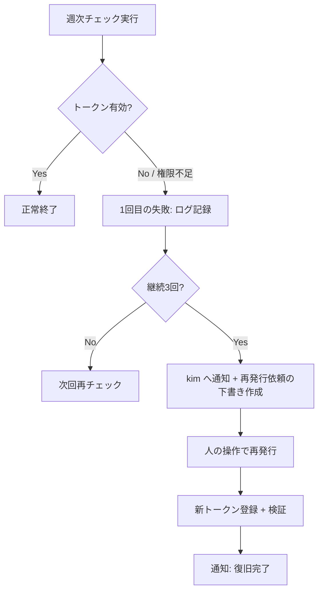

# AIニュース提案 [P-0009]: Facebook トークン管理プロセス

## 課題

Facebook ページへの自動投稿・定期投稿において、以下の問題が発生する可能性がある：

- **トークン未登録による投稿遅延**: 新規案件で Facebook ページ運用が必要になった際、アクセストークンの発行手順が不明で初回投稿が遅れる
- **トークン失効の検知不足**: Facebook ページアクセストークンは正しく発行すれば「無期限」だが、何らかの理由（API変更・アプリの再認証・スコープ不足）で失効した場合、何も検知できず投稿が黙って失敗する
- **類似トークン管理との不整合**: Instagram のトークン管理（`tools/instagram/refresh-token.mjs`）はあるが、Facebook ページトークン用の同様の管理機構が存在しない
- **引き継ぎ時の情報喪失**: トークン発行元の Meta アプリ・アカウント情報が引継ぎ書に残らず、担当者交代時に再発行の手間が発生

## 目的

Facebook ページ運用において、以下の状態を実現する：

1. 新規案件の Facebook 投稿開始までのリードタイムを最小化する
2. トークン失効を自動検知し、未登録による投稿遅延を防止する
3. Instagram トークン管理と統合した Meta トークン統一管理フローを確立する
4. 担当者交代時のトークン情報引き継ぎを確実にする
5. 外部サービス（予約投稿システムなど）へのトークン委譲時も同フローを適用可能にする

## 現状分析

### 既存の訪問可能な Meta 投稿機構

| ツール・機能 | 対象 | トークン管理 | 状態 |
|---|---|---|---|
| `tools/instagram/refresh-token.mjs` | Instagram | 自動リフレッシュ（残10日トリガー）・3回失敗通知 | ✅ 実装済み |
| `tools/instagram-check-token.mjs` | Instagram | 存在確認・有効性チェック | ✅ 実装済み |
| `tools/messenger-watch.mjs` | Facebook Messenger | ブラウザベース（APIトークン不要） | ✅ 実装済み |
| Facebook ページ投稿 | Facebook Page | **未整備** | ❌ 不在 |
| Facebook ページトークン健全性チェック | Facebook Page | **未整備** | ❌ 不在 |
| 予約投稿下書き API | Facebook Page | **未整備** | ❌ 不在 |

### Instagram との差異

| 項目 | Instagram | Facebook ページ |
|---|---|---|
| トークン有効期限 | 60日（リフレッシュ可） | **無期限**（正しい発行手順の場合） |
| リフレッシュAPI | `/refresh_access_token` | 不要（再発行のみ） |
| 発行手順 | Meta Developer Portal → Instagram プロフェッショナル | Meta Developer Portal → Facebook ログイン → ページ管理 |
| 必要な権限 | `instagram_basic`, `instagram_content_publish` | `pages_manage_posts`, `pages_read_engagement` |
| 既存ツール | ✅ `refresh-token.mjs` + `check-token.mjs` | ❌ なし |

## 提案する管理フロー

### 1. トークン初回発行手順

以下をダブルクリック実行可能な `.cmd` として用意し、`docs/` に手順書を置く。

```
【初回発行 .cmd の流れ】
1. Meta Developer Portal をブラウザで開く（発行元アカウントでログイン）
2. 対象アプリを選択（または新規作成：Business タイプ）
3. 「Facebook ログイン」→「設定」→「トークンを生成」→ページ選択
4. 発行されたページアクセストークンをコピー
5. .cmd のプロンプトに貼り付け → .env に保存
6. Graph API で有効性を自動検証（投稿権限の確認含む）
```

**ポイント**: Instagram の `lahaina-instagram-token-cmd.md` と同様の設計にし、操作者は Meta 画面と .cmd の2窓を交互に見ながら進めるだけにする。

### 2. 定期健全性チェック

```bash
# トークンの有効性確認（cron 週次）
node tools/facebook/check-page-token.mjs [--env <path>] [--page-id <id>]

# トークンと投稿権限の一括確認（cron 月次）
node tools/facebook/check-page-token.mjs --all
```

**チェック内容**:
- トークンが Graph API で有効か (`/me` エンドポイントで検証)
- ページへの投稿権限 (`/{{page-id}}/feed` の publish 権限) があるか
- トークンの残り有効期限（無期限トークンでも実際の期限は Meta のポリシーで変わりうる）
- トークンの発行元 Meta アプリがまだ存在するか

3回連続のチェック失敗で kim へ通知する（Instagram の `refresh-token.mjs` と同様の通知パターン）。

### 3. 異常時対応フロー



### 4. 停止時通知

- `notify-kim.mjs` 経由で kim の Discord DM（kim-inbox）へ通知
- Instagram トークンと同じ閾値（3回連続失敗）を適用
- 復旧（チェック成功）時は自動で復旧通知を送信

### 5. 引き継ぎ情報

各 Facebook ページトークンについて、以下の情報を `drives/案件/` 配下の引継ぎ書に確実に記載する：

| 情報項目 | 内容 | 保管場所 |
|---|---|---|
| Meta アプリ名 | Facebook App の識別子 | 引継ぎ書 |
| 発行元アカウント | 誰の Facebook アカウントで発行したか | 引継ぎ書 |
| 対象ページ ID | Facebook ページの数値 ID | 引継ぎ書 + `.env.meta.json` |
| トークン有効期限 | 発行日 + 想定期限 | `.env.meta.json` |
| 投稿権限スコープ | `pages_manage_posts` など | 引継ぎ書 |
| 発行日 | トークンを発行した日付 | `.env.meta.json` |

## トークン種別と有効期限の評価

### Facebook ページアクセストークンの特性

Facebook ページアクセストークンは **「無期限」と公式に記載されているが、実際には以下の条件で失効する**：

| 失効条件 | 頻度 | 検知可能性 |
|---|---|---|
| Meta アプリの削除・無効化 | 低（管理者操作時のみ） | 事前検知困難 |
| Facebook アカウントのパスワード変更 | 中（担当者変更時） | トークン種類により異なる |
| API バージョンアップ（破壊的変更） | 低（数年単位） | Meta 開発者ニュースで事前把握可 |
| 権限スコープの取り消し | 低 | チェック時に検知可 |
| Meta のポリシー変更 | 中（2020年に短期化の動きあり） | 継続監視が必要 |

**結論**: 「無期限」という性質自体はトラブルの原因になりにくいが、**無期限を前提にした監視の欠如が**「気づいたら投稿できなくなっていた」という事態の根本原因となる。Instagram よりも根本的な対策（監視＋通知）が必要。

### Instagram 長期トークンとの比較

| 特性 | Facebook ページトークン | Instagram プロフェッショナルトークン |
|---|---|---|
| 公式寿命 | 無期限 | 60日 |
| リフレッシュ API | 不要 | `/refresh_access_token` |
| リスク | 放置による無自覚の失効 | 定期更新忘れによる急な失効 |
| 対策の必須度 | 監視が必須 | 自動リフレッシュが必須 |
| 初回登録の複雑さ | 中（ページ選択が必要） | 低（アカウント認証のみ） |

## 実装計画

### Phase 1: チェックツール（推奨: Codex に委譲）

| # | ファイル | 内容 | 優先度 |
|---|---|---|---|
| 1 | `tools/facebook/check-page-token.mjs` | ページトークンの有効性確認 CLI。Instagram の `check-token.mjs` 相当 | P0 |
| 2 | `tools/facebook/facebook-api.mjs` | Meta Graph API の共通ラッパー（`ig-api.mjs` 相当） | P0 |
| 3 | `tools/facebook/check-page-token.test.mjs` | ユニットテスト | P1 |

### Phase 2: 初回登録手順書

| # | ファイル | 内容 | 優先度 |
|---|---|---|---|
| 1 | `docs/facebook-page-token-setup.md` | 初回登録の手順書 | P0 |
| 2 | ダブルクリック `.cmd` | トークン登録ワンクリック .cmd | P1 |

### Phase 3: 定期実行組み込み

| # | 内容 | 優先度 |
|---|---|---|
| 1 | cron への週次チェック登録（`facebook/check-page-token.mjs`） | P1 |
| 2 | 3回連続失敗時の通知機構（既存 `notify-kim.mjs` 活用） | P1 |
| 3 | `cron-watch.json` へのエントリ追加 | P2 |

## 費用対効果

| 項目 | 改善前 | 改善後 |
|---|---|---|
| 初回投稿までの時間 | トークン手順不明で半日〜数日 | 手順書＋.cmd で15分 |
| トークン失効の検知 | ユーザーが投稿失敗に気づくまで | cron 監視で24時間以内に検知＋通知 |
| 担当者交代時の引継ぎ | 情報が散逸し再発行が必要 | 引継ぎ書に全情報を一元化 |
| Instagram との統合 | 別個管理 | 共通フレームワークで一元管理 |

## 注意点・リスク

1. **Meta API の変更リスク**: Facebook Graph API の仕様変更により、トークンの動作が変わる可能性がある。監視ロジックは API バージョンに依存しない汎用的なものにする。
2. **セキュリティ**: トークンは `keyserve` 管理とし、`.env` に平文保存する場合は gitignore 対象外であることを明示（lahaina の事例参照）。
3. **複数ページ対応**: ページごとに `.env` を分離する設計とする（`ORGAIST_FB_PAGE_TOKEN_<ページID>` 等の環境変数命名）。

## 評価：未登録による投稿遅延を防止できるか

### 防止できる範囲

| シナリオ | 防止可否 | 理由 |
|---|---|---|
| 新規案件でトークン未発行 | ✅ 防止可 | `.cmd`＋手順書で初回発行を15分に短縮 |
| 週次チェックで失効を早期発見 | ✅ 防止可 | cron が毎週チェック＋3回失敗で通知 |
| 担当者交代でトークンの所在不明 | ✅ 防止可 | 引継ぎ書に全情報を記載 |
| Meta 側の API 仕様変更による突然の失効 | ⚠️ 部分的 | チェックツールで検知可能だが事前防止は不可 |
| トークン発行元アカウントのパスワード変更 | ⚠️ 部分的 | トークン種類による（ページトークンなら影響軽度） |
| Meta アプリの削除 | ⚠️ 部分的 | 週次チェックで検知可能 |

### 総合評価

**評価: 未登録防止には有効だが、即時性の高い対策（cron 週次ではなく日次）が望ましい。**

- 初回登録フローの文書化＋.cmd 自動化で、**未登録による遅延は防止できる**（15分で完了）
- 週次チェックでは最大7日間の失効放置リスクがあるため、日次チェックが望ましい
- 無期限トークンの特性上、Instagram より監視の頻度は低くてよいが、**監視自体の欠如が最大のリスク**
- Instagram トークン管理との統合により、Meta 全体のトークン状態を一覧できる体制が整う

## 関連ドキュメント

- `docs/lahaina-instagram-token-cmd.md` — Instagram トークン登録の先行事例
- `tools/instagram/refresh-token.mjs` — Instagram トークンリフレッシュ実装
- `tools/instagram-check-token.mjs` — Instagram トークン存在確認
- `tools/instagram/ig-api.mjs` — Meta Graph API ラッパー（Instagram版）
- `config/ai-key-owners.json` — 鍵管理台帳

## 改訂履歴

| 日付 | 版 | 変更内容 | 承認 |
|---|---|---|---|
| 2026-11-15 | 1.0 | 初版作成（facebook トークン管理フロー提案） | AI提案（要検証） |