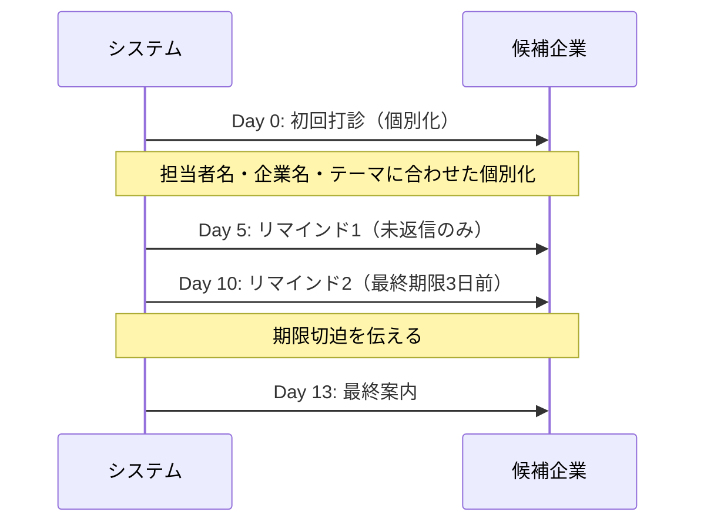
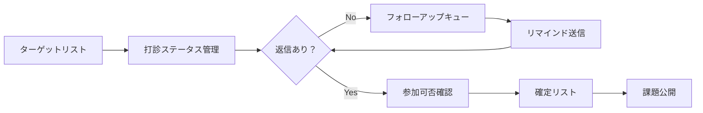
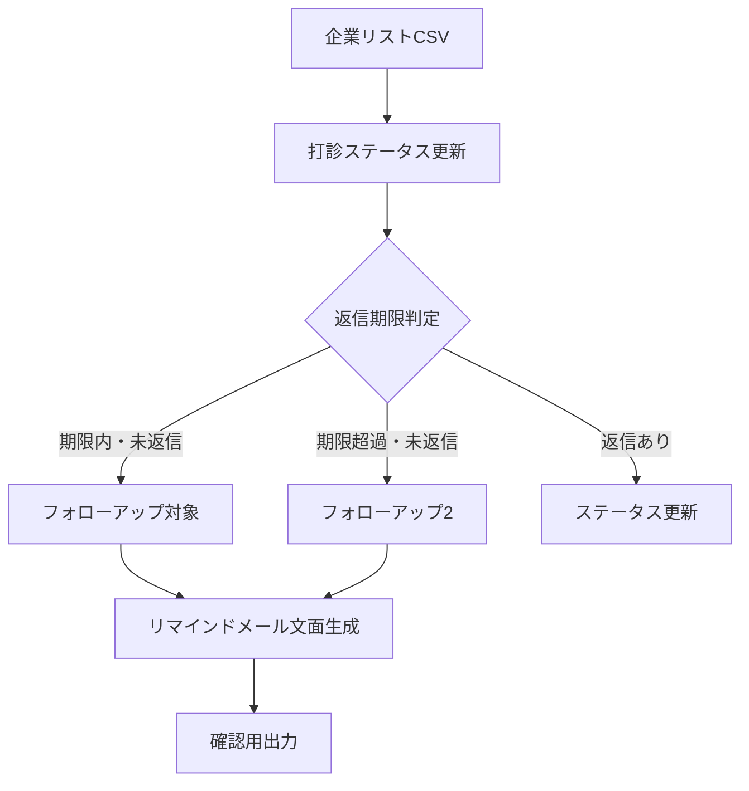

# AIニュース提案 [P-0011]: 課題募集の外部企業協力拡大

## 課題
ピッチイベント（「食×AI ビジネスアイデアピッチ」等）の課題提供企業の募集において、以下の問題が発生している：
- 募集チャネルがメールのみに偏り、返信率が低い（5社中0社が無返信＝返信率0%）
- 初回打診から期限までの期間が短く（3〜5日）、企業の意思決定が間に合わない
- 企業側の担当者（連絡先）が不明な場合が多く、info@ 等の汎用アドレスへ送っても転送されない
- フォローアップが手動で、タイミングを逃す
- 参加企業の成功事例（社会的証明）が次の募集に活用できていない

## 目的
第3回目の課題提供企業募集において、以下の状態を実現する：
1. 参加企業数を前回比10%以上増加させる
2. 募集〜確定までのリードタイムを短縮する
3. 企業にとっての参加メリットを明確に伝える
4. 募集プロセスを自動化・再現可能にする

## 現状分析（260430EIG 第2回募集の振り返り）

### 第2回の実績
| 指標 | 値 | 備考 |
|------|-----|------|
| 打診企業数 | 5社 | Day1, ZERO, ファーメンステーション, ASTRA FOOD PLAN, テーブルクロス |
| 返信率 | 0%（5社中0社） | Cqree は参加不可の返信あり（別枠） |
| 使用チャネル | メールのみ | フォーム送信エラー迂回含む |
| 打診〜期限 | 3〜5日 | 10/27〜10/30に打診、期限11/2 |
| 担当者特定率 | 2/5（40%） | Day1(坂口様), テーブルクロス(城宝様)のみ特定 |

### 改善すべき点
1. **チャネル不足**: メール1本に依存し、到達確認も返信もない
2. **短期間**: 企業の社内調整には通常1〜2週間必要
3. **価値提案が弱い**: 「参加費無料」だけで参加動機が弱い
4. **フォローアップ欠如**: 返信なしでそのまま終了
5. **成功実績の未活用**: 第1回の成功事例が次の募集に活かせていない

## 提案：多チャネル×段階的アプローチ

### 全体戦略

```
フェーズ0: 準備（イベント4週前）
  ├─ ターゲット企業リストの作成（業界×規模×テーマ適合度）
  ├─ 各企業の適切な窓口担当者の特定（LinkedIn・企業HP・取引先紹介）
  ├─ 成功事例の testimonial 作成（第1回・第2回参加企業の声）
  └─ 募集資料一式の準備（FAQ・参加メリットシート・過去イベントレポート）

フェーズ1: 一次打診（イベント3週前）
  ├─ メール（個別担当者宛て＋転送依頼文付き）
  ├─ LinkedIn InMail（法人アカウントがある場合）
  ├─ 取引先・協業先からの紹介ルート
  └─ 回答期限：打診から10日後

フェーズ2: フォローアップ（イベント2週前）
  ├─ 未返信企業へのリマインド（打診から5日後）
  ├─ 電話フォロー（担当者特定済み企業）
  ├─ 業界団体・コミュニティ経由の再アプローチ
  └─ 回答期限：イベント2週前

フェーズ3: 補充募集（イベント1週前）
  ├─ 確定企業数が目標未達の場合の追加リスト
  ├─ SNS・コミュニティでの公募
  └─ 確定企業の紹介（ネットワーク効果）
```

### 具体的な施策

#### 1. ���ーゲット企業リストの拡充とスコアリング

| スコア | 条件 | アプローチ優先度 |
|--------|------|-----------------|
| A（高） | テーマに関連性が高い + 担当者既知 + 過去参加実績あり | 個別メール + 電話 + 紹介 |
| B（中） | テーマに関連性が高い + 担当者不明 | 個別メール + 転送依頼 + LinkedIn |
| C（低） | テーマに関連性が低い or 連絡先が汎用のみ | 公募 or 業界団体経由 |

**目標**: Aスコア5社以上 + Bスコア10社以上 = 計15社以上に打診

#### 2. 価値提案の強化（参加企業向けメリットシート）

参加企業に伝えるべき価値：
- **人材発見**: 優秀な学生・起業志望者へのアプローチ機会
- **マーケティング**: 自社の課題を業界内外に認知してもらう場
- **オープンイノベーション**: 外部の視点からの課題解決案を無償で入手
- **ブランディング**: 先進的な取り組みとしてのPR効果
- **ネットワーキング**: 他参加企業・主催者との関係構築

**テンプレート**: 参加メリットシート（1枚）を Drive に用意し、打診メールに添付。

#### 3. 段階的メールシーケンス（自動化）



各メールには：
- 件名の冒頭に `【Re:` を付けて既存スレッドとして扱わせる
- 1クリックで参加意思表示できるリンク（Google Form 等）
- 不明点があれば気軽に返信できる問い合わせ先

#### 4. 紹介ルートの活用

既存参加企業・協業先からの紹介を仕組み化：
- 参加確定企業に「ご紹介いただくと次回の特典」を提示
- 協業先（エイト等）のネットワークを活用した紹介依頼
- 業界団体・展示会での口コミ

#### 5. 募集管理ダッシュボード



### 成果測定指標

| KPI | 現状（第2回） | 目標（第3回） | 測定方法 |
|-----|-------------|-------------|---------|
| 打診企業数 | 5社 | 15社以上 | リスト件数カウント |
| 返信率 | 0%（0/5） | 30%以上（5/15） | 返信数/打診数 |
| 参加確定数 | 未測定 | 5社以上 | 確定リスト件数 |
| リードタイム | 3〜5日 | 10〜14日 | 初回打診〜期限の日数 |
| チャネル数 | 1（メールのみ） | 3以上 | 使用チャネル数 |
| 担当者特定率 | 40%（2/5） | 70%以上 | 特定済み/全打診先 |

## 自動化ツール設計

### 1. 募集進捗管理スクリプト



### 2. 実施手順

1. `data/p0011-target-companies.csv` にターゲット企業リストを準備
2. 各企業の連絡先・担当者を調査して追記
3. `node tools/p0011-recruit.mjs --phase init` で初回打診文生成
4. 生成された文面を���認・承認後に送信
5. `node tools/p0011-recruit.mjs --phase followup` でフォローアップ

## リスクと対策

| リスク | 確率 | 影響 | 対策 |
|--------|------|------|------|
| 企業の興味喚起不足 | 中 | 高 | メリットシート・事例紹介の強化 |
| 返信率が上がらない | 高 | 高 | 電話フォロー・紹介ルートの併用 |
| 時期が合わない | 中 | 中 | イベント日程の早期確定・余裕を持った募集開始 |
| 競合イベントとの重複 | 低 | 中 | 差別化ポイントの明確化 |
| 紹介ルートが機能しない | 中 | 低 | 直接アプローチの強化で代替 |

## 適用対象
- 株式会社エイト主催のピッチイベント（第3回）
- 同様の課題提供企業募集型イベント全般
- オージャストが協力する他のピッチイベント

## 関連ドキュメント
- `docs/260430EIG_再確認メール案_20261101.md`（第2回募集の実績）
- `apps/expo-apply/`（出展者受付アプリケーション）
- `rules/ai-ops-playbook.md`（AI運用のベストプラクティス）

## 改訂履歴
| 日付 | 版 | 変更内容 | 承認 |
|------|-----|---------|------|
| 2026-11-15 | 1.0 | 初版作成 | auto-session |