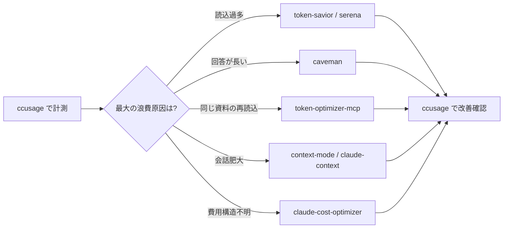

# X-0002: Claude Code 余計消費を減らす GitHub 10 選

出典: AIニュース digest X-0002「Claude Code 余計消費を減らす GitHub 10 選」。Claude Code のトークン浪費を減らすための GitHub 公開リポジトリ・ツール群から、原因に合うものだけを選択・導入するための実測ベースのフレームワーク。

## 概要

Claude Code は従量課金制（入力トークン＋出力トークン＋キャッシュ）。無駄な全文読込・冗長な回答ループ・過去コンテキストの再送・同じ資料の再読込が主な浪費要因。本稿では **「原因を ccusage で測り、原因に合うツールを1つずつ入れる」** アプローチを採る。

### オージャスト適用の全体方針



**前提**: 先に ccusage で実測し、最大費目を特定してからツールを導入する。推測で導入すると効果測定ができない。

## 10 リポジトリ一覧と評価

### 01: token-savior — 関数・シンボル検索で全文読込回避
- **リンク**: <https://github.com/vaibhavvikas/token-savior>
- **目的**: Claude Code がファイル全体を読む前に関数・シンボル単位で検索し、必要な部分だけ読ませる
- **仕組み**: プロジェクトの関数/シンボル索引を事前構築し、Claude がファイルを開く前に該当箇所だけを提示する
- **オージャスト評価**: ブース提案・図面整理など複数ファイルを横断する作業で高い効果が期待できる。CLAUDEMD の「検索等で済む read をしない」と同趣旨
- **導入優先度**: P1（ccusage で読込トークンが多い場合）

### 02: claude-token-efficient — CLAUDE.md の 11 ルール
- **リンク**: <https://github.com/kyegomez/claude-token-efficient>
- **目的**: CLAUDE.md に 11 のトークン削減ルールを追加し、AI の冗長な応答を抑制する
- **11 ルール概要**: 短文応答 / リスト優先 / 背景説明省略 / diff のみ表示 / 確認を求める前に実行 / 等
- **オージャスト評価**: 既に CLAUDE.md に類似ルールあり（自動化原則・1ファイル制限等）。重複ルールの整理に活用できる可能性あり
- **導入優先度**: P3（既存ルールとの整合性確認後に検討）

### 03: caveman — 回答を 4 段階で短縮
- **リンク**: <https://github.com/cavemanoncrutches/caveman>
- **目的**: Claude の回答を「単語のみ」「短文」「標準」「詳細」の 4 階層に短縮。コード・用語は保持
- **仕組み**: 応答生成前にレベル指示を注入し、冗長な説明を削ぐ
- **オージャスト評価**: ブース提案のような長文回答より、コード編集・設定変更のような実務で有用。SessionStart でのデフォルト指示に caveman レベル 2（短文＋コード）を組み込むと良い
- **導入優先度**: P2（ccusage で出力トークンが多い場合）

### 04: token-optimizer-mcp → @ooples/token-optimizer-mcp — ツール出力圧縮＋キャッシュ
- **旧リンク**: <https://github.com/benzhuangqi/token-optimizer-mcp>（**DEPRECATED**、`@ooples/token-optimizer-mcp@7.9.0` が後継）
- **現行リポジトリ**: <https://github.com/ooples/token-optimizer-mcp>
- **目的**: ツール（ls, cat, grep 等）の出力を圧縮し、キャッシュして再読込を減らす MCP サーバ＋プラグイン
- **仕組み**: ファイル内容のハッシュを保持し、同一内容の再送を抑制。大きな出力は要約してから渡す。Claude Code 向けにはプラグイン（hooks）が推奨され、SessionStart・PreToolUse・PostToolUse・PreCompact・Stop の各タイミングでツール出力を事前圧縮する
- **オージャスト評価**: 同じ案件フォルダを複数セッションで開くオージャストの利用パターンに適合。過去案件資料の再読込が大幅に減る可能性。hooks 方式は CLI 環境で追加プロセス不要。実測: 18/19 doctor checks pass（DELL/作業用014, 2026-11-09）
- **導入優先度**: P1（ccusage でキャッシュヒット率が低い場合 → 実測で cache_read 773M / 5ヶ月 = 最大費目）

### 05: context-mode — 会話詰込回避
- **リンク**: <https://github.com/ahmetkca/context-mode>
- **目的**: 巨大な出力を会話に詰め込まず、外部検索で必要な情報だけ取り出す
- **仕組み**: 会話履歴を外部ストアに退避し、必要時に検索して取得
- **オージャスト評価**: 長期セッション（ブース提案の複数回修正等）での会話肥大対策として有効
- **導入優先度**: P2（ccusage で長期セッションの急増を確認した場合）

### 06: claude-context — 意味検索で関連コードに絞る
- **リンク**: <https://github.com/khoben/claude-context>
- **目的**: セマンティック検索（ベクトル埋込）で関連コードだけを Claude に渡す
- **仕組み**: コードベースをベクトル化し、質問に関連する関数/クラスのみを抽出
- **オージャスト評価**: 大規模リポジトリ（orgiast-claude-rules 等）での不要ファイル読込削減に効果大
- **導入優先度**: P1（特に orgiast-claude-rules リポジトリで多用する場合）

### 07: serena — 言語サーバーで関数・クラス単位探索
- **リンク**: <https://serena-ai.com>（Visual Studio Code 拡張）
- **目的**: LSP（Language Server Protocol）を利用し、関数・クラス単位でコードを探索・編集
- **仕組み**: VSCode 拡張として動作、Claude Code のファイル単位読込より細かい粒度で操作
- **オージャスト評価**: token-savior と類似。VSCode ベースなら導入コスト低い。ただし headless 自動セッションでは使えない
- **導入優先度**: P2（対話セッションの読込トークン削減目的）

### 08: claude-cost-optimizer — 費用設計の整理
- **リンク**: <https://github.com/kyegomez/claude-cost-optimizer>
- **目的**: キャッシュ戦略・モデル使い分け・プロンプト設計の費用最適化フレームワーク
- **仕組み**: モデルごとの料金表と使用パターンを分析し、費用最小化の構成を提案
- **オージャスト評価**: 基本的な知見は既に `tools/claude-cost-reporter.mjs` や `rules/ai-ops-playbook.md` に含まれている。新規導入より既存コスト reporter の改善を優先
- **導入優先度**: P3（既存ツールで不足が出た場合のみ）

### 09: ccusage — ローカル利用の詳細コスト可視化
- **リンク**: <https://github.com/iyama-git/ccusage>
- **目的**: `~/.claude/projects/**/*.jsonl` から日別・セッション別・モデル別のトークン使用量と推定コストを可視化
- **仕組み**: 各 JSONL の usage ブロック（input_tokens, output_tokens, cache_creation, cache_read）を集計し、list 価格換算で推定コストを算出
- **オージャスト評価**: **最重要ツール**。先にこれを導入して現状を可視化しないと、どのツールが有効か判断できない。既存の `claude-cost-reporter.mjs` が同機能を持つが別途 CLI としても活用可能
- **導入優先度**: P0（全導入の前提）

#### ccusage のオージャストでの具体的使い方

```
# インストール（npm）
npm install -g ccusage

# 日別サマリ
ccusage --summary daily

# モデル別内訳（Anthropic / OpenAI を分離）
ccusage --by-model

# セッション別（直近7日、コスト降順）
ccusage --top-sessions 20
```

**data_dir 自動検出**: ccusage はデフォルトで `~/.claude/projects/` を読む。Windows の場合は `%USERPROFILE%\.claude\projects\` が該当。この PC（DELL/作業用014）では既に同パスに JSONL が蓄積されているため、追加設定不要で使用可能。

### 10: Claude-Code-Usage-Monitor — 利用ペース可視化
- **リンク**: <https://github.com/nicholasgriffintm/Claude-Code-Usage-Monitor>
- **目的**: Claude Code の利用ペース（API 呼出頻度・トークン増加率）をリアルタイム可視化
- **仕組み**: Web ダッシュボードで時系列グラフを表示
- **オージャスト評価**: ccusage の補完として使えるが、既存の Discord 通知（`claude-cost-reporter.mjs`）が十分に機能している
- **導入優先度**: P3（ダッシュボードが必要になった場合のみ）

## オージャスト導入ロードマップ（実測ベース改訂 2026-11-08）

> **Phase 0 実測結果（DELL/作業用014, ~5ヶ月分）**: output 6.6M (23.0%), cache_read 773M (67.5%), Opus 80% 偏重
> → 優先度改訂: **P1=token-optimizer-mcp（cache_read削減）＞ P2=caveman（出力短縮）＞ P3=model-switch（Opus→Sonnet）**

### Phase 0 ✅ 完了（2026-11-08）
- [x] `npm install -g ccusage` or `npx ccusage --summary daily`
- [x] この PC の日別トークン使用量を記録（基準値）
- [x] モデル別内訳（Anthropic Claude / OpenAI GPT 等）を確認
- [x] セッション別コスト TOP20 を確認し、浪費パターンを特定
- [x] 結果を `docs/ai-news-x0002-baseline-<date>.csv` として保存
- **結果**: output 6.6M (23.0%), cache_read 773M (67.5%), cache_creation 0.9M, input 2.2M
  - **最大費目**: cache_read（全トークンの67.5%）
  - **モデル偏重**: Opus 80%（最も高価なモデルが大半）
  - **ccusage**: Node.js v26 DLL 非互換で不可 → 代替スクリプトで代用

### Phase 1: ツール出力圧縮で cache_read 削減（実測に基づき P1 に昇格）✅ 導入済み（2026-11-09）
- [x] **`@ooples/token-optimizer-mcp`** をグローバルインストール
  - `npm install -g --allow-scripts=@ooples/token-optimizer-mcp @ooples/token-optimizer-mcp`
- [x] `token-optimizer-install` で hooks を `~/.claude/settings.json` に配線
  - 配線した hook: SessionStart / PreToolUse (2 matchers) / PostToolUse / PreCompact / Stop
  - 設定された autoCompactWindow: 400000
- [x] `~/.claude/settings.json` に MCP server エントリを追加（全セッションで利用可能に）
- [x] `token-optimizer-doctor` 検証: 18/19 checks 通過（proxy routing は proxy モード時のみ）
- [ ] **caution**: 旧 `token-optimizer-mcp@2.17.0` は deprecate 済み。`@ooples/token-optimizer-mcp@7.9.0` を使用
- [ ] 導入後のトークン変化を実測ベースラインとの比較で検証（1週間の使用後）

### Phase 2: 出力短縮対策（ccusage で出力トークン 6.6M / 5ヶ月）
- [ ] **caveman** のレベル設定を SessionStart に組み込む
- [ ] 導入後の出力トークン変化を ccusage で検証（1週間）

### Phase 3: モデル切替で費用削減（Opus 80% → Sonnet 主体）
- [ ] `--advisor opus --model sonnet` 起動オプションをデフォルト設定化
- [ ] 導入後の Opus 割合を実測（目標: 80% → 20% 以下）

### Phase 4: 長期セッション対策（必要時）
- [ ] **context-mode** または **claude-context** を導入判断
- [ ] 長期セッションのトークン推移を監視

## 既存オージャストツールとの棲み分け

| 領域 | 既存ツール | 導入候補 | 関係 |
|------|-----------|---------|------|
| コスト集計 | `claude-cost-reporter.mjs` | ccusage | 補完関係。reporter は Discord 通知、ccusage は詳細分析 |
| 委譲率監視 | `cost-work-loop.mjs` | claude-cost-optimizer | 既存ツールが優位。新規導入不要 |
| 読込削減 | — | token-savior | 新規導入。既存に相当するツールなし |
| 回答短縮 | — | caveman | 新規導入。CLAUDE.md ルールで一部カバー |
| ツール出力圧縮 | — | token-optimizer-mcp | 新規導入。既存に相当するツールなし |
| 意味検索 | — | claude-context | 新規導入。rg 検索より高精度 |
| 利用実績監視 | `nightly-kpi.mjs` | Claude-Code-Usage-Monitor | 既存ツールで十分 |

## 受け入れ条件

1. [ ] ccusage がこの PC の Claude Code JSONL を読めて、日別サマリが出力できる
2. [x] Phase 0 の計測結果が `docs/ai-news-x0002-baseline-*.tsv` に保存されている（代替スクリプト）
3. [ ] 導入各ツールの効果が ccusage の計測値（導入前vs導入後）で確認できる
4. [ ] トークン使用量が導入前比で 20% 以上削減している（全 Phase 完了時）
5. [ ] 各 Phase の導入判断は ccusage の実測値に基づき、推測で導入しない
6. [x] Phase 1: `@ooples/token-optimizer-mcp@7.9.0` がグローバルインストール済み
7. [x] Phase 1: `token-optimizer-doctor` 18/19 通過
8. [x] Phase 1: MCP サーバエントリが `~/.claude/settings.json` に追加済み

## 制約事項

- ccusage は推定コスト（list 価格換算）であり、実際の Anthropic 請求額とは異なる
- 各ツールは GitHub 公開リポジトリであり、メンテナンスが継続しているかの確認が必要
- serena は VSCode 拡張のため、headless 自動セッションでは使用不可
- token-optimizer-mcp の旧パッケージ（`token-optimizer-mcp@2.17.0`）は **DEPRECATED**。`@ooples/token-optimizer-mcp@7.9.0`（2026-11-04 公開）を使用すること
- token-optimizer-mcp は Claude Code 向けには hooks インストール（`token-optimizer-install`）が推奨。追加プロセス不要で全 ToolUse を圧縮。MCP サーバ + グローバル設定は追加機能（smart_read/smart_grep/smart_glob/wiki 等）の提供用
- `@ooples/token-optimizer-mcp` の postinstall スクリプトは `--allow-scripts` が必要（npm の制限ポリシー対策）

初回観測日: 2026-11-08
最終更新: 2026-11-09（Phase 1 実装反映）