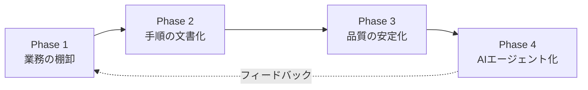

# X-0002: 業務理解後のAIエージェント自動化 — 品質安定 → 自動化の方法論

**出典**: AIニュース digest X-0002「業務理解後のAIエージェント自動化」。自分で業務の流れ・手順・判断基準・完成形を理解し品質を安定させてから自動化する方法論と、株式会社オージャストでの適用手順。

## 概要

AIエージェントに業務を任せる前に、人間のプロセスを文書化し品質を安定させる。この順序を守らないと、不安定なプロセスをAIがそのまま継承し、むしろ品質が悪化する。

### 核となる考え方

```
理解 → 文書化 → 安定化 → 自動化
                     ↑
                   ここがスキップされがち
```

「とりあえずAIにやらせてみる」は逆効果。**人は手順を理解し、判断基準を持ち、品質の完成形をイメージできているからこそ、外れ値を検知して修正できる。** AIエージェントはその暗黙知を引き継げないため、まず明示化する必要がある。

## 4フェーズモデル



### Phase 1: 業務の棚卸（1〜2週間）

**目的**: 自動化候補の業務を洗い出し、優先順位をつける

| ステップ | やること | 成果物 |
|----------|---------|--------|
| 1.1 業務一覧 | チームの全定型業務をリストアップ | 業務インベントリ（20〜50項目） |
| 1.2 頻度分類 | 毎日/週次/月次/四半期/不定期に分類 | 頻度別一覧 |
| 1.3 自動化適性評価 | ルールベース度・判断頻度・例外発生率をスコア化 | 優先度マトリックス |
| 1.4 選定 | 効果大×ルール明確なものから着手 | 実装順リスト |

**評価基準**:
- **ルールベース度**（高いほど自動化しやすい）: 入力→処理→出力が決まっているか
- **判断頻度**（低いほど自動化しやすい）: 人間の判断が必要な分岐が多いか
- **例外発生率**（低いほど自動化しやすい）: 想定外のケースがどの程度出るか

### Phase 2: 手順の文書化（2〜4週間）

**目的**: 人間が暗黙的に行っている判断を明示化する

**文書化テンプレート**:

```markdown
## 業務名: [名称]
### 目的
この業務をなぜ行うのか

### 入力
- 必要なデータ・ファイル・システム
- 入手元・タイミング

### 手順
1. ステップ（操作・判断・入力を1行に）
2. ...
N. 完了状態

### 判断基準
| 条件 | 判断 | 根拠 |
|------|------|------|
| Aの場合 | 処理X | 理由 |
| Bの場合 | 処理Y | 理由 |

### 完成形（ゴールの定義）
- 出力されるもの
- 誰がいつ確認するか
- OK/NGの境界

### 非定型ケースの棚卸
- 過去1年で発生した例外
- その時どう対処したか
- 次回から定型化できるか
```

### Phase 3: 品質の安定化（2〜4週間）

**目的**: 文書化した手順を数回実行し、ばらつきを減らしてから自動化に進む

**チェックリスト**:
1. □ 2名以上の担当者が文書だけで同じ結果を出せる
2. □ 出力のチェックリストが整備されている
3. □ 過去の例外パターンが網羅できている
4. □ 期待する品質（納期・精度・フォーマット）が数値で定義できている
5. □ フィードバックループ（誰がいつ確認するか）が確立している

**安定化の指標**:
| 指標 | 目標値 | 計測方法 |
|------|--------|----------|
| 実行時間のばらつき | ±20%以内 | 3回以上の実測 |
| 出力の品質スコア | 自己評価90点以上 | 5段階評価を3名以上 |
| 手戻り率 | 10%以下 | 修正依頼回数÷実行回数 |
| 例外発生時の対応時間 | 30分以内 | 初動から完了まで |

### Phase 4: AIエージェント化（1〜4週間）

**目的**: 安定した手順をAIエージェントの指示（スキル）に変換する

**変換のポイント**:
1. **入力の形式化**: Phase 2の「入力」をJSON/YAML/CSVなど機械可読に
2. **判断基準のアルゴリズム化**: 「AならX」をif-thenまたはLLM分類に落とし込む
3. **完成形の検証方法**: 出力を自動チェックする仕組みを実装する
4. **例外のエスカレーション**: AIが判断できないケースを人間に回す経路を作る
5. **フィードバック受付**: 品質が安定しない場合の原因特定と修正のサイクルを組み込む

## ケーススタディ: X-0003（展示会ブース制作 キーワードリサーチ）

X-0003は本方法論の実践例である。9ステップのうち、最初の3ステップがPhase 1〜2に該当する。

### 適用の流れ

| 本方法論のPhase | X-0003での実践 |
|----------------|---------------|
| Phase 1: 棚卸 | 展示会ブース制作のSEO業務から「キーワードリサーチ」を選定 |
| Phase 2: 文書化 | 人間のリサーチ手順をIMPLEMENT.mdに162行で文書化 |
| Phase 3: 安定化 | 手順に従いクロール→抽出→スコアリング→提案までを10テストで自動検証 |
| Phase 4: AIエージェント化 | 4Phaseのパイプライン（crawl→collect→score→propose）をrun.mjsで統合 |

### X-0003から得た教訓

1. **文書化が実装の3倍の価値を生む**: IMPLEMENT.mdは単なる設計書ではなく、運用チームがAIエージェントの動作を理解し、修正できる仕様書になった
2. **テストが品質の担保になる**: 10件のdry-run統合テストが、コード変更後の回帰バグを防いだ
3. **非定型ケースの事前洗い出しが効果的**: クロール失敗時のリトライ、GSCデータがない場合のフォールバックなど、Phase 2の例外棚卸がそのまま実装に活きた
4. **人とAIの役割分担が明確になる**: 「LLM分類（スコアリング）はAI、最終判断は人間」という線引きが自然に決まった

## オージャスト実践ロードマップ

### 対象業務候補（展示会ブース制作・イベント企画）

| 業務 | 頻度 | ルールベース度 | 判断頻度 | 優先度 |
|------|------|---------------|---------|--------|
| キーワードリサーチ | 月次 | 高 | 低 | **★Phase 4済み** |
| 展示会出展レポート | 出展後 | 中 | 中 | **★Phase 4（次候補）** |
| 見積書作成 | 週次 | 高 | 低 | Phase 2〜3 |
| 進捗報告メール | 週次 | 中 | 中 | Phase 2〜3 |
| 競合出展調査 | 四半期 | 中 | 中 | Phase 1〜2 |
| 制作スケジュール調整 | 週次 | 低 | 高 | Phase 1（自動化不適） |

### 推奨着手順

```
今週         来週         再来週       来月
├─ Phase 1 ─┤ Phase 2 ──┤ Phase 3 ─┤ Phase 4 ──→
  棚卸        文書化       安定化       AIエージェント化
  ・全業務      ・見積書作成    ・2名で実行検証   ・定型レポート
  ・優先順位    ・進捗報告     ・手戻り率計測    作成エージェント
```

### Phase 1 即実行タスク

```
□ 展示会ブース制作の業務一覧を作成（20項目以上）
□ 各業務の頻度を記録
□ ルールベース度・判断頻度・例外発生率を3段階評価
□ 優先度マトリックスにプロット
□ Phase 2に進む3業務を選定
```

### 定型レポート作成エージェント（Phase 4の第一候補）

**対象**: 展示会出展後の定型レポート（写真・来場者数・商談数・成果サマリ）

**なぜ適しているか**:
- 毎回同じフォーマット（写真枠 + 数値テーブル + コメント）
- 数値は集計済みデータから取得可能
- 判断（強調するポイントの選定）はLLMに任せられる
- 人間は最終確認だけに集中できる

**実装計画**（X-0003のスキル構造を流用）:

```
skills/exhibition-report/
├── SKILL.md           # スキル定義
├── IMPLEMENT.md       # Phase 2文書から変換
├── run.mjs            # オーケストレータ
├── process/
│   ├── phase1-collect.mjs  # データ収集（写真・数値）
│   ├── phase2-compose.mjs  # レポート原稿生成（LLM）
│   └── phase3-review.mjs   # 自動品質チェック
├── template/
│   └── report-template.md  # レポートフォーマット
└── test/
    └── dryrun.test.mjs     # 統合テスト
```

## 運用のポイント

### やってはいけないこと

| NGパターン | なぜダメか | 代わりにやること |
|-----------|-----------|----------------|
| 手順の文書化を飛ばしてAIにプロンプトを書く | 暗黙知が抜け落ち、精度が安定しない | まず人間向けの手順書を書き、それをAI指示に変換する |
| Phase 3（安定化）を1回のテストで済ませる | 例外ケースの網羅が不足する | 最低3回の実運用を通してから自動化に進む |
| 全てをAIに任せようとする | 人間の判断が不要な業務はほとんどない | AIエージェントの限界（判断・例外処理）を明確にし、人間にエスカレーションする経路を必ず作る |
| 完成形を定義せずに着手する | 「どんな出力が正解か」が不明瞭なまま進む | 最初の1件は人間が手動で完成させ、それを正解サンプルとしてAIに示す |

### 成功の鍵

1. **文書化が最大の価値**: AIエージェント化が途中で頓挫しても、文書化された業務手順はチームのナレッジとして残る
2. **スコープを狭く始める**: いきなり全業務を自動化しようとせず、1つの定型業務から始める
3. **人間の役割を残す**: AIができない判断・交渉・例外対応は人間に残し、AIは定型処理と下書き作成に集中させる
4. **フィードバックループを組み込む**: AIの出力を人間が確認・修正した履歴を蓄積し、プロンプトの改善に使う
5. **計測して語る**: 自動化前後の時間・品質・コストを計測し、改善を可視化する

## 受け入れ条件

1. [ ] 4フェーズモデルが文書化されている
2. [ ] 展示会ブース制作の業務棚卸（Phase 1）が完了している
3. [ ] 定型レポート作成の手順文書（Phase 2）が作成されている
4. [ ] Phase 2の文書だけで2名以上が同じ品質のレポートを作成できる（Phase 3確認）
5. [ ] 定型レポート作成エージェントの実装計画（Phase 4）が確定している

## 参考

- X-0003: 展示会ブース制作 キーワードリサーチAIエージェント化（本方法論の実践例として参照）
  - `skills/booth-kw-research/IMPLEMENT.md` — 文書化された手順（Phase 2の成果物）
  - `skills/booth-kw-research/run.mjs` — AIエージェント実装（Phase 4の成果物）
- AIニュース提案 [X-0004]: ページインデックス最適化とAI引用分析（Phase 0〜1の別実践例）