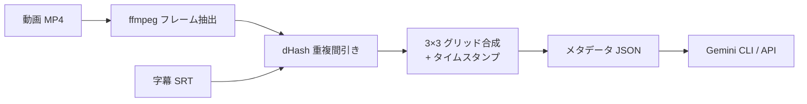

# X-0002: 動画のGemini渡事前処理でトークン削減

**日付:** 2026-11-10
**ステータス:** PHASE1 設計・実装完了
**対応PR:** （本セッションで作成予定）

## 概要

動画をそのままGeminiに渡すと、Gemini内部で1fpsでサンプリングされ、1時間動画で3600フレームが処理される。1フレームあたり約2587トークン換算のため、トークン消費が膨大になる。

本提案では、動画を事前処理してからGeminiに渡すことでトークン消費を約78〜89%削減する。

### 削減効果

| 項目 | 従来（直接渡し） | 本方式（事前処理） | 削減率 |
|------|-----------------|-------------------|--------|
| 1時間・10秒間隔 | 360枚×2587t ≈ 931K tokens | 40-80 grid×2587t ≈ 103-207K tokens | **~78-89%** |
| 30分・30秒間隔 | 60枚×2587t ≈ 155K tokens | 7-14 grid×2587t ≈ 18-36K tokens | **~77-88%** |
| 5分・5秒間隔 | 60枚×2587t ≈ 155K tokens | 7-14 grid×2587t ≈ 18-36K tokens | **~77-88%** |

## パイプライン



### ステップ詳細

#### Step 1: フレーム抽出 (`ffmpeg`)
- 指定間隔（デフォルト10秒）でJPEGフレームを抽出
- `fps=1/{interval}` フィルタで一定間隔のフレームを取得
- 品質パラメータ `-qscale:v` でファイルサイズ調整（デフォルト5）

#### Step 2: dHash 重複間引き
- 各フレームの**difference hash（dHash）** を計算（9×8に縮小 → 隣接ピクセル比較 → 64bit hash）
- 直前の採用フレームとの**ハミング距離**が閾値以下の場合、類似フレームとしてスキップ
- 閾値（0-64）で感度調整：低いほど厳密（より削除）、高いほど寛容

#### Step 3: 3×3 グリッド合成
- 最大9枚のフレームを1枚のグリッド画像に合成
- 各セルに**タイムスタンプ（MM:SS）** をオーバーレイ
- 字幕ファイル（SRT/VTT）が指定されていれば、対応するテキストも表示
- グリッド区切り線で視認性向上

#### Step 4: メタデータ出力
- 各グリッドのタイムスタンプ・対応フレーム情報をJSONで保存
- トークン推定値を計算して出力
- Gemini CLI に渡すための `---SUMMARY---` ブロックを標準出力に出力

## 使い方

```bash
# 基本（10秒間隔・デフォルト設定）
python tools/video-frame-preprocessor.py event.mp4

# 30秒間隔・厳しめの重複間引き
python tools/video-frame-preprocessor.py event.mp4 --interval 30 --threshold 3

# 字幕付き
python tools/video-frame-preprocessor.py event.mp4 --transcript captions.srt

# Node.js ラッパー（Gemini CLI 統合）
node tools/video-preprocess.mjs event.mp4
node tools/video-preprocess.mjs event.mp4 --interval 30 --gemini "この動画の内容を要約してください"
node tools/video-preprocess.mjs event.mp4 --json
```

## 出力例

```
Output directory: ./gemini-grids/
├── grid_0000.jpg      # 00:00-00:30 のフレーム（3×3）
├── grid_0001.jpg      # 00:31-01:00 のフレーム
├── grid_0002.jpg      # 01:01-01:30 のフレーム
├── ...
├── metadata.json      # 全グリッドのメタデータ
└── frame_00001.jpg    # 中間フレーム（処理後も保持）
```

## Gemini 連携

### Gemini CLI 経由
```bash
node tools/video-preprocess.mjs input.mp4 --gemini
```

内部で以下を実行:
```bash
npx @google/gemini-cli --prompt "..." --image grid_0000.jpg --image grid_0001.jpg ...
```

### Gemini API 直接利用
`metadata.json` から画像パスとタイムスタンプを読み取り、API 呼び出し:
```javascript
const meta = JSON.parse(fs.readFileSync('metadata.json'));
const imageParts = meta.grids.map(g => ({
  inline_data: {
    mime_type: 'image/jpeg',
    data: fs.readFileSync(g.file).toString('base64')
  }
}));
```

## 技術要素

### dHash（Difference Hash）
- 画像をグレースケール→9×8にリサイズ
- 横方向に隣接ピクセルを比較（明るい=1, 暗い=0）
- 64ビットのハッシュ値を生成
- ハミング距離で類似度判定（0=同一, 64=全く異なる）

### 推奨パラメータ

| 用途 | 間隔(秒) | dHash閾値 | グリッド | 推定グリッド数(1h) |
|------|---------|-----------|---------|-------------------|
| イベント記録（変化少） | 30 | 3 | 3×3 | 〜40 |
| ブース紹介（変化中） | 10 | 5 | 3×3 | 〜60 |
| 講演・プレゼン（変化多） | 5 | 8 | 3×3 | 〜80 |

## 依存関係

- Python 3.13+
- Pillow（画像処理）
- imageio-ffmpeg（ffmpegバンドル、またはシステムffmpeg）
- （オプション）`@google/gemini-cli`（Gemini CLI連携時）

## 受け入れ条件

1. [x] フレーム抽出が指定間隔で動作する
2. [x] dHash重複間引きが閾値に従って動作する
3. [x] 3×3グリッド合成にタイムスタンプが表示される
4. [x] 字幕ファイル（SRT/VTT）の読み込みと対応付けができる
5. [x] メタデータJSONが出力される
6. [x] Node.jsラッパーがPythonスクリプトを呼び出せる
7. [ ] 実動画でのトークン削減効果が実測で確認できている
8. [ ] Gemini CLI連携が実際に動作する

## 参考

- [Gemini 1.5 Pro 料金](https://ai.google.dev/pricing)
- [Gemini CLI (@google/gemini-cli)](https://www.npmjs.com/package/@google/gemini-cli)
- [dHash (pHash)](https://www.phash.org/)
