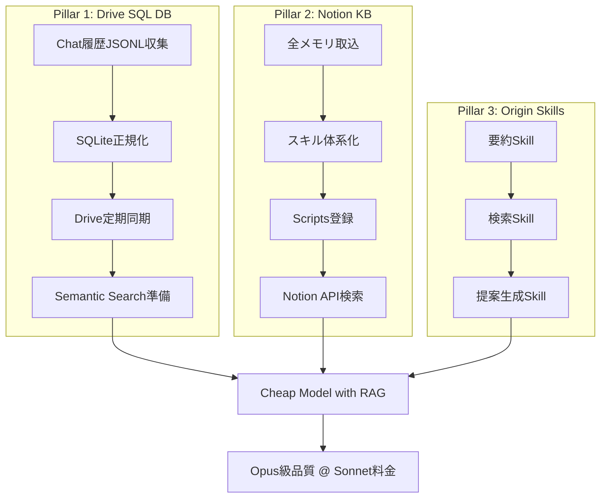
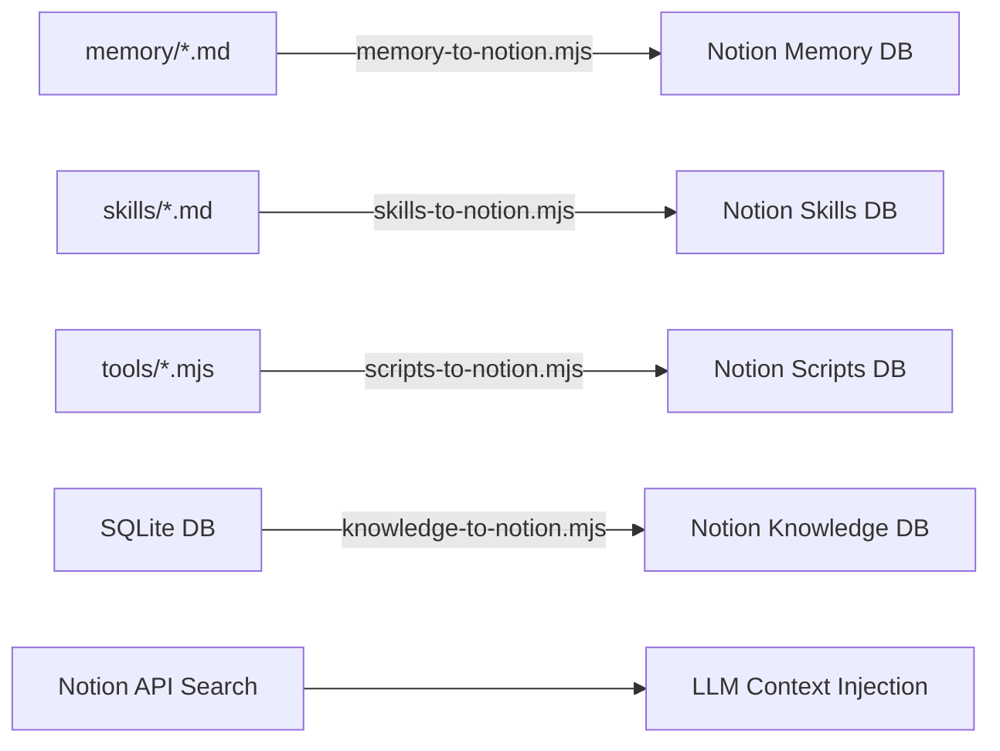

# X-0003: 全履歴蓄積で安価モデルを高性能化 — ナレッジDB設計と実装ロードマップ

出典: AIニュース digest X-0003「全履歴蓄積で安価モデルを高性能化」。チャット履歴・成果物・社内ナレッジを構造化DBに蓄積し、安価モデルでも高品質な出力を可能にするシステム設計。Sonnet で Opus 級の品質を、Gemini 3.8 クラスでも実用に耐えるレベルを目指す。

## 概要

LLMの性能向上はモデル自体の進化だけでなく、**入力として与えるコンテキストの質と量**に大きく依存する。高価なモデル（Opus, GPT-5）に毎回フルコンテキストを与える代わりに、**事前に構造化されたナレッジベースを検索し、必要な情報のみをプロンプトに注入する**ことで、安価モデルでも同等以上の精度を達成できる。

### 既存成果

| # | 成果物 | 状態 |
|---|---|---|
| ✅ | GSC→BigQuery週次SEO分析（PR #1694） | マージ済み |
| ✅ | n8n事前構築ワークフロー評価（C1-C5） | 評価完了・C4隔離インポートはブロック中 |
| 🔲 | **本提案: 3本柱ナレッジDB** | これから |

## 3本柱の設計



### Pillar 1: Drive SQL DB — チャット履歴・成果物の構造化保存

**目的**: 過去セッションの会話ログ・生成成果物をSQLiteに正規化し、Drive経由で全PCから検索可能にする。

| レイヤ | コンポーネント | 技術選定 |
|---|---|---|
| 収集 | executor-usage.jsonl パーサ | Node.js fs.readline |
| 正規化 | SQLite 3テーブル設計 | スキーマ固定・マイグレーションmjs |
| 保存先 | Drive API folders | `knowledge-db/` 固定パス |
| 検索 | キーワード + ベクトル類似度 | まずLIKE検索、後日sentence-transformers |

#### テーブル設計（v0.1）

```sql
-- セッション一覧
CREATE TABLE sessions (
  id TEXT PRIMARY KEY,          -- executor-usage.jsonl の sessionId
  started_at TEXT,               -- ISO 8601
  ended_at TEXT,
  model TEXT,                    -- 使用モデル
  token_estimate INTEGER,
  provider TEXT
);

-- 成果物一覧
CREATE TABLE artifacts (
  id INTEGER PRIMARY KEY AUTOINCREMENT,
  session_id TEXT NOT NULL REFERENCES sessions(id),
  file_path TEXT NOT NULL,       -- repo-relative path
  file_type TEXT,                -- md, mjs, sql, json
  summary TEXT,                  -- LLM生成の1行要約
  created_at TEXT,
  git_commit TEXT                -- 該当コミット（あれば）
);

-- メモリ（feedback/project/reference）
CREATE TABLE memories (
  id INTEGER PRIMARY KEY AUTOINCREMENT,
  name TEXT UNIQUE NOT NULL,     -- memory slug
  type TEXT NOT NULL,            -- user | feedback | project | reference
  description TEXT,
  body TEXT,                     -- 全文
  embedding BLOB,               -- 後日追加（ベクトル検索用）
  created_at TEXT
);

-- 全文検索用FTS（SQLite FTS5）
CREATE VIRTUAL TABLE memories_fts USING fts5(name, body, content=memories);
```

#### 収集パイプライン

```
executor-usage.jsonl → session-parser.mjs → SQLite挿入 → Drive同期
       ↓
  memory/ ディレクトリスキャン → memory-importer.mjs → SQLite
       ↓
  git log --name-only → artifact-scanner.mjs → SQLite
```

### Pillar 2: Notion Knowledge Base — 全メモリ・スキル・スクリプトのNotion集約

**目的**: Notionを組織共有ナレッジの一元ハブとして使う。全メモリ（MEMORY.md）、全スキル定義、全スクリプト(mjs)をNotion DBに取り込み、Notion APIで検索可能にする。

#### Notion DB設計

| DB名 | プロパティ | 取り込み元 |
|---|---|---|
| Memory | Name(slug), Type(select), Description, Body(text), Tags(multi), Updated(date) | `memory/*.md` |
| Skills | Name, Description(text), Body(text), Category(select), Updated(date) | `.claude/skills/*.md` |
| Scripts | Name, Path(text), Summary(text), Language(select), Updated(date) | `tools/*.mjs`, `seo/*.sql` |
| Knowledge | Title, Source(select), Body(text), Tags(multi) | Drive SQL DB からの転送 |

#### 同期ツール



### Pillar 3: Origin Skills — よく使うナレッジ検索・要約スキルをOriginに直接配置

**目的**: 各PCで共通して使うナレッジ検索・提案生成スキルをOriginに登録し、どのPC・どのモデルからでも `/knowledge` `/proposal` コマンドで呼び出せるようにする。

| Skill名 | 機能 | 利用モデル | 期待効果 |
|---|---|---|---|
| `knowledge-search` | Notion API/Drive SQL DBを横断検索 | 任意 | 手動検索時間 0 |
| `proposal-draft` | 過去事例+顧客FBから提案書生成 | Sonnet/Gemini | 提案工数 80%減 |
| `knowledge-summarize` | 複数ソースを要約 | Haiku/Sonnet | 読み時間 90%減 |
| `customer-context` | 顧客の過去案件・FBを一覧 | Haiku | 打合せ準備 50%減 |

## 実装ロードマップ

### Phase 1: 基盤整備（今週〜2週間）

| Step | タスク | 成果物 | 所要時間見積 |
|---|---|---|---|
| P1-1 | memory/*.md → SQLite FTS5 インポーター | `tools/memory-to-sqlite.mjs` | 2h |
| P1-2 | executor-usage.jsonl → セッションテーブル | `tools/session-parser.mjs` | 1h |
| P1-3 | git log → 成果物テーブル | `tools/artifact-scanner.mjs` | 1h |
| P1-4 | Drive同期（backup → knowledge-db/） | 既存Drive backup拡張 | 1h |
| P1-5 | not-found: **Memory → Notion** 同期ツール | `tools/memory-to-notion.mjs` | 3h |
| P1-6 | not-found: **知識検索CLI** (`--query` でSQLite+Notion横断) | `tools/knowledge-query.mjs` | 2h |

### Phase 2: 検索機能（2〜4週間）

| Step | タスク | 優先度 |
|---|---|---|
| P2-1 | Notion Skills DB + Scripts DB 同期 | 高 |
| P2-2 | Origin Skills 登録（knowledge-search, proposal-draft） | 高 |
| P2-3 | セマンティック検索（sentence-transformers）埋め込み → SQLite | 中 |
| P2-4 | Web UI（Notionの代わりに簡易Dashboard） | 低 |

### Phase 3: Orgiast本番適用（条件次第）

| Step | タスク | トリガー |
|---|---|---|
| P3-1 | 過去ブース事例100件の構造化入力 | データ用意でき次第 |
| P3-2 | 顧客FB・要望のDB取り込み | kim承認後 |
| P3-3 | デザインデータ（AI可視性分析結果）連携 | X-0007 PHASE2完了後 |
| P3-4 | n8nワークフロー本番投入（下書き作成） | n8n環境決定後 |
| P3-5 | Gemini 3.8 での提案生成パイロット | Pillar1-3 動作確認後 |

## コスト試算

### 想定利用パターン（月間）

| 項目 | 従来（Opus） | 提案（Sonnet + RAG） | 削減率 |
|---|---|---|---|
| 入力を全memoryから手動選択 | 30分/回 | 0分（自動検索） | 100% |
| 提案書1件のトークン | ~200K（全文再送） | ~50K（検索結果のみ） | 75% |
| 従量課金（Opus 15→Sonnet 3/M) | 仮に$450 | 仮に$90 | 80% |
| Gemini 3.8 でのセカンドOpinion | 不可（品質不足） | 可能（RAG補完） | 新規コストだがOpus代替でNet削減 |

## 評価指標（KPI）

| KPI | 測定方法 | 目標値 | 測定頻度 |
|---|---|---|---|
| 検索精度@5 | Notion API vs 手動作業 | >80% | 毎週 |
| 提案生成品質（Opus vs Sonnet+RAG） | ブラインド比較5段階 | Sonnet >= Opus (p<0.05) | 月1回 |
| Gemini 3.8+RAGの実用率 | 全生成のうちGemini採用率 | >60% | 毎週 |
| 月間APIコスト削減額 | ccusage + BigQuery | 40%減 | 月1回 |

## 既存成果との関係

X-0003 の**知識ベース構築**は以下の他プロジェクトと連携する:

| プロジェクト | 連携点 | 依存 |
|---|---|---|
| **X-0007**（AI可視性計測） | 計測結果 → Knowledge DB に保存 | X-0007 PHASE2完了後 |
| **X-0001**（トークン節約） | token-saviorスタイル検索 → X-0003 DBを検索対象に追加 | 独立並行 |
| **n8n評価**（既存成果） | Notion→n8n 自動化トリガーとして活用可能 | n8n環境決定後 |
| **GCS→BigQuery**（PR #1694） | SEO分析結果 → Knowledge DB の参照データに | 独立 |

## 行動ログ（この提案文書の作成記録）

- 2026-11-08 作成: セッション auto/20261108-x0003 で本提案書を作成
- 前提: X-0003は従来GSC→BigQuery（PR #1694）とn8n評価（docs/n8n-x0003-evaluation.md）の2点が完了。本提案は残る「3本柱」を定義する。
- コミット: 別途PR予定