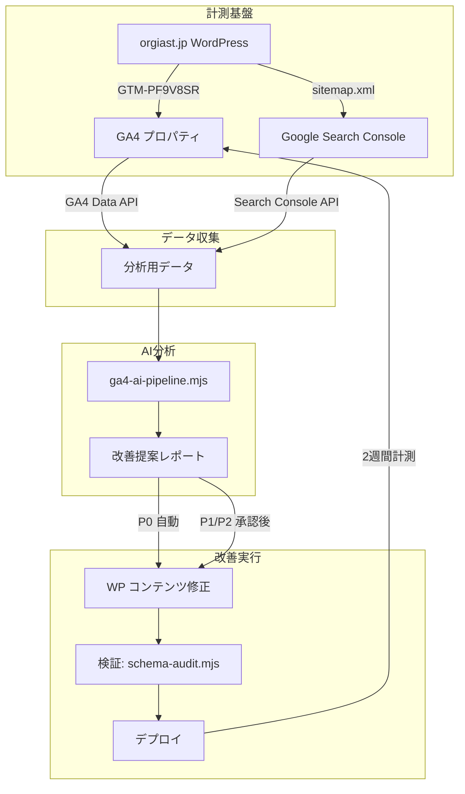
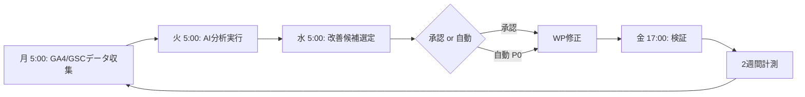

# X-0005 GA4×AI SEO自動改善 実装ランブック

**更新日**: 2026-11-11
**対象サイト**: https://www.orgiast.jp （株式会社オージャスト）
**状態**: 🔴 GA4未導入（UA-26359261-1 のみ、2024年7月計測停止）

---

## 全体アーキテクチャ



## 現状診断サマリ（2026-11-11 実測）

| 項目 | 状態 | 備考 |
|------|------|------|
| Google Analytics | UA-26359261-1 のみ（計測停止済み） | 🔴 **GA4未導入** |
| Google Tag Manager | GTM-PF9V8SR 設置済み | 🟢 GA4タグ追加のみで導入可能 |
| gtag.js 直貼り | UA コードがテーマに直書き | 🟡 削除推奨（GA4には影響しない） |
| GA4測定ID | 未設定 | 🔴 G-XXXXXXXXXX が必要 |
| Search Console | 未確認 | ⏳ API鍵不在のため未照会 |
| robots.txt | WP管理画面のみDisallow | 🟡 AIクローラー許可なし |
| sitemap.xml | All in One SEO Pack 2.11 生成済み | 🟢 有効 |
| タイトルタグ | 「社内イベント企画プロデュース、オンラインイベント…」 | 🔴 **展示会KWなし** |
| メタディスクリプション | 社内イベント・オンラインイベント中心 | 🔴 **展示会KWなし** |
| H1 | 画像ベースでテキストなし | 🔴 **SEO・アクセシビリティ上の重大課題** |
| JSON-LD構造化データ | Organization / WebSite / FAQPage(3問) | 🟡 Service / Article / BreadcrumbListなし |
| PHP/WordPress | PHP 7.4.33 / Apache / WP + All in One SEO Pack | 🟢 やや旧版だが動作中 |

---

## PHASE 0: GA4導入（所要: 30分、kim Google操作必要）

**ブロッカー**: GA4プロパティ作成・GTMタグ追加は Google Analytics / Tag Manager の Web UI 操作が必要。このセッションの Claude 環境からは API 実行不可（SA鍵不在のため）。

### 手順 0-1: GA4プロパティ作成

1. kim@orgiast.jp で [Google Analytics](https://analytics.google.com) にログイン
2. 管理 → 「+ プロパティを作成」
   - プロパティ名: `orgiast.jp`
   - レポートタイムゾーン: 日本
   - 通貨: 円
3. 「Web」を選択 → URL: `https://www.orgiast.jp`
4. 作成後、測定 ID（`G-XXXXXXXXXX`）を控える

### 手順 0-2: GTMにGA4タグ追加

1. [Google Tag Manager](https://tagmanager.google.com/) → コンテナ **GTM-PF9V8SR**
2. 「タグ」→「新規」→「Google アナリティクス: GA4 設定」
   - 測定 ID: 手順0-1で取得した G-XXXXXXXXXX
   - トリガー: **All Pages (Initialize - All Pages)**
3. タグ名: `GA4 - Configuration`
4. プレビューで発火確認 → **公開**

### 手順 0-3: 動作確認

```bash
# GA4測定IDの存在確認（変更後）
curl -sL https://www.orgiast.jp/ | grep "G-"

# UA古コードの確認（削除前）
curl -sL https://www.orgiast.jp/ | grep "UA-26359261-1"
```

### 手順 0-4: UA直書きコード削除

WordPress管理画面 → 外観 → テーマエディター → `header.php` から以下を削除:

```html
<!-- Global site tag (gtag.js) - Google Analytics -->
<script async src="https://www.googletagmanager.com/gtag/js?id=UA-26359261-1"></script>
<script>
  window.dataLayer = window.dataLayer || [];
  function gtag(){dataLayer.push(arguments);}
  gtag('js', new Date());
  gtag('config', 'UA-26359261-1');
</script>
```

---

## PHASE 1: タイトル・メタ・H1の最適化（所要: 10分、WP操作）

### 1.1 タイトルタグ（全ページで推奨）

| ページ | 現状 | 改善案 | 効果 |
|--------|------|--------|------|
| トップ | 社内イベント企画プロデュース、オンラインイベント、クリエイティブ制作の株式会社オージャスト［東京・大阪・福岡］ | **展示会ブース制作・イベント企画 | 株式会社オージャスト ［大阪・東京・福岡］** | 高 |
| /booth | （未確認/動的生成） | **展示会ブース制作実績と料金 | 大阪・東京 オージャスト** | 高 |
| /rebooth | （未確認） | **Re:ブース 再利用型展示ブース | CO2 77%削減 オージャスト** | 中 |

### 1.2 メタディスクリプション

**現状**: オンラインイベント・社内イベント中心の内容で、展示会ブース制作のKWがない

**改善案（トップページ用）**:
```
展示会ブース制作・イベント企画なら大阪・東京・福岡の株式会社オージャスト。
デザインから施工・撤去まで一貫対応。CO2 77%削減のRe:ブースでサステナブルな出展を。
万博パビリオン級の品質。全国7拠点。無料見積もり随時受付。
```

### 1.3 H1タグ

**課題**: 画像ベースのH1でテキストがない。これはSEO上もアクセシビリティ上も大きな問題。

**改善案**: 画像の `alt` 属性か、非表示テキストH1として以下を設定:
```html
<h1 class="visually-hidden">展示会ブース制作・イベント企画制作 株式会社オージャスト</h1>
```

---

## PHASE 2: JSON-LD構造化データ拡充（デプロイ準備済み）

以下のファイルをWPの `header.php`（またはフッター）に追加する。

**対象ファイル**: `seo/json-ld-expanded-schemas.json`

### 追加内容

| スキーマ | 状態 | 追加項目 |
|---------|------|---------|
| FAQPage | 3問→20問拡充 | FAQPage mainEntity 17問追加 |
| BreadcrumbList | 新規 | パンくずリスト構造化 |
| Service (×3) | 新規 | ブース制作 / Re:ブース / イベント制作 |
| LocalBusiness | 新規 | 営業時間・価格帯・対応エリア |
| Organization | 維持 | 現状のまま（品質良好） |
| WebSite | 維持 | 現状のまま |

### 構造化データを追加する方法

1. **WordPress** → 外観 → テーマエディター → `header.php`
2. `</head>` タグの直前に、既存のJSON-LD `<script>` タグの後ろに以下を追加:
```html
<script type="application/ld+json">
【 json-ld-expanded-schemas.json の内容をここに貼り付け 】
</script>
```

3. 検証: `node tools/schema-audit.mjs https://www.orgiast.jp`

---

## PHASE 3: AI分析パイプライン構築（自動化準備済み）

### 3.1 パイプラインスクリプト
`seo/ga4-ai-pipeline.mjs` — GA4データをAIに渡して改善提案を生成

**使い方（GA4データ蓄積後）**:
```bash
# GA4 UIからCSVエクスポート後
node seo/ga4-ai-pipeline.mjs --ga4-csv ./data/ga4-pages.csv --gsc-csv ./data/gsc-queries.csv

# モックデータで動作確認（APIキー不要）
node seo/ga4-ai-pipeline.mjs --mock --verbose
```

**設定可能なAIプロバイダ**:
```bash
# Gemini（デフォルト、安価）
AI_PROVIDER=gemini GEMINI_API_KEY=xxx node seo/ga4-ai-pipeline.mjs --mock

# Groq（安価、高速）
AI_PROVIDER=groq GROQ_API_KEY=xxx node seo/ga4-ai-pipeline.mjs --mock
```

### 3.2 GSC BigQuery週次分析（推奨）
`seo/gsc-bq-weekly-analysis.sql` — BigQuery用の週次分析SQL

Search Console の一括エクスポート機能（BigQuery連携）を設定後、このSQLで週次分析を実行。

---

## PHASE 4: 週次改善ループ（自動化構想）



### 自動化のレーン設計

| レーン | 担当 | コスト |
|--------|------|--------|
| データ収集 | cron / GAS / GitHub Actions | 無料 |
| AI分析 | Gemini Flash（最安） | 月数十円 |
| 改善案作成 | Gemini Flash | 月数十円 |
| 承認 | kim（水曜朝の確認1回） | 1分 |
| 実装 | Codex / WP手動 | 状況次第 |
| 検証 | Claude（Sonnet） | 月数百円 |

---

## 納品物一覧

| # | ファイル | 説明 | 状態 |
|---|---------|------|------|
| 1 | `seo/ga4-ai-pipeline.mjs` | GA4→AI改善提案パイプライン | ✅ 作成済み |
| 2 | `seo/json-ld-expanded-schemas.json` | 拡張JSON-LD（FAQ 20問 + α） | ✅ 作成済み |
| 3 | `seo/robots-ai-optimized.txt` | AIクローラー最適化robots.txt | ✅ 作成済み |
| 4 | `seo/gsc-bq-weekly-analysis.sql` | GSC BigQuery週次分析（既存） | 既存 |
| 5 | 本ドキュメント | 実装ランブック | ✅ 作成済み |

---

## 次のアクション（優先度順）

| 優先度 | アクション | 担当 | 所要時間 | 依存 |
|--------|-----------|------|---------|------|
| **P0 🔴** | GA4プロパティ作成（Google Analytics UI） | kim | 5分 | Googleアカウント |
| **P0 🔴** | GTMタグ追加（Tag Manager UI） | kim | 5分 | GA4測定ID |
| **P1 🟡** | タイトルタグ・メタ説明改善（All in One SEO Pack） | Claude | 10分 | WP管理画面 |
| **P1 🟡** | H1タグのテキスト追加（header.php編集） | Claude | 5分 | WPテーマ編集 |
| **P2 🟢** | robots.txt AI最適化（.htaccess or WP管理画面） | Claude | 5分 | - |
| **P2 🟢** | JSON-LD拡張構造化データ追加（header.php） | Claude | 10分 | WPテーマ編集 |
| **P2 🟢** | UA直書きコード削除（header.php） | Claude | 5分 | WPテーマ編集 |
| **P3 ⏳** | GA4→AI分析パイプライン初回実行 | Claude | 10分 | GA4データ蓄積(2週間) |
| **P3 ⏳** | Search Console API連携（SA鍵設定） | kim | 15分 | SA鍵生成 |
| **P3 ⏳** | GSC BigQuery連携設定 | kim | 30分 | GCP project |
| **P4 📋** | 週次改善ループのGitHub Actions化 | Codex | 2h | 全P0-P3完了 |

---

## 検証方法

```bash
# 1. GA4導入確認
curl -sL https://www.orgiast.jp/ | grep "G-"

# 2. UA削除確認
curl -sL https://www.orgiast.jp/ | grep "UA-26359261-1"  # 空であること

# 3. robots.txt AI最適化確認
curl -s https://www.orgiast.jp/robots.txt | grep "GPTBot"

# 4. 構造化データ確認（事前に schema-audit.mjs を実行）
node tools/schema-audit.mjs https://www.orgiast.jp

# 5. パイプラインテスト
node seo/ga4-ai-pipeline.mjs --mock

# 6. Search Console 状態確認（SA鍵必須）
node tools/google-property-check.mjs
```

---

## 定常運用

- **週次**: GA4データが蓄積されたら `node seo/ga4-ai-pipeline.mjs` を実行
- **月次**: JSON-LDの拡充・更新が必要か確認
- **四半期**: 全体的なSEO戦略の見直し（X-0008 90日計画参照）