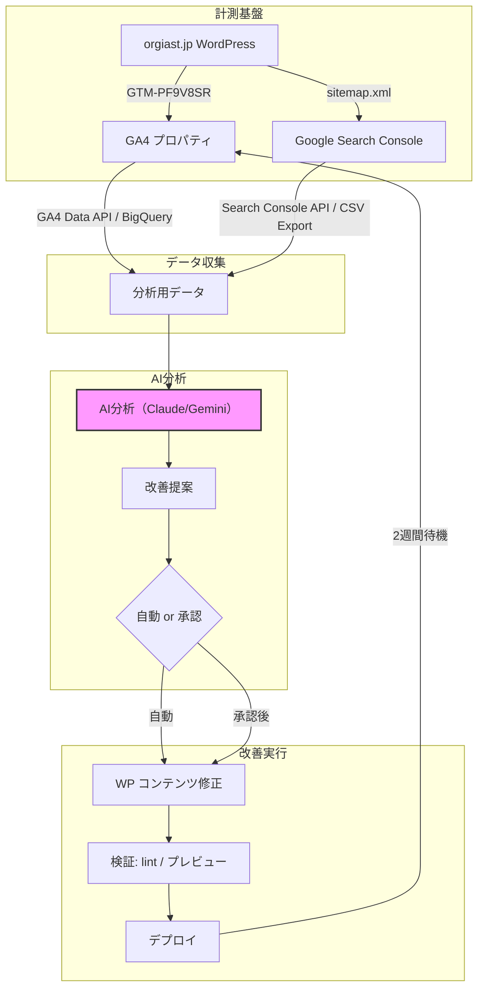
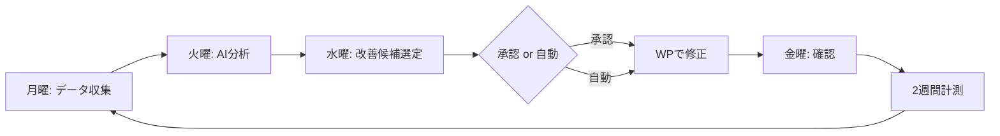

# X-0006: GA4データ × AI による SEO/AIO 自動改善 — 株式会社オージャスト実装ガイド

出典: AIニュース提案 X-0006「GA4データとAIによるSEO/AIO自動改善」。GA4 + Search Console のデータを AI に渡し、改善提案の実行までを自動ループ化する手法を、株式会社オージャストの展示会・イベント関連ページに適用する実装手順書。

## 現状診断（2026-11-10 実測）

| 項目 | 状態 | 備考 |
|------|------|------|
| Google Analytics | UA-26359261-1（旧ユニバーサルアナリティクス）のみ | **UA は 2024年7月に計測停止済み。現状、有効なアクセス解析は動作していない** |
| Google Tag Manager | GTM-PF9V8SR 設置済み | 全ページに GTM スニペットあり |
| gtag.js 直貼り | UA の gtag.js が WP テーマに直接埋め込み | GTM と重複して UA コードが2重にあるが、UA 停止後のため実害なし |
| GA4 測定 ID | 未設定 | G-XXXXXXXXXX が存在しない |
| Search Console | 実測未確認 | sitemap.xml や robots.txt の状態は要確認 |
| JSON-LD 構造化データ | Organization / FAQPage（3問）設置済み | WebSite の publisher 参照はあるが粒度は最小限 |
| サイト基盤 | WordPress（PHP 7.4.33 / Apache） | カスタムテーマ、All in One SEO Pack 2.11 利用 |

### 課題

1. **UA 停止状態**: 旧 UA コードが head にベタ書きされており、GA4 未導入のためアクセスデータが 2 年以上取れていない
2. **GTM は生きている**: GTM-PF9V8SR が動作している ⇒ GA4 タグを GTM に追加するだけで GA4 導入可能
3. **直書きコードの除去が必要**: UA の gtag.js 直貼りコード（`UA-26359261-1`）は header.php から削除しないと GTM 経由の GA4 と競合はしないが無駄な読み込みになる
4. **AI 連携の準備**: GA4 と Search Console のデータを AI に渡すパイプラインは未整備

## 全体アーキテクチャ



## PHASE 0: GA4 導入（初回セットアップ）

### 手順 0-1: GA4 プロパティの作成

1. Google Analytics → 管理 → 「+ プロパティを作成」→ **プロパティ名**: `orgiast.jp`、**レポートのタイムゾーン**: 日本、**通貨**: 円
2. 「Web」を選択 → URL: `https://www.orgiast.jp`
3. 作成後、**測定 ID**（`G-XXXXXXXXXX`）を控える
4. **拡張計測機能**: デフォルトで有効にする（ページビュー、スクロール、離脱クリック、サイト内検索、動画エンゲージメントが自動取得）

### 手順 0-2: GTM で GA4 タグを設定（変更不要の最小手順）

GTM-PF9V8SR は既に全ページで動作しているため、**新規タグ 1 つを追加するだけ**で GA4 導入完了。

1. [Google Tag Manager](https://tagmanager.google.com/) にログイン → コンテナ **GTM-PF9V8SR**
2. **タグ** → 「新規」→ 「Google アナリティクス: GA4 設定」を選択
   - 測定 ID: `G-XXXXXXXXXX`（手順 0-1 で作成した ID）
   - トリガー: **All Pages**（Initialize - All Pages）
3. タグ名: `GA4 - Configuration`
4. 右上「プレビュー」で発火確認 → GA4 リアルタイムレポートでテストビューが計測されることを確認
5. **公開**

### 手順 0-3: UA 直書きコードの削除（推奨）

UAの直書きコードが header.php に残っている。GA4 の動作には影響しないが、不要なスクリプト読み込みを削除する。

1. WordPress 管理画面 → **外観 → テーマエディター** → `header.php`
2. 以下のブロックを削除:

```html
<!-- Global site tag (gtag.js) - Google Analytics -->
<script async src="https://www.googletagmanager.com/gtag/js?id=UA-26359261-1"></script>
<script>
  window.dataLayer = window.dataLayer || [];
  function gtag(){dataLayer.push(arguments);}
  gtag('js', new Date());
  gtag('config', 'UA-26359261-1');
</script>
```

3. **変更のみ保存**し、サイト全体で GA4 のみが動作することを確認
4. GTM プレビューモードで**二重計測がないこと**を確認（UA タグが発火していない）

### 手順 0-4: GA4 の目標設定

| 目標 | 測定方法 | 備考 |
|------|---------|------|
| ページビュー | 拡張計測（自動） | 全ページ自動 |
| ブース制作の問い合わせ | CTA クリックイベント | GTM でクリックトリガー設定 |
| 展示会事例の閲覧 | ページビュー + スクロール深度 | `scroll` イベント（25%/50%/75%/90%） |
| Re:ブース資料請求 | フォーム送信イベント | `generate_lead` イベント |

### 手順 0-5: Search Console の確認

1. [Search Console](https://search.google.com/search-console) にアクセス
2. `https://www.orgiast.jp/`（URL プレフィックス）が所有権確認済みかチェック
3. GA4 プロパティと Search Console をリンク（管理 → プロパティの関連付け → Search Console）
4. sitemap.xml の送信状態を確認: `https://www.orgiast.jp/sitemap.xml`

## PHASE 1: 展示会・イベントページのトラッキング強化

展示会ブース制作の集客経路を可視化するため、以下のイベントトラッキングを GTM で設定する。

### 1. ブース制作お問い合わせ CTA 計測

展示会事例ページ・Re:ブースページにある問い合わせボタンのクリックを計測。

| GTM 設定 | 値 |
|---------|-----|
| トリガータイプ | クリック - すべての要素 |
| トリガー条件 | `Click URL` が `contact` を含む、または `Click Text` が「お問い合わせ」「見積もり依頼」 |
| イベント名 | `booth_inquiry` |
| パラメータ | `page_path`, `inquiry_source`（事例ページか Re:ブースページか） |

### 2. 展示会事例のエンゲージメント計測

事例一覧ページ・個別事例ページでのユーザー行動を計測。

| 項目 | 設定 |
|------|------|
| スクロール深度 | GTM の「スクロール深度」トリガーで 25% / 50% / 75% / 90% |
| 滞在時間 | GA4 のデフォルト指標で取得（`user_engagement`） |
| クリック | 事例一覧から個別ページへのクリックを `case_click` で計測 |

### 3. イベント関連ページの分類

GA4 の `content_group` パラメータでページをグループ化:

| content_group | 該当パス |
|--------------|---------|
| `exhibition_booth` | /booth, /booth/* |
| `event_production` | /event, /event/* |
| `re_booth` | /rebooth, /rebooth/* |
| `case_study` | /works, /works/* |
| `company_info` | /company, /profile |

## PHASE 2: AI データ分析パイプライン

### 2.1 GA4 データのエクスポート方式

GA4 のデータを AI（Claude / Gemini）に渡す 2 つの経路:

| 方式 | データ量 | 手間 | 適している用途 |
|------|---------|------|-------------|
| GA4 UI → CSV ダウンロード | 制限あり | 月1回手動 | 初回分析・小規模サイト |
| GA4 Data API → スクリプト | 制限なし | 自動化可能 | 週次・月次の定期分析 |

推奨: まずは **GA4 UI + Search Console UI からの CSV エクスポート**で始め、安定したら Data API + BigQuery Export へ移行。

#### CSV エクスポート（初回）

1. GA4 → 「レポート」→ 「エンゲージメント」→ 「ページとスクリーン」
2. 期間: 直近 28 日（データが溜まるまでは最大期間）
3. 右上「共有」→ 「CSV をダウンロード」
4. Search Console → 「検索結果」→ 「日付範囲」→ 「エクスポート」

### 2.2 AI 分析プロンプトテンプレート

Claude / ChatGPT に渡すプロンプト:

```
あなたは SEO アナリストです。以下の GA4 ページ別データと Search Console データから、展示会ブース制作サイト（orgiast.jp）の改善提案をしてください。

## GA4 データ（直近28日）
{GA4 CSV を貼り付け}

## Search Console データ（直近28日）
{GSC CSV を貼り付け}

## 分析してほしいこと
1. 流入が多いのにコンバージョンが低いページ（改善優先度大）
2. 検索順位が 5-20 位でクリック率が低いクエリ（タイトル・メタディスクリプション改善候補）
3. 展示会・ブース制作の検索意図に合っていないページ
4. AI（LLM）に引用されやすいページとされにくいページの差
5. 競合サイトと比較したコンテンツの不足領域

## 出力形式
- 改善提案を優先度順に列挙
- 各提案に「期待効果（低/中/高）」と「実装難易度（1-5）」を付ける
- タイトル・H1・H2 の具体的な修正案を含める
```

### 2.3 週次改善ループ



**レーン**: 人間は選定された改善案の**承認/却下**のみ。修正テキストの作成・実装は AI と自動化で行う。

## PHASE 3: SEO/AIO 改善の自動実行

### 3.1 適用ルール（他 AI ニュース提案との連携）

| 提案 | 連携内容 |
|------|---------|
| X-0004（LLMO コンテンツ最適化 4箇条） | GA4 の直帰率が高いページに LLMO 対策を優先適用 |
| X-0007（LLMO 効果測定 40 ポイント） | GA4 改善ループの効果を月次で測定 |
| X-0008（90日 AI SEO 計画） | GA4 データから新しいトピックの仮説を生成 |

### 3.2 AI 書き換えの禁止事項

AI によるコンテンツ修正は以下に厳格に従う:

- **タイトルタグ**: 長さ 30-60 文字。KW は前方に。ブランド名は省略可
- **メタディスクリプション**: 長さ 120-160 文字。KW を含め自然な文章
- **H1**: ページごとに一意。メイン KW を含む
- **H2/H3**: トピッククラスターを形成。内部リンクを含める
- **禁止**: 事実の捏造、存在しない事例の追加、価格の創作、在庫状況の偽装

### 3.3 JSON-LD 構造化データの追加

現状の Organization + FAQPage（3問）に加え、以下を各ページに追加:

| ページ種別 | 追加する構造化データ |
|-----------|-------------------|
| ブース制作事例 | Article, ImageGallery |
| サービスページ | Service, Product（Re:ブース） |
| 会社概要 | LocalBusiness（詳細化） |
| FAQページ | FAQPage（10問以上に拡充） |
| ブログ記事 | Article, BlogPosting |

**FAQPage 拡充案**（現状 3 問 → 10 問以上へ）:

| # | 質問 | 回答の要点 |
|---|------|-----------|
| 4 | 展示会ブースの制作期間はどのくらい？ | 企画〜施工まで標準 2-3 ヶ月、短期対応可能 |
| 5 | 小規模ブース（3小間）の制作费用は？ | 規模・オプションに応じて変動、無料見積もり |
| 6 | 東京以外の地域での施工は可能？ | 全国 7 拠点で対応可能 |
| 7 | デザインだけの依頼はできる？ | デザインのみ・設計のみの部分依頼対応 |
| 8 | 過去の展示会実績は？ | 万博パビリオン含む多数の実績 |
| 9 | 環境に配慮したブース制作は？ | Re:ブースで CO2 77% 削減、ISO 14067 証明書 |
| 10 | 初めての展示会出展で不安 | 企画段階からサポート、初心者向けパッケージあり |

## 費用と効果の見積もり

### 導入コスト

| 項目 | 金額 | 備考 |
|------|------|------|
| GA4 プロパティ作成 | 無料 | Google Analytics 標準 |
| GTM タグ設定 | 無料 | 自社で GTM 操作可能な場合 |
| Search Console | 無料 | すでに設定済みの可能性 |
| AI 分析（Claude/Gemini API） | 月数百〜数千円 | データ量による |

### 期待効果

| KPI | 現在（推定） | 3ヶ月目標 | 6ヶ月目標 |
|-----|-----------|----------|----------|
| 有機検索トラフィック | 計測不可（UA 停止中） | GA4 計測開始 + 20% | 前月比 +30% |
| AI 引用率 | n/a（X-0007 測定対象） | 指名クエリ 80% | 全平均 60% |
| 展示会問い合わせ CVR | n/a | トラッキング開始 | ガイドライン確立 |

## 次アクション一覧

| 優先度 | 作業 | 担当 | 所要時間 |
|--------|------|------|---------|
| **P0** | GA4 プロパティ作成 + GTM タグ追加 + 公開 | Claude | 15分 |
| **P0** | UA 直書きコードの削除（header.php） | Claude | 5分 |
| **P0** | GA4 リアルタイムレポートで動作確認 | Claude | 5分 |
| **P1** | Search Console で sitemap.xml 確認 | Claude | 5分 |
| **P1** | GA4 ↔ Search Console のリンク設定 | Claude | 5分 |
| **P1** | GTM で展示会 CTA イベントタグ追加 | Claude | 30分 |
| **P2** | 構造化データ FAQPage の拡充（3問→10問） | Claude/Codex | 30分 |
| **P2** | 最初の AI 分析用 CSV エクスポート | kim | 10分 |
| **P3** | 改善ループの自動化スクリプト作成 | Codex | 2時間 |

## 検証方法

1. **GA4 導入確認**: `curl -sL https://www.orgiast.jp/ | grep "gtag\|G-"` で GA4 測定 ID が出力されること
2. **UA 削除確認**: `curl -sL https://www.orgiast.jp/ | grep "UA-26359261-1"` が空であること
3. **GTM 発火確認**: Google Tag Assistant（Chrome 拡張）または GTM プレビューモードで GA4 タグが All Pages で発火すること
4. **GA4 データ受信確認**: GA4 リアルタイムレポートに自画面が表示されること
5. **Search Console 確認**: `curl -s https://www.orgiast.jp/sitemap.xml | head -5` で有効な XML が返ること

## 出典

- GSC＋GA4統合でSEO改善提案を自動化するClaude Codeスキル（NEXA, 2026）
- SENRI-GAN AI Web解析ツール（PR TIMES / 株式会社relation, 2026）
- GIIP FDE SEO/GEO Autopilot（GIIP, 2026）
- Search ConsoleとGA4でSEO改善を自動化した実践例（NCP, 2025-2026）