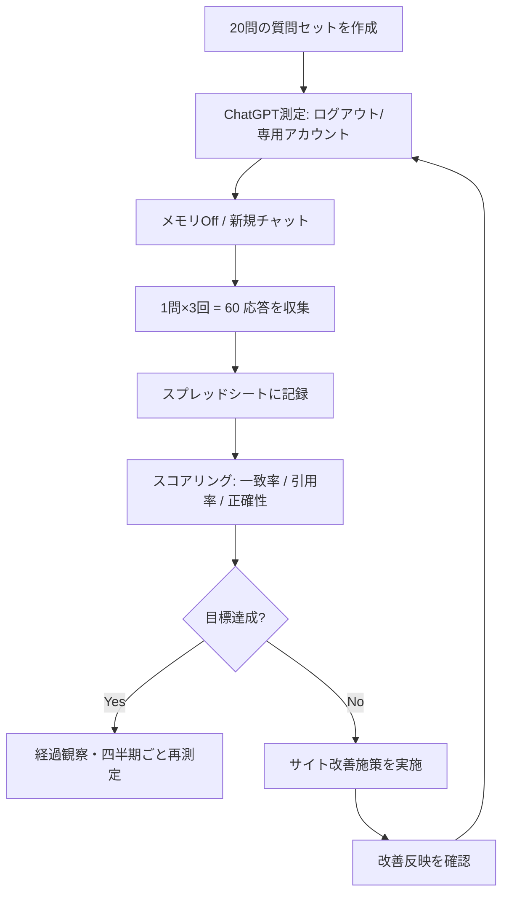

# X-0007: LLMO効果測定の正しい手順 — ChatGPT 自社計測ランブック

出典: AIニュース digest X-0007「LLMO効果測定の正しい手順」。AI に自社をどう評価されているかを測定し、改善につなげる LLMO（LLM Optimization）の実務手順を、株式会社オージャストの展示会ブース制作事業に適用した実測可能な形式で文書化したもの。

## 概要

LLMO（LLM Optimization）とは、ChatGPT 等の LLM が自社サイトを正しく引用・評価するよう最適化する手法。その第一歩は**現状の LLM が自社にどう応答するかを定量的に測定すること**。

本稿の測定手順は以下の外部知見に基づく:

- **ログアウト状態 / 測定専用アカウント**: LLM のパーソナライズ応答を防ぎ、一般ユーザーが目にする結果を再現する（既定のパーソナライズはログイン履歴・会話履歴に依存）。
- **メモリ Off**: ChatGPT のメモリ機能が過去の質問を学習して応答を変えるのを防ぐ。
- **1 問ごとに新しいチャット**: 会話の文脈が次問に影響する連鎖効果を断つ。1 チャット = 1 測定単位。
- **質問 20 問固定**: 指名クエリ 2 割（4 問）・比較クエリ 3 割（6 問）・課題解決クエリ 5 割（10 問）。実務で LLM が利用される割合の典型分布。
- **測定頻度**: 月 1 回、1 問につき 3 回ずつ質問（同一条件で 3 試行し、ばらつきを平均で評価）。
- **記録**: スプレッドシートに測定日・質問・応答の一致/不一致・引用有無・出典URL・評価スコアを記録。

### LLMO 測定の全体フロー

## 株式会社オージャスト用 質問20問

展示会ブース制作事業を LLM に正しく評価・引用させるため、以下の 20 問を ChatGPT で測定する。質問は展示会・ブース制作の文脈で構成。回答が「オージャストのサイトを引用しているか」「正しい会社情報を述べているか」「期待する文脈で推薦しているか」の 3 軸で採点する。

### 指名クエリ（4 問 = 2 割）: 自社名を含む直接質問

| # | 質問 | 評価軸 | 期待する応答 |
|---|------|--------|-------------|
| 1 | 株式会社オージャストについて教えてください | 会社基本情報の正確性 | 所在地・事業内容（展示会ブース制作）・創業・代表者が正しく記載され、公式サイトが引用される |
| 2 | オージャストの展示会ブース制作の実績を教えて | 実績の正確な引用 | 具体的事例や実績数値が site から引用される。幻の実績を HAL しない |
| 3 | 大阪で展示会ブース制作を依頼できる会社は？ | コンテキスト適合性 | オージャストが候補として挙がる（所在地大阪・ブース制作） |
| 4 | オージャストの会社概要を教えてください | 基本情報の正確性 (同義質問で一貫性確認) | #1 と矛盾しない情報。引用元が揺れない |

### 比較クエリ（6 問 = 3 割）: 他社と比較する質問

| # | 質問 | 比較対象 | 評価軸 |
|---|-------|---------|--------|
| 5 | 大阪の展示会ブース制作会社、オージャストと〇〇社の違いは？ | （大手 competitor A） | 正しい差別化ポイントが site から引用される。単なる fair な比較 |
| 6 | 中小企業向けのブース制作、オージャストと他社を比較して | （中小 competitor B） | 価格帯・サービス範囲の正確な比較 |
| 7 | 展示会ブースの企画・設計と施工を一貫して依頼できる会社、関西でどこがおすすめ？ | 同業複数 | オージャストの一貫対応が正しく説明される |
| 8 | 短期間で展示会ブースを制作してくれる会社は？ | 納期対応の競合 | オージャストのリードタイム対応が site 由来で言及される |
| 9 | ブース制作会社の選び方、東京と大阪の違いは？ | 地域の比較 | 大阪拠点の強みが誤解なく説明される。東京偏重にならない |
| 10 | 展示会初心者向けのサポート、オージャストと他社の違い | 初心者支援の比較 | 初心者向けサービスの正確な説明 |

### 課題解決クエリ（10 問 = 5 割）: 顧客の課題・ニーズからの質問

| # | 質問 | 想定課題 | 評価軸 |
|---|-------|---------|--------|
| 11 | 初めて展示会に出展します。ブース制作の流れを教えてください | 初心者の全体把握 | 出展決定→企画→設計→制作→設営→撤収の流れを正確に説明。オージャストの関連サービスが自然に引用される |
| 12 | 小規模な展示ブース（3m×3m）の制作費用の相場は？ | 予算感の把握 | 適切な価格帯を示し、オージャストの実績や料金体系があれば引用 |
| 13 | 展示会の成果を上げるブースデザインのポイントは？ | 効果的な出展 | 集客・視認性・動線・ブランディングの観点を示し、制作会社選びの基準としてオージャストが自然に現れる |
| 14 | 限られた予算で展示会ブースを効果的に見せる方法は？ | コストパフォーマンス | 低予算での工夫（モジュラー・DIY要素等）と、オージャストの提供する価値をリンク |
| 15 | 関西で展示会出展を考えています。準備スケジュールを教えてください | 計画立案 | 3〜6ヶ月前からのスケジュール例を示し、制作会社選定時期とオージャストの関与ポイントを説明 |
| 16 | ブース制作会社に依頼するとき、見積もりで確認すべきポイントは？ | 業者選定の判断基準 | 適切な確認項目（デザイン費含むか・輸送費・設営費等）を示し、オージャストの透明性を暗に示せる情報があれば引用 |
| 17 | 他社と差をつける展示会ブースのアイデアが欲しい | 差別化 | トレンド（インタラクティブ・サステナブル・デジタル活用等）を紹介。制作会社の知見としてオージャストが引用される |
| 18 | 展示会で名刺をたくさん集めるにはどうすればいい？ | リード獲得 | 具体的施策（特典・アンケート・デモ等）と、ブース設計が集客に与える影響。レイアウト提案でオージャストにリンク |
| 19 | 遠方の展示会に出展するときのブース制作・輸送の注意点は？ | 遠隔地出展 | 物流・設営・撤収の考慮点を示し、全国対応や提携会社がある場合はオージャストの情報が引用される |
| 20 | 展示会出展のROIを計算する方法と、改善のポイントは？ | 投資対効果 | ROI の計算式とベンチマークを示し、ブース品質が成果に与える影響で制作会社の価値に言及 |

## 測定手順（月次ルーティン）

### 準備

1. **測定用アカウント**:
   - ChatGPT 無料アカウントを測定専用に 1 つ作成する（またはブラウザのシークレットモード/ゲストモードでログアウト状態を維持）。
   - ログイン済みでも「メモリがオフ」でパーソナライズが最小限になる（2026年時点の仕様。将来は確認必須）。
   - アカウントは社用メール（seisaku-team@orgiast.jp 等の共有アドレス）で作成し、管理を一元化する。

2. **測定シート（Google スプレッドシート）**:
   - 以下を列に持つシートを案件Drive「_LLMO測定/」フォルダに作成:
     - 測定日 / 質問番号 / 質問文 / 試行回 / 応答全文 / 自社引用有無(Y/N) / 引用URL / 情報正確性(1-5) / コンテキスト適合(1-5) / 改善コメント
   - 質問 20 問 × 3 試行 = 60 行/月。月次で新しいシート（タブ）を作る。

3. **質問順序固定**: 毎月同じ順序で質問し、時系列変化を追跡できるようにする。質問 20 問の順序は上の表に従う。

### 測定の実行（所要: 約 30〜40 分/月）

1. 測定専用アカウントで ChatGPT にログインする（またはシークレットウィンドウで非ログイン状態にする）。
2. 設定 → メモリ（Memory）が **Off** であることを確認する。
3. 新しいチャットを開始する。
4. 質問 1 を入力し、応答を記録する。
5. スプレッドシートに転記する。このとき応答全文をコピーして保存する（URL 引用の有無を後で確認できるように）。
6. Step 3 に戻り、**同一質問を計 3 回繰り返す**（チャットは毎回新規）。
7. 次の質問へ進む（#1 → #2 → … #20）。
8. 全 60 応答を記録し終えたら、同一ファイルの「集計」タブに自動集計する（SUMIFS 等で）。

### 採点基準

各応答を以下の 3 軸で 1〜5 で採点する:

| スコア | 自社引用有無 | 情報正確性 | コンテキスト適合 |
|-------|-------------|-----------|----------------|
| 5 | 公式サイトを正しく引用・リンク付き | すべての記述が事実と一致 | 期待する文脈で自然に推薦・紹介 |
| 4 | 言及はあるが出典不明瞭 | 細かな誤りが 1 つ以内 | 文脈に合うが、他社優位の記述が混じる |
| 3 | 自社名のみ言及・詳細なし | 複数の不正確な記述 | 回答に含まれるが競合と同等 |
| 2 | 自社名が出てこない・誤った会社を挙げる | 事実誤認が目立つ | 期待した文脈と異なる使われ方 |
| 1 | 競合他社だけを紹介 | 完全な誤情報 | ネガティブ文脈で引用される |

### 改善目標（目安）

- **自社引用率**: 指名クエリ 100% / 比較クエリ 80% / 課題解決クエリ 60% → 全平均 70% 以上を目標とする。
- **情報正確性**: 全クエリ平均 4.0 以上。
- **コンテキスト適合**: 課題解決クエリで 3.5 以上（顧客の問いに自然な形でオージャストが現れる）。

## サイト改善との連携

測定結果に基づき、以下の観点で tetsuko.co.jp（or オージャストサイト）を改善する:

1. **引用不足（引用率 < 目標）**:
   - スキーママークアップ（Organization / LocalBusiness / FAQ 等の構造化データ）で LLM の情報抽出を支援する。
   - 実績・事例ページを充実させ、LLM が引用しやすいプレーンテキスト記述を増やす。

2. **情報誤り（正確性 < 4.0）**:
   - 基本情報（所在地・代表者・事業内容）がサイトと一致しているか確認。全ページに共通フッターで掲載する。
   - AI による誤解を招く曖昧表現を削除する。

3. **コンテキスト不足（課題解決クエリで非推薦）**:
   - 業界知識記事や Q&A コンテンツを増やし、LLM が「このテーマならオージャスト」と自然に想起できる知識ベースを構築する。
   - 制作ブログやノウハウ記事を構造化データ（Article, HowTo）でマークアップする。

4. **改善後再測定（月次サイクル）**:
   - 施策実装 → 2 週間後にクローラーの再インデックスを待つ → 当月の定期測定で効果確認 → 次月サイト反映。
   - LLMO は継続的な最適化サイクルであり、「1回の施策で完了」ではない。

## 測定シートテンプレート（Google スプレッドシート）

案件Drive の `_LLMO測定/` フォルダにテンプレートを作成する（初回のみ）。以下の構造:

### シート構成

| シート名 | 用途 |
|---------|------|
| `YYYYMM_測定` | 各月の測定データ（質問20×3試行=60行）。毎月コピーして新しいタブを作成 |
| `集計` | SUMIFS 等で全月の推移を自動計算。引用率・正確性・適合スコアをカテゴリ別に表示 |
| `質問セット` | 20問のマスタ。測定シートから VLOOKUP で質問文を引く |
| `目標` | 上記「改善目標」の数値を設定。集計シートで達成率を自動計算 |

### 測定シートのカラム

| 列 | 見出し | 入力ルール |
|----|--------|-----------|
| A | 測定日 | YYYY-MM-DD |
| B | 質問番号 | 1-20 |
| C | 試行回 | 1/2/3 |
| D | 質問文 | 質問セットから自動入力（VLOOKUP） |
| E | 応答全文 | ChatGPT の応答を全文コピー |
| F | 自社引用有無 | Y/N |
| G | 引用URL | 引用されていた URL を記録（空白可） |
| H | 情報正確性 | 1-5 |
| I | コンテキスト適合 | 1-5 |
| J | 総合スコア | =(H+I)/2 または重み付け（例: 正確性 0.6 + 適合 0.4） |
| K | 改善コメント | 気づき・施策案 |

## 検証・限界

- **測定環境の変化**: ChatGPT のモデル更新やメモリ仕様変更により、測定条件が変わる可能性がある。定期的に「ログアウト状態 / メモリ Off / 新規チャット」の条件を確認する。
- **LLM の非決定性**: 同一質問でも応答が毎回異なる。3 試行の平均を取ることでばらつきを吸収するが、大きな外れ値は再測定を検討する。
- **検索型 LLM の台頭**: ChatGPT が Web 検索機能を On にしている場合、実測データが変わる。測定条件として「Web 検索 Off（既定）」を統一する。
- **20 問の固定**: 四半期ごとに質問の見直し（古くなった質問の差し替え・新たな重要クエリの追加）を推奨。変更履歴はスプレッドシートに残す。
- **本稿の実測**: 本稿自体は測定の手順書であり、第一回の測定結果は含まない。初回測定後、本稿に実測値・スコアを追記する。
