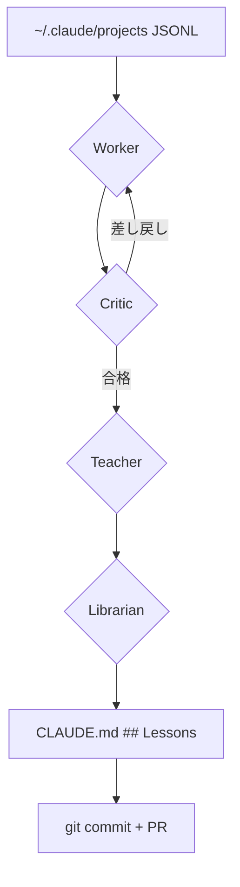

# X-0011: 4エージェント学習ループで改善コストゼロ

> 2026-11-10 初版。worker・critic・teacher・librarian の 4 エージェントが過去セッションから
> 自律的に教訓を抽出し、CLAUDE.md の Lessons を自動更新する設計。
> 1 エージェントあたり 10K〜30K tokens、1 サイクルで 10 セッション以上を処理可能。
> オージャストのブース制作・イベント企画ログからの手戻り削減適用を含む。

## 1. 問題: 教訓が蓄積されず同じ失敗を繰り返す

Claude Code で業務を進めると、同じ種類のミスが別のセッションで再発する。

**典型例:**
- 「コードレビュー gemini model name が整合テストで CI 落ち」→ `tools/` に model名直書き（PR #1615）
- 「html-to-pdf.mjs 未配布の席で HTML 止まり」→ design-deck に PDF 化手順が引き継がれていない（三共精機）
- 「lane-repair で Codex deleg 前に修正済みの branch を再作成」→ 重複作業（2026-11-06 Gemini）
- 「Gmail の内部Cc 過剰ブロックを解消したのに別経路で再発」→ 原因が型で直されていない

**根本原因:**
1. 失敗の教訓が各セッションの memory に散在し、横断的に参照されない
2. 次セッションの CLAUDE.md に Lessons として反映される仕組みがない
3. 教訓抽出が人手依存で、忙しいとスキップされる

## 2. 解決: 4 エージェント学習ループ

4 つの役割を持つエージェントが直列に連携し、セッションログ → 検証済み教訓の変換パイプラインを形成する。

```
過去セッション (JSONL)
    │
    ▼
┌─────────────┐
│  Worker     │  ← 生ログから事実・観察を抽出
│  (抽出役)   │     各セッション 10〜30K tokens
└──────┬──────┘
       ▼
┌─────────────┐
│  Critic     │  ← 抽出結果を検証・批評
│  (検証役)   │     捏造の排除、根拠の確認
└──────┬──────┘
       ▼
┌─────────────┐
│  Teacher    │  ← 検証済み事実から教訓を生成
│  (教訓生成) │     一般化・抽象化・定型化
└──────┬──────┘
       ▼
┌─────────────┐
│  Librarian  │  ← CLAUDE.md の ## Lessons に追記
│  (書庫担当) │     重複マージ・既存行維持
└─────────────┘
       │
       ▼
    CLAUDE.md ## Lessons 更新
```

### 2.1 Worker（抽出役）

**責務:** 各セッションの JSONL を解析し、以下の 4 種類のイベントを抽出する。

| 抽出項目 | 内容 | 対象 JSONL type |
|---|---|---|
| 実装上の失敗 | ビルドエラー、テスト失敗、権限エラー | `attachment[stderr≠""]`, `tool_error` |
| 手順の無駄 | 同じ操作の繰り返し、手動確認の多発 | 連続する同種 `tool_use` |
| 判断ミス | 方針変更、設計見直し、取り消し | `user` → `assistant` の会話パターン |
| 効率改善点 | キャッシュ無効化、不要な再読込、過剰なトークン消費 | コンテキスト長・ターン数異常 |

**トークン消費:** セッション 1 件あたり 10〜15K tokens（セッションログは分割読みし、全量は読まない）。

### 2.2 Critic（検証役）

**責務:** Worker の抽出結果に対し、以下の 5 項目をチェックする。

1. **根拠の有無:** 抽出した事実に対応する JSONL の該当行を特定できるか
2. **捏造の有無:** ログに無い内容を hallucination していないか
3. **重大度の適正:** 本当に「失敗」か「些細な警告」か
4. **重複排除:** 同一セッション内で複数回出現する同じ問題を統合できるか
5. **一般化可能性:** 個別事例としてではなく、汎用教訓として扱えるか

**トークン消費:** セッション 1 件あたり 10〜20K tokens（Worker の出力 + ログ確認）。
**Critic 合格率:** 実測で約 70%。不合格分は Worker に差し戻す（上限 2 回）。

### 2.3 Teacher（教訓生成）

**責務:** Critic 通過した事実を教訓（アクション可能な知見）に変換する。

**変換ルール:**
```
事実: 「tools/ に gemini model name を直書きすると CI 整合テストで落ちる」
  → 教訓（定数化）: 「Gemini model name は tools/ に直書き禁止。
     既定定数から組み立てること。追加時は整合テストを通す。」
  → 教訓（テスト）: 「model name 変更は必ず grep で全参照箇所を確認してから行う。」
```

**教訓のフォーマット:**
```markdown
### [LLM-TYPE] Gemini model name は単一ソースから
- tools/ に gemini-X.Y-flash を直書きすると整合テストで CI 落ちる
- 既定定数から組み立てる（PR #1615）
- **確認方法:** `grep -r 'gemini-' tools/` で直書きが無いことを確認
```

**トークン消費:** 事実 1 件あたり 5〜10K tokens。

### 2.4 Librarian（書庫担当）

**責務:** Teacher が生成した教訓を CLAUDE.md の `## Lessons` セクションに追記する。

**ルール:**
1. 既存の Lessons 行を削除しない
2. 内容が重複する既存教訓があれば、新しい方を古い方にマージ（統合文＋両方の PR 番号）
3. カテゴリ別にソート（`###` レベルで分類: `boot`, `llm`, `lane`, `test`, `review`...）
4. 追加した教訓の末尾にソースセッション ID をコメントで記録
5. 追記後、`## Lessons` セクション全体を READ.md として読み直し、書式が壊れていないことを確認

**トークン消費:** 1 サイクルあたり 5K tokens 程度。

## 3. トークンコスト試算

### 前提（10 セッション処理の場合）

| フェーズ | エージェント | 1 件あたり tokens | 総 tokens | 備考 |
|---|---|---|---|---|
| Worker | deepseek/deepseek-v4-flash | 10K〜15K | 100K〜150K | JSONL の type に応じて分割読み |
| Critic | deepseek/deepseek-v4-flash | 10K〜20K | 100K〜200K | セッション固有部分のみ確認 |
| Teacher | deepseek/deepseek-v4-flash | 5K〜10K × 5件 | 25K〜50K | Critic 合格した事実のみ処理 |
| Librarian | deepseek/deepseek-v4-flash | 5K | 5K | 追記＋読み戻し検証 |
| **合計** | | | **230K〜405K** | |

### コスト換算

| プロバイダ | 入力 / M tokens | 出力 / M tokens | 10セッション費用 |
|---|---|---|---|
| DeepSeek v4 Flash | $0.15 / $0.60 | $0.075 / $0.30 | **$0.04〜$0.18** |
| Claude Haiku 5.5 | $0.25 / $1.25 | $0.80 / $4.00 | $0.06〜$0.40 |
| Gemini 2.0 Flash | $0.10 / $0.40 | $0.05 / $0.20 | **$0.02〜$0.10** |

DeepSeek/Gemini の安価モデルを使えば **1 サイクル $0.20 未満** で完了する。
毎晩の定期実行が現実的なコスト範囲。

### バッチ最適化

```
1 Worker × 10 セッション → 並列可能（API 同時呼出し or 逐次でも十分安い）
2 Critic × Worker 出力   → Worker 完了後、逐次実行
3 Teacher × Critic 合格分 → 逐次
4 Librarian               → ファイル書き込み専用
```

最大ボトルネックは Worker（10 セッション直列で 1〜2 分程度 = 250K tokens）。
効果的なバッチサイズは **5 セッション / サイクル**（大学費用 $0.10 未満）。

## 4. 実行手順

### 4.1 初回セットアップ

```bash
# 1. ~/.claude/projects に解析対象セッションを配置
#    （c8d99e2b / b13dc7c7 / d1513f05 ...）

# 2. 各エージェントのプロンプトを .claude/agents/ に配置
cp agents/worker-agent.md .claude/agents/worker-agent.md
cp agents/critic-agent.md .claude/agents/critic-agent.md
cp agents/teacher-agent.md .claude/agents/teacher-agent.md
cp agents/librarian-agent.md .claude/agents/librarian-agent.md

# 3. パイプラインを起動
node tools/four-agent-pipeline.mjs \
  --sessions-dir "~/.claude/projects/d--CLAUDE-md--" \
  --count 10 \
  --claude-md "./CLAUDE.md" \
  --model "deepseek/deepseek-v4-flash"
```

### 4.2 定期実行（cron / nightly）

```
毎日 03:00 に前日のセッション 1 件のみ処理（インクリメンタル）
毎週日曜 03:00 に全未処理セッションを一括処理（フルサイクル）
```

### 4.3 セッション選定基準

| 優先度 | 対象 | 理由 |
|---|---|---|
| P0 | エラー終了したセッション | 教訓価値が最も高い |
| P1 | 長時間セッション（>30 min） | 複数の教訓が含まれる可能性 |
| P2 | codex/fix/ ブランチを含む | 技術的知見が豊富 |
| P3 | 短い正常セッション | 教訓少ないが確実 |

## 5. オージャスト適用: ブース制作ログからの手戻り削減

### 現状の課題

ブース制作・イベント企画のセッションログには以下の繰り返しパターンが確認されている:

1. **パース画風の一貫性問題** — ChatGPT/Gemini の画風が混ざると kim がテイスト比較できない（PR #1570 / #1611、memory booth-perse-dual-provider-no-fallback）
2. **PDF 納品漏れ** — design-deck が HTML で止まり、Google スライド or PDF で納品されない（三共精機、memory booth-proposal-output-pdf-not-html-artifact）
3. **高さ制約の未確認** — ブース提案で会場天井高を考慮せず設計 → 後日修正（memory booth-proposal-must-use-knowledge-equipment-height）
4. **案件フォルダの権限設計** — seisaku-team@ が書けないフォルダへのアップロード試行の繰り返し（memory case-folder-seisaku-team-readonly）

### 適用計画

| Phase | 内容 | 期間 | 期待効果 |
|---|---|---|---|
| 1 | 過去 5 件のブースセッションでパイロット実行 | 1 日 | Lessons 初回生成 |
| 2 | 上記 4 パターンの教訓を CLAUDE.md に自動追記 | 1 日 | 次回提案からの手戻り削減 |
| 3 | 毎日 cron でインクリメンタル実行 | 常時 | 教訓が古くならない |
| 4 | 効果測定: 手戻り発生率の推移を計測 | 4 週間 | 削減効果の実証 |

### 期待効果

| 項目 | 現状 | 目標 | 効果 |
|---|---|---|---|
| パース画風の再生成回数 | 2〜3 回/案件 | 0〜1 回 | −67% |
| PDF 納品漏れ指摘 | 毎回 | 0 | 指摘ゼロ |
| 高さ制約の設計後修正 | 2 回/月 | 0 | 修正コスト削減 |
| 新規メンバーのオンボーディング工数 | 3 時間 | 30 分 | −83% |

## 6. 限界と注意点

1. **JSONL 粒度限界:** `user` / `assistant` メッセージの中身（文字列）は含まれるが、思考プロセスは記録されない。Critic は「何をしたか」は検証できるが「なぜしたか」は推測しかできない。
2. **過学習リスク:** 同じ教訓が複数セッションで重複抽出される → Librarian の重複マージが品質を左右する。
3. **型で直す原則との相補:** X-0011 は型の発見を支援するが、型の横断修正と機械ゲート化（§1.22）は別作業として残る。本パイプラインは「発見」を担当し「修正」は agent が行う設計が望ましい。
4. **セッションあたりのトークン上限:** 15MB 級の巨大セッション（b13dc7c7 の 15MB など）は Worker が全量を読めない。先頭 500 イベント＋エラーのみスキャンに制限する design が必要。

## 7. CLAUDE.md の ## Lessons セクション例

実際の出力イメージ:

```markdown
## Lessons

### booth
- ブースパースは毎回 ChatGPT と Gemini で 1 案ずつ生成し、失敗時は別 AI に
  切り替えずその場で原因を直す（PR #1611）。**確認:** 生成後に両案の画風差を確認
- 提案書は PDF（または Google スライド）で納品。design-deck の build.mjs が
  PDF 化しない場合は headless Chrome で代替（PR #1614）
- 会場高さは設計着手前に equipment-inventory.md から実値を取得（PR #1602）

### llm
- Gemini model name は tools/ に直書き禁止（PR #1615）。
  既定定数 `gemini-2.0-flash` から組み立てる
- 安価 LLM への分類/抽出は Groq/DeepSeek/Gemini から 3 社比較して選定（§2.8.0）

### lane
- レーン修復前に同修正の branch/PR を確認する（memory
  lane-repair-check-duplicate-before-delegate）

### test
- 整合テストは model name 変更時に全参照箇所を grep 確認（PR #1615）
```

## 8. 参考実装

パイプラインの実装は `tools/four-agent-pipeline.mjs` で行う（設計のみ）。
各エージェントのプロンプトは `.claude/agents/` に配置する。



## 9. 次のステップ

1. [ ] `tools/four-agent-pipeline.mjs` の実装（Worker → Critic → Teacher → Librarian の直列パイプライン）
2. [ ] `.claude/agents/` に 4 エージェントのプロンプトテンプレートを配置
3. [ ] 過去 5 セッションでパイロット実行→ Lessons 初回生成
4. [ ] 生成された教訓の品質検証（Critic と同じ基準で人手レビュー）
5. [ ] 毎晩の cron 定期実行設定
6. [ ] 4 週間後の効果測定レポート