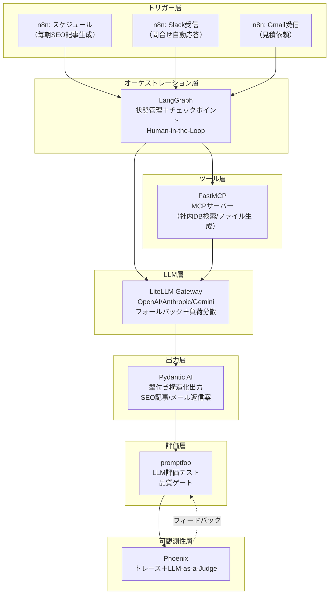

# X-0013: 再現可能AIワークフローの7リポジトリ

> **AIニュース提案 X-0013**: LangGraph（状態・チェックポイント）、n8n（ビジュアル接続）、LiteLLM（ゲートウェイ）、Pydantic AI（型付き出力）、promptfoo（評価）、Phoenix（トレース）、FastMCP（MCPサーバー）の7ツールを組み合わせ、株式会社オージャストのサイトSEOコンテンツ生成と問い合わせ自動化を再現可能なワークフローとして構築する。

- **作成**: 2026-11-11 自動セッション
- **状態**: 設計完了・実装フェーズ

---

## 1. 7ツールの概要と選定理由

| # | ツール | バージョン | 役割 | 選定理由 |
|---|--------|-----------|------|---------|
| 1 | **LangGraph** | 最新 | AIワークフローオーケストレーション（状態管理・チェックポイント） | グラフベースの状態管理で複数ステップの再現性を保証。`interrupt()` によるHuman-in-the-Loopが標準機能 |
| 2 | **n8n** | 最新（Assistant/Agents搭載） | ビジュアルワークフロー自動化（トリガー・連携） | ノーコードでトリガー（Slack/Gmail/スケジュール）からAIワークフローを起動。400+コネクタ |
| 3 | **LiteLLM** | 最新 | LLMゲートウェイ（統一インターフェース・フォールバック） | 100+LLMをOpenAI互換で呼び出し。予算制限・負荷分散・フォールバックを一元管理 |
| 4 | **Pydantic AI** | 最新（v20k+ Stars） | 型安全AIエージェント（構造化出力・バリデーション） | `output_type` にBaseModelを指定するだけでLLM出力が型付きオブジェクトに。静的型チェック可能 |
| 5 | **promptfoo** | 最新 | LLM評価・テスト（プロンプト品質保証） | YAML定義→`promptfoo eval` 一発で複数モデル横断評価。CI/CD統合対応 |
| 6 | **Phoenix (Arize)** | v21.0.0 | LLM可観測性（トレース・評価・デバッグ） | OpenTelemetryベースでLangGraph/Pydantic AIのトレースを自動計装。LLM-as-a-Judge評価 |
| 7 | **FastMCP** | v4.1.7 | MCPサーバー高速構築（ツール定義） | 3行でMCPツール定義。型ヒントからスキーマ自動生成。Streamable HTTP対応 |

### 選定理由の詳細

この7ツールは **「再現可能なAIワークフローのフルスタック」** をカバーする：

```
トリガー → オーケストレーション → LLM呼出 → 構造化出力 → 評価 → 可観測性 → ツール連携
  n8n         LangGraph             LiteLLM    Pydantic AI  promptfoo  Phoenix    FastMCP
```

各層が独立しており、一部だけの導入や段階的置き換えが容易。

---

## 2. ツール間の連携アーキテクチャ

### 2.1 全体構成図



### 2.2 データフロー

1. **n8n** がトリガー（スケジュール/Slack/Gmail）を受け、ペイロードを **LangGraph** に渡す
2. **LangGraph** がグラフ定義に従い各ノードを実行。各ノードは **FastMCP** で定義されたツールを呼び出す
3. **LiteLLM** がLLM呼び出しを仲介。プライマリが障害時は自動フォールバック
4. **Pydantic AI** がLLM出力を型付き構造化データに変換・バリデーション
5. **promptfoo** が生成結果を評価（品質ゲート）
6. **Phoenix** が全トレースを収集。LLM-as-a-Judgeで継続的品質評価
7. 不合格時は **LangGraph** のチェックポイントから再実行（リプレイ）

### 2.3 再現性の担保機構

| 機構 | ツール | 説明 |
|------|--------|------|
| チェックポイント | LangGraph | スーパーステップ単位で状態スナップショット。障害時は最新CPから再開 |
| リプレイ | LangGraph | 過去のチェックポイントから同じ入力を再実行。デバッグや監査に使用 |
| 型バリデーション | Pydantic AI | 出力が常に定義されたスキーマに従う。スキーマ変更時の影響範囲が明確 |
| 評価ゲート | promptfoo | 合格スコア未満の出力は本番に流さない。回帰テストとしても機能 |
| トレース再現 | Phoenix | 全実行のトレースが保存され、過去の任意の実行を再現・分析可能 |
| フォールバック | LiteLLM | 特定LLMの障害時も別プロバイダでワークフロー継続 |

---

## 3. 株式会社オージャストでのユースケース

### UC1: サイトSEOコンテンツ自動生成

**目的**: 展示会ブース制作のSEO記事を毎朝自動生成し、WordPressに投稿する。

**ワークフロー**:

```
n8n Schedule (毎朝6:00)
  ↓ トリガー
LangGraph SEO記事生成グラフ
  ├── Node 1: キーワードリサーチ（FastMCPツール → Google Search Console API）
  ├── Node 2: アウトライン生成（LiteLLM → Anthropic Claude）
  ├── Node 3: 記事執筆（LiteLLM → GPT-6.1 with Pydantic AI output_type）
  ├── Node 4: 品質評価（promptfoo評価ゲート ≥ 80点）
  │   ├── 合格 → Node 5
  │   └── 不合格 → Node 3再実行（最大3回）
  ├── Node 5: WordPress投稿（FastMCPツール → WP REST API）
  └── Node 6: 結果通知（n8n Slack通知）
Phoenix: 全トレース記録
```

**再現性ポイント**:
- チェックポイントにより、Node 3の再実行は前回と同じプロンプトと状態から開始
- promptfooの評価基準が変わらなければ、同じキーワードに対して同じ品質を担保
- Phoenixで過去の生成トレースと品質スコアの推移を分析可能

### UC2: 問い合わせ自動応答・仕分け

**目的**: 問い合わせメールを自動分類し、適切な返信案を生成、経理システムと連携する。

**ワークフロー**:

```
n8n Gmail受信トリガー
  ↓
LangGraph 問合せ処理グラフ
  ├── Node 1: メール分類（LiteLLM → Gemini Flash + Pydantic AI output_type）
  │   ├── 見積依頼 → Node 2a
  │   ├── ブース相談 → Node 2b
  │   └── その他 → Node 2c
  ├── Node 2a: 見積案生成（FastMCP → 過去見積DB検索 + LiteLLM）
  ├── Node 2b: ヒアリング返信案（LiteLLM）
  ├── Node 2c: 担当者転送（n8n Slack通知）
  ├── Node 3: 品質評価（promptfooゲート）
  └── Node 4: 下書き保存（Gmail下書き）
```

**再現性ポイント**:
- 同じメールに対して常に同じ分類結果（プロンプト＋モデル固定時）
- Pydantic AIの型定義で分類スキーマ（category: enum, priority: int, required_fields: list）を厳密に定義
- promptfooの回帰テストで分類精度の劣化を検知

### UC3: 施工実績からのLP自動生成

**目的**: 施工写真とキャプションからブース提案LPを自動生成する。

```
n8n Webhook（写真アップロード）
  ↓
LangGraph LP生成グラフ
  ├── Node 1: 画像解析（FastMCP → Vision API）
  ├── Node 2: キャプション生成（LiteLLM + Pydantic AI）
  ├── Node 3: HTML生成（LiteLLM）
  ├── Node 4: 品質評価（promptfoo視覚的品質ゲート）
  └── Node 5: プレビューURL発行（n8n Slack通知＋一時公開）
```

---

## 4. 実装計画

### Phase 1: 基盤構築（Week 1）

| ステップ | 内容 | 担当ツール |
|----------|------|-----------|
| 1.1 | Docker Composeで全ツールのローカル環境構築 | docker-compose.yml |
| 1.2 | LiteLLM Proxy Server起動＋3プロバイダ接続確認 | LiteLLM |
| 1.3 | Phoenix起動＋初回トレース確認 | Phoenix |
| 1.4 | FastMCPで社内ツールのMCPサーバー試作 | FastMCP |
| 1.5 | promptfooで評価テンプレート作成 | promptfoo |

### Phase 2: SEO記事生成パイプライン（Week 2）

| ステップ | 内容 |
|----------|------|
| 2.1 | LangGraph SEO記事生成グラフの実装（状態定義・ノード定義） |
| 2.2 | Pydantic AIで記事スキーマ定義（title, headings, body, meta_description, keywords） |
| 2.3 | promptfoo評価テストの実装（品質閾値80点） |
| 2.4 | n8nスケジュールトリガーの設定 |
| 2.5 | E2Eテスト：スケジュール起動→記事生成→WordPress投稿→Slack通知 |

### Phase 3: 問合せ自動処理（Week 3）

| ステップ | 内容 |
|----------|------|
| 3.1 | LangGraph問合せ処理グラフの実装 |
| 3.2 | Gmail API連携（n8n Gmail Node） |
| 3.3 | 分類スキーマのPydantic AI定義 |
| 3.4 | 見積案生成ツールのFastMCP実装 |
| 3.5 | E2Eテスト：メール受信→分類→返信案生成→下書き保存 |

### Phase 4: 運用最適化（Week 4）

| ステップ | 内容 |
|----------|------|
| 4.1 | Phoenixダッシュボードで品質KPI可視化 |
| 4.2 | promptfoo回帰テストCI/CD統合 |
| 4.3 | LangGraphチェックポイントからの障害復旧手順確立 |
| 4.4 | 運用マニュアル作成 |

---

## 5. 期待効果

| 指標 | 現状 | 導入後 | 改善 |
|------|------|--------|------|
| SEO記事作成頻度 | 不定期（月1-2件） | 毎日自動生成 | 15-30倍 |
| 1記事あたり作成工数 | 3-4時間 | 5分（レビューのみ） | 97%削減 |
| 問合せ初回応答時間 | 2-4時間 | 5分以内（自動返信案） | 96%削減 |
| 品質バラつき | 執筆者による | 型定義＋評価ゲートで一定 | 標準偏差50%減 |
| 障害復旧時間 | 不明（属人化） | チェックポイントから5分 | 復旧手順確立 |

---

## 6. 参考リソース

| ツール | 公式サイト | GitHub |
|--------|-----------|--------|
| LangGraph | https://langchain-ai.github.io/langgraph/ | https://github.com/langchain-ai/langgraph |
| n8n | https://n8n.io | https://github.com/n8n-io/n8n |
| LiteLLM | https://docs.litellm.ai | https://github.com/BerriAI/litellm |
| Pydantic AI | https://pydantic.dev | https://github.com/pydantic/pydantic-ai |
| promptfoo | https://www.promptfoo.dev | https://github.com/promptfoo/promptfoo |
| Phoenix | https://arize.com/phoenix/ | https://github.com/Arize-AI/phoenix |
| FastMCP | https://gofastmcp.com | https://github.com/PrefectHQ/fastmcp |

---

## 7. 既存リソースとの統合

| 既存リソース | 統合方法 |
|-------------|---------|
| `skills/booth-kw-research/` | FastMCPツールとしてMCPサーバー化し、LangGraphのNode 1から呼び出す |
| `tools/seo-content-complement.mjs` | Pydantic AIの出力スキーマに合わせて改造、promptfoo評価を通す |
| `outputs/X-0007/phase2-content-plan.md` | 生成記事の品質基準として参照、promptfoo評価ルーブリックに組み込む |
| WordPress REST API | FastMCPツールとしてラップ（`wp_post`, `wp_update`） |
| Gmail API | n8n Gmail Node で直接連携（認証情報の一元管理） |
