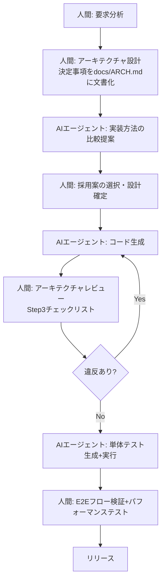

# X-0019 AIエージェントコーディングで人間がアーキテクチャを所有する4ステップ

> **元記事**: [How to own the architecture when AI agents write the code](https://stackoverflow.blog/2026/10/23/how-to-own-the-architecture-when-ai-agents-write-the-code/) (Stack Overflow Blog, 2026-10-23)
> **作成日**: 2026-11-12
> **対象**: 株式会社オージャスト（orgiast.jp）

## 概要

AIエージェント（Claude Code、Codex、Cursor、GitHub Copilot等）がコード生成の主流になりつつある現在、最大の落とし穴は**AIエージェントをアーキテクチャ決定のシニアエンジニアとして扱うこと**。エージェントは局所的なコード生成に優れるが、システム全体の構造・トレードオフ・将来の変更可能性を考慮した設計判断はできない。本提案では人間がアーキテクチャを所有し続けるための4ステップを定義し、オージャストの展示会ブース関連ウェブサイト開発に適用する。

## 4ステップ

### Step 1: コーディング前にアーキテクチャを決定する

**原則**: AIエージェントにコードを書かせる前に、人間が以下を文書化する。

| 決定項目 | 具体的内容 |
|----------|-----------|
| **アーキテクチャパターン** | SPA/SSR/SSG、マイクロサービス/モノリス、コンポーネント設計 |
| **ストレージ設計** | DB種類・スキーマ・キャッシュ戦略・ファイル保存先 |
| **データフロー** | APIの入出力・バケツリレー防止・状態管理の方針 |
| **システム境界** | フロントエンド/バックエンド/外部APIの責務分離・エラー境界 |

**よくある失敗**: 「とりあえずAIに書かせて後で直す」→ アーキテクチャの一貫性が失われ、後戻り工数が増大する。

### Step 2: エージェントに探索させるが決定させない

**原則**: AIエージェントに以下の役割を割り当て、最終判断は人間が行う。

| エージェントの役割 | 人間の役割 |
|-------------------|-----------|
| アプローチ比較（A案/B案/C案） | 採用する案の選択 |
| トレードオフの特定 | ビジネス要件との優先順位付け |
| 代替案の提案 | 技術的負債の許容範囲の決定 |
| 既存コードの分析・影響範囲調査 | 方針転換の判断 |

**実践テクニック**: エージェントに「3つの実装方法を比較し、それぞれのメリット・デメリット・推定工数を表にまとめてください」と指示する。人間はその表をレビューして1つ選ぶ。

### Step 3: コードだけでなくデザインをレビューする

**原則**: 単体テストが全て通過していても、アーキテクチャ違反の可能性がある。以下の観点でレビューする。

- **責務の分離**: コンポーネントが想定より多くの責務を持っていないか
- **データフローの整合性**: 設計書と実際のデータの流れが一致しているか
- **依存関係**: 逆依存（上位層が下位層に依存すべきが逆転していないか）
- **抽象化レベル**: 適切な抽象化がなされているか、または過剰な抽象化になっていないか

**チェックリスト**: コードレビューに以下の項目を追加する。
- [ ] 設計書のコンポーネント図と実際のファイル構成が一致しているか
- [ ] データの流れが設計通りの方向（例: ユーザー入力→バリデーション→API→DB）になっているか
- [ ] 外部依存が設計で許容した範囲内か
- [ ] エラーハンドリングがシステム境界で適切に実装されているか

### Step 4: システム全体を検証する

**原則**: 単体テストだけでなく、実際のユーザーフロー・性能・信頼性・クロスブラウザ・地域横断の挙動をテストする。

| テスト種別 | 検証内容 | AIエージェント任せにできない理由 |
|-----------|---------|-------------------------------|
| **E2Eユーザーフロー** | 登録→予約→確認→キャンセルの一連の流れ | エージェントは個々の機能テストに集中し、またぎの状態整合性を検証しない |
| **パフォーマンス** | 同時アクセス時のレスポンス・DB負荷 | エージェントはN=1の動作確認しかしない |
| **信頼性** | ネットワーク切断・DB障害時の挙動 | エラーケースの組み合わせ爆発を網羅できない |
| **クロスブラウザ/デバイス** | スマホ/タブレット/PCでの表示崩れ | エージェントはヘッドレスブラウザ1種類のみでテストすることが多い |
| **セキュリティ** | XSS・CSRF・認証バイパス | 生成AIに共通する「安全そうに見えて実は脆弱」なコードパターン |

## オージャストでの適用計画

### 適用対象

1. **展示会ブース関連ウェブサイト**（イベントランディングページ、ブース予約システム）
2. **イベント予約管理システム**（来場予約・資料請求・アンケート）
3. **社内向け業務アプリ**（経理ハブの新機能追加）

### 開発フロー（AIエージェント活用版）

### 具体的な実践手順

#### Phase 0: 設計ドキュメントテンプレートの整備（1日）

- `docs/ARCH.md` テンプレートの作成（アーキテクチャ決定事項を記録するフォーマット）
- Step3用コードレビューチェックリストの `.claude/rules/` への追加
- E2Eテストフレームワークの選定（Playwright / Cypress）

#### Phase 1: 小規模プロジェクトでの試行（3日）

1. 既存の小規模ウェブサイトのリニューアルで本フローを試す
2. 設計書 → AIエージェント実装 → レビュー → 検証のサイクルを計測
3. 時間と品質のベースラインを記録

#### Phase 2: 本格適用とツール化（1週間）

1. 展示会用ランディングページ生成パイプラインに本フローを組み込む
2. アーキテクチャ違反の自動検出ツール（静的解析ルール）の整備
3. 人間のレビュー負荷を減らすチェック自動化

#### Phase 3: 組織への展開

1. 全開発案件での本フロー適用の標準化
2. AIエージェント活用時のアーキテクチャレビューをQAゲートに組み込み
3. ナレッジベースへのフィードバック（よくある違反パターンの蓄積）

### 期待効果

| 指標 | 現状（推定） | 目標 |
|------|------------|------|
| アーキテクチャ違反による手戻り | 発生时有り | 0（設計時点で防止） |
| AI生成コードの採用率 | 部分的な利用 | 設計範囲内で80%以上 |
| E2E不具合の本番検出 | 时有り | 0（全フロー検証で事前発見） |
| 新規開発のリードタイム | 現行 | 20〜30%短縮 |

## 参考資料

- [How to own the architecture when AI agents write the code](https://stackoverflow.blog/2026/10/23/how-to-own-the-architecture-when-ai-agents-write-the-code/)（原典）
- [X-0025: プロンプトキャッシュと安価ルーティングで90%削減](X-0025の該当ファイル) — 実装コスト最適化と組み合わせて効果倍増
- [X-0023: サブエージェント小型モデル委譲](X-0023の該当ファイル) — 本フローのStep2・Step3のエージェント委譲に小型モデルを活用
