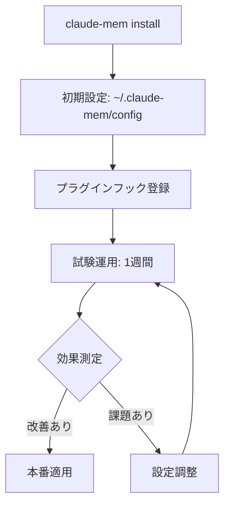

# X-0021: Claude Code強化用GitHubリポジトリの活用

> AIニュース提案 2026-11-11
> 対象: skills (Vercel Labs)、ECC、andrej-karpathy-skills、claude-mem

## 概要

Claude Codeの能力を拡張する4つのオープンソースリポジトリを評価し、株式会社オージャストのサイト開発・イベントページ制作ワークフローへの導入計画を策定する。

## 1. 各リポジトリの評価

### 1.1 claude-mem（優先: ★★★ 最優先）

| 項目 | 内容 |
|------|------|
| リポジトリ | thedotmack/claude-mem |
| スター | ~115k |
| ライセンス | Apache 2.0 |
| 用途 | セッション間の永続的コンテキスト保持 |

**機能**:
- セカンダリエージェントがセッション中のツール呼出（Read/Edit/Write）を監視・観察
- セッション終了時に観察結果をSQLite（`~/.claude-mem/claude-mem.db`）に保存
- 次セッション開始時に過去の関連コンテキストを注入
- MCP検索ツール（index → timeline → details の3段階検索）でトークン効率約10倍
- チーム共有（TeamBrain）オプション対応
- スクリーンショット対応、秘密情報保護（`<!-- secret -->` タグ）
- **対応エージェント**: Claude Code, Codex, Cursor, OpenCode, Gemini, 他11+

**インストール**:
```bash
npx claude-mem install
# または
/plugin install claude-mem
```

**必要条件**: Node.js 20.19+ / 22.12+, SQLite 3

### 1.2 skills / Vercel Labs（優先: ★★★ 最優先）

| 項目 | 内容 |
|------|------|
| リポジトリ | vercel-labs/skills + vercel-labs/agent-skills |
| ライセンス | MIT |
| 用途 | 再利用可能なAIエージェントスキルのインストールCLI |

**機能**:
- `npx skills add <repo>` でスキルをインストール
- 75+エージェント対応（Claude Code, Codex, Cursor等）
- SKILL.md 形式のYAML frontmatter + Markdown指示書
- トリガーワードによる自動発動
- プロジェクト単位/グローバルインストール可能

**導入メリット**:
- オージャストのブース企画・施工手順書生成・イベントサイト制作をスキル化
- `npx skills add orgiast/booth-skills` で全PCに配布
- 既存の `~/.claude/skills/` と互換性あり（SKILL.md形式に統一）

### 1.3 ECC - Everything Claude Code（優先: ★★☆ 推奨）

| 項目 | 内容 |
|------|------|
| リポジトリ | affaan-m/ECC |
| スター | 高評価 |
| ライセンス | MIT |
| 用途 | 統合Claude Code設定・スキル・フック・MCP管理 |

**機能**:
- 単一設定ソースから全AIコーディングツールを設定
- TDDワークフロー、セキュリティレビュー、コーディング標準などのスキル
- MCPサーバー管理（Supabase, Playwright, Memory, Sequential Thinking等）
- マルチエージェントロール定義（explorer, reviewer, docs-researcher）
- GitHub Marketplaceアプリ対応
- Codex CLI互換

**導入注意**: オージャストの既存設定（tools/, skills/, 各種フック）と競合する可能性あり。部分採用（MCP設定テンプレートやレビュースキル）が適切。

### 1.4 andrej-karpathy-skills（優先: ★★☆ 推奨）

| 項目 | 内容 |
|------|------|
| リポジトリ | multica-ai/andrej-karpathy-skills |
| スター | ~231k |
| ライセンス | MIT |
| 用途 | Claude Codeの振る舞い改善（4原則） |

**4原則**:
1. **Think Before Coding** — 前提を明示、トレードオフを提示、必要に応じて押し返す
2. **Simplicity First** — 最小コード、過剰設計・投機的抽象化を禁止
3. **Surgical Changes** — 必要な箇所のみ変更、隣接コードを「改善」しない
4. **Goal-Driven Execution** — 成功基準を定義し検証までループ

**導入**: `/plugin marketplace add forrestchang/andrej-karpathy-skills` または CLAUDE.md に追加。

**オージャスト既存ルールとの関係**: ONBOARDING.md §1.2「根本診断」・§1.13「トークン効率」・§1.22「事故は型で直す」と親和性が高い。新規に追加するより、既存ルールの補強として `claude-skills/` に配置するのが適切。

---

## 2. claude-mem 導入計画（最優先）

### 2.1 現状の課題

オージャストの現行システムは以下でセッション間のコンテキストを保持している:

- `~/.claude/next-session.md` — TODO継承
- `memory/` ディレクトリ + MEMORY.md索引 — 永続的知識
- `auto-session/runs/` — 実行ログ
- `case-sessions/` — 案件作業履歴

**課題**:
- セッション中の細かい気づき・試行錯誤が記録されにくい
- 次セッションの起動時に過去の全コンテキストを人手で引き継ぐ必要がある
- 同一案件の複数セッション間でコンテキストが断絶しがち

### 2.2 claude-mem による改善

claude-mem は自動観察エージェントが以下を行う:

1. **セッション中のツール呼び出しを監視**: Read/Edit/Write/Shell の各操作を記録
2. **観察結果を自動要約**: セッション終了時に「何をしたか」「何がわかったか」を自然言語で保存
3. **次セッションへの自動注入**: 過去の関連観察のみを選択的に注入（トークン効率約10倍）
4. **MCP検索ツール**: 必要な情報だけをSQLiteから検索

### 2.3 導入手順



**Step 1: インストール**
```bash
npx claude-mem install
# 確認
claude-mem --version
```

**Step 2: 基本設定**
```bash
# 設定ファイルの確認
cat ~/.claude-mem/config.json
# 必要に応じて:
# - 監視対象ツールの絞り込み
# - 保存対象の最大トークン数
# - チーム共有の有効化
```

**Step 3: 既存システムとの統合**
- claude-mem は `~/.claude-mem/claude-mem.db` にデータを保存（既存 `memory/` とは独立）
- 既存 `next-session.md` の役割を補完（代替ではなく併用）
- `memory/` への手動記録と claude-mem の自動観察を併用

### 2.4 リスクと対策

| リスク | 確率 | 影響 | 対策 |
|--------|------|------|------|
| トークン消費増加（監視エージェント分） | 中 | 中 | 監視対象ツールを制限、出力を最小化 |
| 既存メモリシステムとの競合 | 低 | 中 | 併用モードで試験運用、競合が起きたら claude-mem 優先 |
| プライバシー/秘密情報の漏洩 | 低 | 高 | `<!-- secret -->` タグ活用、監視対象パスの制限 |
| SQLite の肥大化 | 低 | 低 | 定期的なクリーンアップ設定 |

### 2.5 期待される効果

| 指標 | 現状 | 目標 |
|------|------|------|
| セッション立ち上げ時間 | 5-15分（手動引継ぎ） | 1-3分（自動コンテキスト注入） |
| 過去の知見の再利用率 | 低（記憶頼み） | 中〜高（自動観察からの検索） |
| 同一案件のセッション断絶 | 頻発 | 低減（自動引継ぎ） |
| 手���メモ記録の手間 | 大（毎回手動Write） | 小（自動観察＋必要時のみ手動） |

---

## 3. 導入優先順位

| 優先度 | リポジトリ | 着手 | 理由 |
|--------|-----------|------|------|
| P0 | claude-mem | 今週 | セッション間コンテキストの自動継承が最大の課題 |
| P1 | skills CLI | 今週 | 既存SKILL.mdとの統合、配布の標準化 |
| P2 | andrej-karpathy-skills | 来週 | 4原則をCLAUDE.mdに反映（低コスト） |
| P3 | ECC | 検討中 | 既存設定との競合リスク評価が必要 |

---

## 4. 次のアクション

- [ ] claude-mem のインストール（`npx claude-mem install`）
- [ ] claude-mem の初期設定と試験運用
- [ ] claude-mem と既存 memory/ システムの併用テスト
- [ ] skills CLI の導入評価（`npx skills add` のテスト）
- [ ] andrej-karpathy-skills 4原則の既存ルールへの反映検討
- [ ] ECC の部分採用（MCP設定テンプレートのみ抽出）
