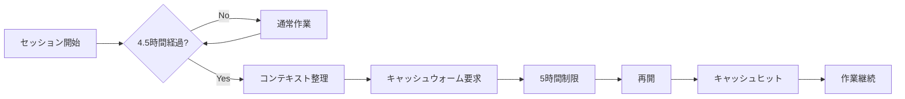
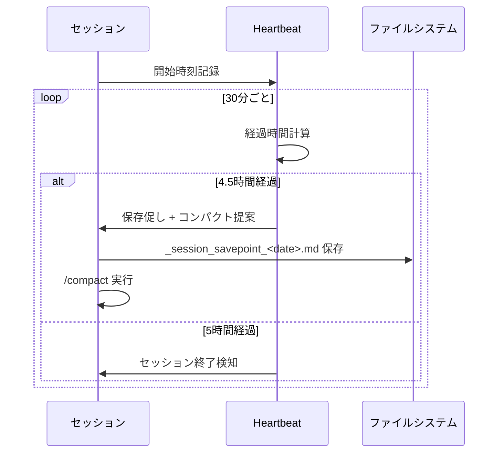

# X-0022: 5時間制限前コンテキスト整理でキャッシュ維持

**AIニュース提案 X-0022**: Claude Code の5時間セッション制限到達前にコンテキストを整理し、キャッシュを維持しながら中断・復旧する手法。制限後の再開は肥大化コンテキストのキャッシュ再構築でコスト増大する問題を、定期的なコンテキスト整理で回避する。オージャストのブースデザイン長時間生成セッションで試用する。

観測日: 2026-11-14

---

## 1. 課題

### 1.1 5時間セッション制限の実態

Claude Code（非Ultraアカウント）には最初のメッセージから5時間のセッション制限がある。

| 項目 | 値 |
|------|-----|
| 制限時間 | 5時間（初回メッセージから） |
| リセット条件 | 5時間経過後の自動リセット（待機モード時は継続可能） |
| 影響 | セッション中断 → コンテキスト破棄 → キャッシュ消失 |
| Ultraアカウント | 5時間制限なし |
| 自動再開 | 対話セッションでは待機後自動継続可能（v2.1.234以降） |

### 1.2 問題の構造

```
5時間経過前の状態:
  [巨大コンテキスト(200K+ tokens)] → キャッシュの大部分が有効
  
5時間経過後の再開:
  セッション再起動 → コンテキスト再送 → 全キャッシュミス（高コスト）
  肥大化した履歴を再度送信 → 入力トークン増大 × キャッシュ非効率
```

**現状の緩和策とその限界**:
- `/compact`: 手動要約だが、モデル依存の自動実行でタイミング制御不可
- `/clear`: 履歴全削除でキャッシュは再構築必要。過去の意思決定を失うリスク
- 自動圧縮: Claude Codeのauto-compactionはあるが、5時間制限を見越した事前整理は行わない

### 1.3 オージャストの具体的事例

ブースデザイン生成やイベント企画の長時間セッション:
- 1セッションあたり数百ターン、数万〜数十万トークン
- 過去のデザイン決定・顧客フィードバック・修正履歴が蓄積
- 5時間経過後の再開で全コンテキスト再送 → キャッシュ再構築コスト大
- ブースデザイン案件は集中して長時間行うことが多い

---

## 2. 提案手法

### 2.1 戦略：「定期コンテキスト整理 ＋ 再開時のキャッシュウォーム」

5時間制限を前提とし、**制限到達前に能動的にコンテキストを整理**し、**再開時にキャッシュが素早く戻る状態**にする。



### 2.2 3層の整理機構

#### Layer 1：定期的なコンパクト（30分〜1時間間隔）

`/compact` または同等の自動圧縮を定期的に実行する。X-0024の実測（COMPACT_RECACHE 8/8）ではコンパクト後に必ずキャッシュ再構築が発生するが、「区切りの良いところで1回」まとめて行う方が細かい分割より効率的。

**実践ルール**:
- ブースデザイン等の長時間セッションでは **1時間ごとに `/compact focus on [現在のトピック]`** を実行
- 会話の自然な区切り（1デザイン案完了、1ラウンドのフィードバック終了）で実行
- コンパクト後はシステムプロンプト＋固定仕様を1回通してから本題に入る（キャッシュウォーム）

#### Layer 2：5時間制限前の準備整理（制限30分前）

制限30分前になったら、作業中の状態をファイルに保存し、コンパクトを実行してから待機する。

**手順**:
1. 現在の進捗・未完了タスク・決定事項を `_session_savepoint_<date>.md` に保存
2. `/compact` で会話を要約
3. システムプロンプト＋固定部分のみの簡易リクエストを送信（キャッシュウォーム）
4. 制限が来たら自動再開を待つ

#### Layer 3：再開時のキャッシュウォーム

再開後、即座に作業に入らずキャッシュを温めてから本題に入る。

**手順**:
1. プロジェクトの固定システムプロンプト＋ツール定義を含むダミーリクエスト（`continue` 等）を送信
2. この1ターン目はキャッシュミスだが、システムプロンプトとツール定義がキャッシュに書き込まれる
3. 2ターン目以降のキャッシュヒット率が大幅に改善
4. 保存したセーブポイントを参照し、作業再開

### 2.3 コンパクトの生存要素

`/compact` 後も保持される要素（Claude Code仕様）:

| 要素 | 保持 | 備考 |
|------|------|------|
| System Prompt | ✅ | 完全保持 |
| CLAUDE.mdルール | ✅ | 完全保持 |
| 自動メモリ（auto-memory） | ✅ | 完全保持 |
| スキル定義 | ✅ | 完全保持 |
| git status | ✅ | 実行時の状態 |
| Plan Mode出力 | ✅ | 最新のplan |
| 最近変更したファイル（最大5） | ✅ | 保持 |
| 過去の会話詳細 | ❌ | 要約に置換 |
| ツール実行結果 | ❌ | 要約に置換 |
| 中間思考 | ❌ | 要約に置換 |

### 2.4 ツール定義: `tools/session-heartbeat.mjs`

セッション経過時間を監視し、設定された閾値でアクションを促すツール（または定時実行ジョブ）。



---

## 3. 検証計画

### 3.1 前提: このPC（HP）での制約

- デスクトップ版Claude Codeは **billion-context(bili)** が導入済み（5万トークン超で自動圧縮）
- 圧縮拡張（bili）とClaude Code標準のauto-compactionの相互作用を確認する
- 5時間制限の実測は長時間セッションが必要 → 実際のブースデザイン作業と併せて検証

### 3.2 検証項目

| # | 検証項目 | 方法 | 合格基準 |
|---|---------|------|---------|
| 1 | コンパクト後のキャッシュ回復速度 | コンパクト前後の `usage.cache_read_input_tokens` 比較 | 5ターン以内にコンパクト前の70%以上のヒット率 |
| 2 | 再開後の再ウォーム効率 | 再開後の最初の10ターンのヒット率推移 | 3ターン目以降で90%以上のヒット率 |
| 3 | セーブポイントの復元精度 | 保存した決定事項が再開後も参照可能か | 保持率100%（要約の影響を受けない） |
| 4 | コスト削減効果 | 整理あり/なしの総入力トークン比較 | 整理ありが20%以上少ない |

### 3.3 関連実装との関係

| 関連実装 | 関係 | 競合/補完 |
|---------|------|----------|
| X-0019 session-fold.mjs | 履歴の折りたたみ・展開 | 補完: foldで保存した詳細をX-0022の再開時に利用可 |
| X-0024 cache-warm-audit.mjs | キャッシュ漏れ監査 | 補完: ヒット率測定をX-0022の効果検証に利用 |
| X-0035 prompt-caching | キャッシュ基本設計 | 上位概念: X-0022はキャッシュ維持の運用面を担当 |
| bili compression | 自動圧縮拡張 | 補完: bili導入済みなら標準のauto-compactionとの併用注意 |

---

## 4. 実装

### 4.1 セッション経過時間監視ツール

`tools/session-heartbeat.mjs` — セッションの開始時刻を記録し、経過時間に応じたアクションを促す。

**インターフェース**:

```bash
# セッション開始（DESKTOPのみ実行時）
node tools/session-heartbeat.mjs start

# 現在の経過時間確認
node tools/session-heartbeat.mjs status

# セーブポイント作成
node tools/session-heartbeat.mjs savepoint --note "現在の進捗"
```

**出力例**:

```
$ node tools/session-heartbeat.mjs status
セッション経過: 3時間15分
残り時間: 1時間45分
次回アクション目安: 30分後にコンパクト推奨
状態: 正常
```

### 4.2 セーブポイントフォーマット

`_session_savepoint_<YYYYMMDD_HHmm>.md`:

```markdown
# セッションセーブポイント
作成: 2026-11-14 14:30
経過時間: 4時間30分

## 現在のタスク
- ブースデザイン案Cのレイアウト修正
- 顧客フィードバック反映（9/20受信分）

## 決定事項
1. メイン素材: アルミ複合パネル（A1-0023）
2. 照明プラン: LED間接照明（PL-045）
3. レイアウト: L字型 → アイランド型に変更

## 未完了項目
- [ ] 見積書の再計算（2026-11-15 締切）
- [ ] 施工図の提出（2026-11-18）

## 保留事項
- 天吊り看板の素材選定（サンプル待ち）

## コンパクト要約
...
```

---

## 5. 期待効果

| 指標 | 現状 | 目標 |
|------|------|------|
| 5時間制限再開後のキャッシュ効率 | 低（ほぼ全ミス） | 5ターン以内に90%回復 |
| 制限前のコンテキスト肥大化 | 放置（200K tokens超） | 定期的に100K以下に維持 |
| 再開後の作業再開時間 | 10〜20分（文脈把握） | 2〜3分（セーブポイント参照） |
| 制限前後のトークン浪費 | 週により変動 | 一定（整理による削減20%+） |
| 長時間セッション1回のトークンコスト | 100%（基準） | 整理なし比で20〜30%削減 |

---

## 6. リスクと対策

| リスク | 影響 | 確率 | 対策 |
|--------|------|------|------|
| コンパクトのタイミングを逃す | 整理効果半減 | 中 | 30分ごとの自動リマインダー |
| セーブポイントに必要な情報が不足 | 再開後迷う | 低 | テンプレート必須項目を定義 |
| bili圧縮と二重圧縮で情報消失 | 精度低下 | 低 | 併用時の実測確認（要検証） |
| コンパクト実行自体のコスト | コスト増 | 低 | コスト増 < 整理効果であることを確認 |
| Ultraアカウントで制限なし | 本手法が不要 | 低 | 非Ultraアカウントを対象と明記 |
| 再開セッションで過去の実データ欠落 | デバッグ不能 | 中 | コンパクト前に決定事項をファイル保存し確認 |

---

## 7. 今後の展開

| Phase | 内容 | 時期 |
|-------|------|------|
| Phase 1 | 本設計書の策定とPR作成 | 本セッション |
| Phase 2 | `tools/session-heartbeat.mjs` 実装とテスト | 次回 |
| Phase 3 | ブースデザイン実セッションでの検証（1セッション） | 次々回 |
| Phase 4 | 効果測定と知見の全社展開 | Phase 3完了後 |
| Phase 5 | 定期的な自動実行への組み込み（cron / hook） | Phase 4完了後 |