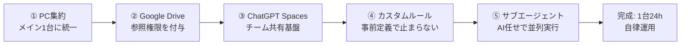
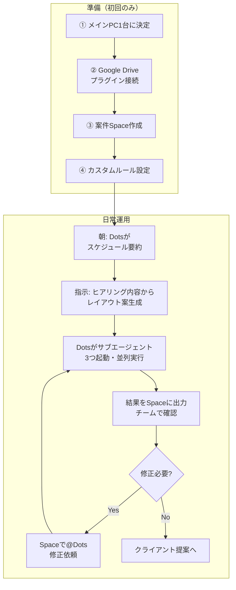

# X-0048: AIエージェントDotsを1つで運用する5つのコツ

> AIニュース提案 2026-11-17
> 対象: OpenAI Dots（GPT-6 Astra搭載、常時稼働AIエージェント）を1台のPCで実務運用するための5つの実践的コツ。Google Drive連携・ChatGPT Spaces併用・カスタムルール設定・サブエージェント委譲を含む。
> 基: [X-0025 Claude Codeのキャッシュ効率化とWorktree並列運用](ai-news-x0025-prompt-cache-cheap-routing.md), [X-0044 AIエージェントの測定可能な製品改善ワークフロー](ai-news-x0012-verifiable-reproducible-workflow.md)

## 概要

OpenAI Dots（2026年9月発表）はGPT-6 Astraを搭載した常時稼働AIエージェントで、クラウド上のブラウザとコンピュータを持ち、24時間バックグラウンドでタスクを実行する。しかし「複数PCで使う」「権限の壁で止まる」「サブエージェン���が乱立する」といった運用上の落とし穴が多い。本稿では、1台のPCに集約してDotsを実務で使い倒す5つのコツを解説する。



| # | コツ | 目的 | オージャストでの効果 |
|:-:|------|------|---------------------|
| ① | **PCを1台に集約** | 情報の分散防止、操作の一貫性確保 | ブース案件の情報が1台のDotsに集約、検索・参照が一発 |
| ② | **Google Drive連携** | 過去事例・資料の自動参照、乗り換え耐性 | 過去のブースデザイン資料からレイアウト案を自動生成 |
| ③ | **ChatGPT Spaces併用** | チームでの成果物共有、Dotsへのタグ付け依頼 | ブースデザイン案をSpaceで共有、Dotsに修正依頼をタグ付け |
| ④ | **カスタムルール事前定義** | 承認待ちで止まらない、安全に自律実行 | 「クライアント名の記載がない提案は承認待ち」などルール化 |
| ⑤ | **サブエージェント委譲** | 並列作業で高速化、コンテキスト汚染防止 | レイアウト案・予算案・スケジュール案を同時生成 |

## コツ①: つなぐPCはメインの1台に集約する

**問題**: DotsはChatGPTのどのセッションからも操作できるが、複数PCで使うと情報が分散する。PC-Aで設定したカスタムルールをPC-BのDotsが知らず、挙動が変わる。

**解決**: 1台のPC（メインPC）だけをDots操作の窓口にする。その他PCではChatGPT SpaceのブラウザアクセスでDotsの成果物を確認するにとどめる。

**ポイント**:
- Dots自体はクラウド上で動作するため、操作PCを変えてもDotsの処理は継続する
- 設定（カスタムルール・接続プラグイン）はアカウント単位で統一されるが、操作の習慣を1台に固定することで「あの設定どこでしたっけ」を防ぐ
- スマホからの確認は可。操作（新規タスク追加・ルール変更）はメインPCのみ

**オージャスト適用**:
- 展示会ブース案件のDots操作は担当者1名のPC1台に固定
- 他のメンバーはSpace上でDotsの生成したレイアウト案を閲覧・コメント
- 営業が見積を依頼するときだけメインPCでDotsに指示

## コツ②: Googleドライブを見られるようにする

**問題**: Dotsに指示を出すたびに「このファイルを読んで」と添付するのは手間。Dotsは過去の資料を知らないまま作業する。

**解決**: Google Driveプラグインを接続し、Dotsが自律的にファイルを読めるようにする。Dotsのプロアクティブリサーチ（読み取り専用）機能で、指示がなくても関連資料を自動スキャンする。

**設定手順**:
1. ChatGPT設定 → プラグイン → Google Driveを接続（1回のみ）
2. Dotsに共有するフォルダを専用Googleアカウントで作成し、チームで編集
3. Dotsへの指示で「Google Driveの○○フォルダを参照して」と指定

**注意点**:
- プロアクティブリサーチは**読み取り専用**。Dotsがファイルを編集・削除することはない
- フォルダ単位の制限はできないため、専用Googleアカウントで分離するのが実運用のコツ
- 接続を切ってもDotsが学習済みの情報は消えない（情報管理に注意）

**オージャスト適用**:
- 過去のブースデザイン事例・施工写真・見積テンプレートをDriveに集���
- Dotsに「過去のブース事例フォルダから、クライアントの要望に合うレイアウトを3案提案して」と1指示で完了
- クライアントヒアリングシート（Google Sheets）をDotsに読ませ、ブースサイズ・予算・要望を自動抽出

## コツ③: ChatGPTのスペース機能を併用する

**問題**: Dotsの成果物はデフォルトで個人の会話履歴に保存される。チームで共有するには毎回エクスポートが必要。

**解決**: ChatGPT Spacesを使う。Spaceはチーム共有のワークスペースで、Dots・ChatGPT・Codex・人間が同じコンテキストで協業できる。

**Spaceの利点**:
- Dotsが生成した文書・表・プレゼンテーションがSpace内のPagesとして自動保存
- チームメンバーが@DotNameでDotsにタグ付けして修正依頼
- バージョン管理され、変更履歴を追跡可能
- Pro/Business/Enterpriseプランで利用可能

**運用フロー**:
1. 案件ごとにSpaceを作成（例: 「2026-12展示会ブース案件」）
2. Space内でDotsに「ブースレイアウト案を生成して」と指示
3. Dotsが結果をSpaceのPageとして出力
4. メンバーがPageにコメント、@DotNameで修正依頼
5. Dotsが修正案を再生成、履歴に残る

**オージャスト適用**:
- 案件Spaceを作り、Dots・デザイナー・営業が同じ場所でブース案を詰める
- クライアントヒアリング内容をSpaceのノートに書き、Dotsがレイアウト案を自動生成
- 過去案件のSpaceをテンプレート化して次案件に使い回す

## コツ④: 許可で止まらないよう、先にタスク管理のルールを作る

**問題**: Dotsは安全設計上、影響のある操作（メール送信・ファイル削除・外部共有）で都度承認を求める。ルール未定義だと「これは送っていいですか？」の確認で止まり続ける。

**解決**: 先にカスタムルールを定義し、Dotsが自律判断できる範囲と人間承認が必要な範囲を明確にする。

**カスタムルールの設定例**:

```
設定場所: ChatGPT設定 → パーソナライズ → カスタムルール

ルール1: Google Drive内の「案件_進行中」フォルダへの新規ファイル作成は承認不要
ルール2: クライアント名・日付・予算の3項目が揃った見積案は自動生成してSpaceに保存
ルール3: 外部メールの送信・SNS投稿は常に人間の承認が必要
ルール4: 定例タスク（毎朝9時に今日のスケジュールを要約）は自動実行
```

**ルール設計のコツ**:
- 最初は**読み取り専用ルール**のみで運用し、信頼できた範囲から書き込み権限を追加
- 「◯◯の場合は必ず確認」という否定ルールより、「◯◯の条件を満たせば自動実行」という肯定ルールの方が止まらない
- 定例タスク（毎朝の情報収集・毎週の進捗サマリ）は先にスケジュール設定しておく

**オージャスト適用**:
- 「ブースレイアウト案の生成は自動実行、クライアントへの送信は承認必須」とルール化
- 「毎朝9時に今日の案件スケジュールとGoogle Driveの更新を要約」を定期タスクに設定
- ルールの効果を週1回見直し、止まった箇所をルールに追加

## コツ⑤: サブエージェントはAIに任せる

**問題**: 1つのDotsに複数タスクを依頼すると逐次処理になり遅い。「このレイアウト案を3パターン作って」と頼んでも1つずつ生成される。

**解決**: Dotsのサブエージェント機能を活用する。Dotsが自動的に並列サブエージェントを起動し、各タスクを同時処理する。サブエージェントの起動・管理はDots自身が判断する。

**サブエージェント���動作**:
- Dotsがタスクを分析し、並列実行可能なサブタスクに分解
- 各サブエージェントが独立したコンテキストで処理（コンテキスト汚染防止）
- 全サブエージェントの完了後、Dotsが結果を統合して報告
- 最大同時実行数はデフォルト6（OpenAI Agents APIで設定可能）

**指示のコツ**:
- 「3つ同時に生成して」と明示しなくても、並列可能な作業はDotsが自動判断
- ただし「AをやったあとB」と順序依存を明示すると誤判断防止になる
- サブエージェントの中間結果を他のサブエージェントが参照したい場合はSpaceのPage経由で共有

**オージャスト適用**:
- 「ブースデザイン案（レイアウト・配色・予算見積）を同時生成して」と1指示
- Dotsが3つのサブエージェントを起動: レイアウト案生成 / 配色パターン提案 / 予算見積算出
- 各サブエージェントが独立動作、完了後に1つの提案書として統合
- 従来1時間かかった初回提案が10分に短縮

## 5つのコツを組み合わせた運用フロー



## オージャスト導入計画

### 準備フェーズ（所要: 1日）
1. メインPCを1台に決め、ChatGPT Pro/BusinessアカウントでDots有効化
2. Google Driveプラグイン接続（専用アカウント推奨）
3. 案件用Spaceを作成（テンプレート化）
4. カスタムルールを5〜10個定義（読み取り専用から開始）

### 試行フェーズ（所要: 1週間）
1. 実際の案件1件でDotsにブースレイアウト案を生成させる
2. Google Driveの過去事例を参照させる
3. サブエージェントで並列生成を試す
4. ルールの過不足を確認し調整

### 定着フェーズ（所要: 2週間）
1. 全案件でSpace運用を開始
2. チームメンバーにSpaceへの参加と@Dots依頼を周知
3. 週1回ルール見直し
4. 効果測定（1案件あたりの提案作成時間の削減）

## 注意点

- **情報管理**: DotsにGoogle Driveを読ませると、Dotsが学習した情報は永続する。機密情報が含まれるフォルダは専用アカウントで分離する
- **課金**: DotsはPro（月額$20〜）/Business（月額$25〜）/Enterpriseプランで利用可能。SpaceはBusiness以上でチーム機能がフル活用できる
- **サブエージェントのコスト**: 並列サブエージェントは同時にトークンを消費する。大量並列実行時は従量課金に注意
- **フェイルセーフ**: 重要な操作はカスタムルールで人間承認を必須にする。Dotsが「勝手に送信」しない設計は守る
- **乗り換え耐性**: 情報はGoogle Driveに保存するのが原則。Dotsをやめてもデータは残る

## 関連

- [X-0025: Claude Codeのキャッシュ効率化とWorktree並列運用](ai-news-x0025-prompt-cache-cheap-routing.md) — 複数エージェントの並列運用ノウハウ
- [X-0044: AIエージェントの測定可能な製品改善ワークフロー](ai-news-x0012-verifiable-reproducible-workflow.md) — エージェント効果の測定方法
- [X-0047: advisorオフとeffort制限の実測トークン削減](ai-news-x0033-effort-advisor-token-reduction.md) — AIエージェントのコスト最適化
- [X-0014: Grok Bot 24時間監視ケチケチ運用](ai-news-x0027-grok-bot-role-clarification.md) — 常時稼働エージェントの運用設計