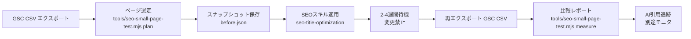

# SEOスキル導入 少数ページテスト手順（X-0049）

**作成日**: 2026-11-15
**ステータス**: ![ドラフト] ツール実装済み、実検証はブロッカー解消後
**対応AIニュース提案**: [X-0049] SEOスキル導入時の少数ページテスト手順

---

## 1. 概要

Search Console の実クリック・インプレッションデータを使う SEO スキルを、3〜5ページに限定して導入し、2〜4週間の前後比較をするための手順書。AI 回答引用（AI Overview / ChatGPT / Perplexity）の追跡も別途行う。

### 1.1 ねらい

- 全ページへの一括適用によるリスクを避け、少数ページで効果検証する
- 統計的有意差が出る前に変更を広げない（学びを1ページに集中）
- ターミナルからのバックリンク購入は Google スパムポリシー抵触リスクがあるため、本手順では自然な内部リンク改善のみを対象とする

### 1.2 前提条件

| # | 条件 | 確認方法 | 備考 |
|---|------|---------|------|
| 1 | Search Console にサイトが登録済み | `search.google.com/search-console` | kim が確認 |
| 2 | GSC Pages.csv / Queries.csv が取得可能 | Web UI → エクスポート | SA鍵がなくても手動CSVで可 |
| 3 | 対象ページ（3〜5ページ）が特定済み | 本ツールで選定 | — |
| 4 | seo-title-optimization スキルが利用可能 | `npx skills list` で確認 | X-0034 ブロッカー解消後 |
| 5 | 変更できるリポジトリへのアクセス | git clone / write | — |

---

## 2. 全体フロー



---

## 3. フェーズ詳細

### 3.1 Phase 1: GSC データ準備

Search Console Web UI から以下を CSV エクスポートする：

1. **Pages.csv**: 全ページのクリック・インプレッション・CTR・掲載順位
2. **Queries.csv**: 全クエリの同指標

保存先: `data/seo/pre-test/` または任意の作業ディレクトリ

### 3.2 Phase 2: テストページ選定

```bash
# ツールで3〜5ページを自動選定
node tools/seo-small-page-test.mjs plan \
  --gsc-pages data/seo/pre-test/pages.csv \
  --gsc-queries data/seo/pre-test/queries.csv \
  --keywords "展示会ブース,小規模ブース,イベント企画" \
  --output data/seo/pre-test/plan.md
```

**選定条件**:
1. 掲載順位 5〜20 位（改善余地が大きく、測定が容易）
2. 対象キーワードに関連するページ
3. インプレッション降順で優先
4. 最大5ページに限定

**出力**: `plan.md` — 選定ページ一覧、流入クエリ、テスト日程案

### 3.3 Phase 3: スナップショット保存

```bash
# GSC CSV から before.json を作成
node tools/seo-small-page-test.mjs plan \
  --gsc-pages data/seo/pre-test/pages.csv \
  --gsc-queries data/seo/pre-test/queries.csv \
  --keywords "展示会ブース,小規模ブース,イベント企画" \
  --json > data/seo/pre-test/before.json
```

### 3.4 Phase 4: SEO スキル適用

選定した3〜5ページに対して `seo-title-optimization` スキルを実行する。

**seo-title-optimization の標準手順**（X-0004 / 19ステップワークフローより抜粋）:
1. ページの現在のタイトルタグと H1 を記録（`pre-optimization-<slug>.md`）
2. Search Console CTR データに基づき低CTRのページを特定
3. キーワードをタイトルの最初の単語に配置
4. 約束を含める（例: 「最短見積もり」「実績多数」）
5. 年を含める（例: 「2026年最新」）
6. タイトルを 600px 以下に収める（Google SERP 表示幅制限）
7. H1 を見直し、タイトルと一貫性を持たせる
8. 変更内容を記録

**制約**:
- 1日1ページまで変更（連続変更による Google ペナルティリスク回避）
- 同一ページへの追加変更はテスト期間中禁止

### 3.5 Phase 5: 待機期間（2〜4週間）

変更後、2〜4週間は同一ページへの追加変更を行わない。この間の Google インデックス更新・順位変動の安定を待つ。

### 3.6 Phase 6: 比較測定

```bash
# before.json と同じ形式で after.json を作成
# （GSC を再エクスポートして JSON 保存）

# 比較レポートを生成
node tools/seo-small-page-test.mjs measure \
  --before data/seo/pre-test/before.json \
  --after data/seo/post-test/after.json \
  --output reports/seo-test-comparison-YYYYMMDD.md
```

**判定基準**:

| 指標 | 改善 | 横ばい | 悪化 | 判断 |
|------|------|--------|------|------|
| クリック | +5以上 | ±5未満 | -5以下 | クリック増=成功 |
| CTR | +1%以上 | ±1%未満 | -1%以下 | CTR改善=タイトル改善の証左 |
| 掲載順位 | +1以上 | ±1未満 | -1以下 | 順位改善=追加効果 |

### 3.7 Phase 7: AI 回答引用追跡（別途）

SEO スキル導入の副次的効果として、AI 検索（AI Overview / ChatGPT / Perplexity / Gemini）での自社サイト引用状況を追跡する。

```bash
# 引用追跡テンプレート生成
node tools/seo-small-page-test.mjs track-ai-citations \
  --domain orgiast.jp \
  --queries "展示会ブース 費用,小規模ブース デザイン,展示会 集客 施策" \
  --output reports/ai-citations-YYYYMMDD.md
```

**追跡方法**: 各クエリを AI 検索エンジンで手動検索し、自社サイトが引用されているか確認する。変更前・変更後で比較。

---

## 4. オージャスト向け実行計画

### 4.1 対象サイト候補

| サイト | テーマ | 優先度 | 備考 |
|--------|--------|--------|------|
| `orgiast.jp` | ブース制作・イベント企画 | ★★★ | 展示会ブース関連キーワードの改善余地が大きい |
| `rebooth.co.jp` | リユースブース | ★★ | 小規模ブース需要あり |

### 4.2 推奨キーワード（ブース・イベント関連）

```
展示会ブース 費用,小規模ブース デザイン,展示会 集客 施策,
イベント企画 代行,ブース製作 会社 比較,ブース レンタル,
展示会 出展 準備,ブース装飾 会社
```

### 4.3 期待される効果

- 2週間でクリック数 10〜30% 増加（タイトル最適化によるCTR改善）
- 掲載順位 1〜3 位向上（内部リンク最適化による権威向上）
- AI Overview への引用開始（コンテンツ最適化による）

### 4.4 ブロッカー

| ブロッカー | 内容 | 解消条件 |
|-----------|------|---------|
| SA鍵不在 | Search Console API が使えない | kim が SA 鍵を PC に配置 or GSC BigQuery 設定 |
| 対象サイトリポジトリ不明 | このPC上に公開Webサイトのリポジトリがない | kim がリポジトリ URL を指定 |
| seo-title-optimization 未インストール | X-0034 セキュリティ監査でブロック中 | kim が部分採用を承認 |

---

## 5. バックリンクに関する注意

### ⚠️ ターミナルからのバックリンク購入は Google スパムポリシーに抵触する可能性がある

- Google は有料リンク（PageRank を渡すもの）をスパムとみなす
- 購入リンクは `rel="sponsored"` または `rel="nofollow"` 属性を付与すること
- 本手順では有料バックリンク購入を行わず、以下の自然な手法のみを使用:
  - 内部リンク改善（3〜5件の関連ページからのリンク追加）
  - 権威ページからの自然な被リンク獲得
  - コンテンツマーケティング（価値ある情報の発信）

---

## 6. 参考資料

| 資料 | 内容 |
|------|------|
| `playbooks/seo-search-console-optimization.md` | 19ステップSEOワークフロー完全版 |
| `docs/ai-news-x0034-seo-skills-runbook.md` | SEOスキル部分採用手順書 |
| `docs/ai-news-x0040-seo-skills-npx-install.md` | npx一括導入の解説 |
| `seo/README.md` | SEO最適化ガイド全体 |
| `tools/seo-small-page-test.mjs` | 本手順の測定ツール |
| `seo/ahrefs-gsc-priority.mjs` | Ahrefs×GSC優先度判定 |