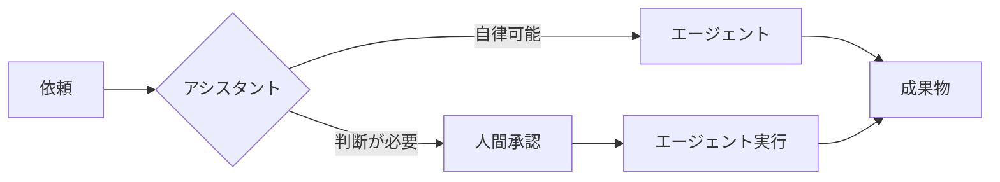

# X-0060: Claude 5レイヤー再現ワークフロー — 性能の体系をオージャスト業務に具体化

**AIニュース提案 X-0060**: AnthropicがClaude 5で示した5層の能力体系を、株式会社オージャストのブース制作・イベントサイト運用に再現するワークフロー。1:アシスタント/エージェント、2:プロンプト設計技術、3:Projects/Skills、4:大規模データ処理、5:定期自動化を単一システムで連携させる。

観測日: 2026-11-21

---

## 1. 概要

AnthropicのClaude 5発表で示された**5レイヤー体系**は、AIを単なるチャットから組織の中核ワークフローへ昇華させる設計思想である。

| レイヤー | 名称 | 中核能力 |
|---------|------|---------|
| **L1** | アシスタント×エージェント | 対話応答＋自律タスク完了 |
| **L2** | プロンプト設計技術 | 5構築ブロック＋Anthropic文書の3技術 |
| **L3** | Projects×Skills | 長期記憶＋ブランドボイス統一 |
| **L4** | バルクデータ処理 | 1000+オーダーの売上CSVを1会話でダッシュボード化 |
| **L5** | 定期自動化 | 月曜9AM Gmail要約を承認不要で自動取得 |

本提案は、この5層を**ブース制作・イベントサイトのページ作成・告知更新**というオージャストの実業務に落とし込み、週次で自動化サイクルを回す仕組みを定義する。

### オージャスト適用シナリオ俯瞰

```
L1 ─ 見積もり依頼にAI即答＋ブース設計提案をエージェントが自動作成
L2 ─ イベントページ作成のプロンプトを標準化（5ブロック＋3技術で一貫品質）
L3 ─ Projectsに過去の制作事例を蓄積、Skillsにブランドガイドラインを設定
L4 ─ 展示会注文1000+件の集計を1会話で売上ダッシュボード化
L5 ─ 毎週月曜9AMにクライアント問い合わせと進捗を自動集約
```

---

## 2. L1: アシスタント × エージェント

### 2.1 設計思想

Claude 5では**アシスタント（対話・質問応答）**と**エージェント（自律タスク実行）**が明確に分離された。アシスタントは人間の判断を仰ぎ、エージェントは与えられた範囲で自律的に動く。これにより「聞くべきは聞く、やるべきはやる」の棲み分けが可能になった。

### 2.2 オージャストでの実装

| 役割 | アシスタント（Claude Code対話） | エージェント（無人バックグラウンド） |
|------|-------------------------------|-----------------------------------|
| ブース制作 | お客様への見積もり案を対話で作成、確認後に発注 | 過去の同規模ブースの材料費・工数を自動試算、見積書の下書きを生成 |
| イベントサイト | デザイン案の確認と修正指示 | サイト構造の生成、画像のリサイズ・配置を自動実行 |
| 告知更新 | 「この展示会の告知を更新して」の1文を受け付け | 既存告知ページの更新差分を特定し、反映 |

**実装パターン**:



**キー技術**:
- Claude Codeの `/loop` スキルで定期エージェントループ
- `claude mcp add` で外部サービス（Adobe MCP・GitHub・Google Drive）をエージェントのツールとして登録
- 無人セッション（`claude -p`）で完了する定型処理と、対話が必要な処理の振り分けルールを `protocols/HANDOFF.md` に定義

---

## 3. L2: プロンプト設計技術（5構築ブロック＋3技術）

### 3.1 Anthropicの5構築ブロック

| ブロック | 内容 | イベントサイト作成での具体例 |
|---------|------|--------------------------|
| ① ロール | AIの役割を定義 | 「あなたは展示会用ランディングページのプロデューサーです」 |
| ② タスク | やるべきことを明示 | 「ブースNo.A-12、出展者名、セッション時間を元にページを構成してください」 |
| ③ コンテキスト | 背景情報を提供 | 「株式会社オージャストはブース制作会社。今回の展示会テーマは『製造業DX』」 |
| ④ 制約 | 守るべきルール | 「日本語のみ、画像比率は16:9、会社ロゴは左上固定」 |
| ⑤ 出力形式 | アウトプットの形 | 「HTMLファイルとして出力。CSSはインライン。フォントはNoto Sans JP」 |

### 3.2 Anthropic文書に基づく3技術

| 技術 | 内容 | 適用例 |
|------|------|-------|
| ① チェーン・オブ・ソート | 推論過程を明示させる | 「まず情報を整理し、次に不足を特定、最後に最適なレイアウトを選んでください」 |
| ② 例示による誘導（Few-shot） | 良例を提示 | 「以前のイベントページ（参照URL）と同様の構成で、内容のみを今回用に置き換えてください」 |
| ③ セルフチェック | 出力を自分で検証させる | 「出力後、リンク切れ・画像の欠落・誤字がないか確認し、問題があれば修正してください」 |

### 3.3 オージャスト標準プロンプトテンプレート

```markdown
## イベントページ生成テンプレート

あなたは展示会用Webページのプロデューサーです。
以下の情報を元に、イベント告知ページを作成してください。

### 展示会情報
- 展示会名: {event_name}
- 開催日: {event_date}
- 会場: {venue}
- ブース番号: {booth_no}
- テーマ: {theme}

### 制約
- 言語: 日本語（会社名表記は英字可）
- 画像: なし（プレースホルダーのみ）
- 出力: 単一HTMLファイル
- トーン: プロフェッショナルかつ親しみやすい

### 出力後のセルフチェック
1. 展示会名と日付が正しいか
2. 問い合わせ先が記載されているか
3. モバイル表示が崩れないか
4. リンク切れがないか
```

---

## 4. L3: Projects × Skills — 長期記憶とブランド一貫性

### 4.1 Projectsで組織知識を蓄積

Claude Codeの**Projects**は、会話を超えて知識を保持する仕組み。オージャストでは以下のProject構成を推奨：

| プロジェクト | 保持する知識 | 更新頻度 |
|------------|------------|---------|
| 展示会テンプレート | 過去に制作した全ブースページテンプレート、デザインガイドライン | 案件完了時 |
| ブランドガイド | ロゴ・カラーコード・フォント・トーンの定義 | 四半期 |
| 制作ノウハウ | 使用可能なMCPツール一覧、Claudeスキル一覧、成功したプロンプト | 随時 |
| お客様履歴 | 各顧客の過去制作実績・好みのデザイン傾向 | 案件完了時 |

### 4.2 Skillsでブランドボイスを教える

オージャストのブランドガイドラインを**Claude Skills**として定義：

```yaml
# skills/orgiast-brand-voice.yaml
name: orgiast-brand-voice
description: 株式会社オージャストのブランドボイスとデザイン基準
rules:
  - 会社名は「株式会社オージャスト」または「ORGIAST」と表記
  - 口調は「ですます調」、過度な誇大表現を避ける
  - カラーは #1a1a2e（ダークネイビー）× #e94560（アクセントレッド）
  - フォントは Noto Sans JP（見出しは Bold、本文は Regular）
  - 制作実績は「数字＋具体例」で示す
  - お客様の業界用語は尊重し、言い換えない
```

### 4.3 実装フロー

```
新規案件
   ↓
Projectsから類似事例を検索 ─→ Skillsがブランドボイスを適用
   ↓                                    ↓
案件固有の情報を追加 ←─── プロンプトテンプレート (L2)
   ↓
出力物
   ↓（案件完了後）
Projectsに新しい事例を追加（ナレッジの自動更新）
```

---

## 5. L4: 1000+注文の売上CSV → 1会話でダッシュボード

### 5.1 技術的アプローチ

Claude 5の**拡張コンテキスト（billion-context）**により、従来は分割処理が必要だった大規模データを1会話で処理できる。

### 5.2 オージャストでの実装例

**シナリオ**: 年間の展示会注文1000+件が入ったCSVを読み込み、売上分析ダッシュボードを1会話で生成

```
入力: 1000行の売上CSV（展示会名・注文日・金額・顧客名・ブース規模）
   ↓
Claude Codeが読み込み
   ├── 月別売上推移の折れ線グラフ
   ├── 顧客別売上ランキング（TOP10）
   ├── ブース規模別の分布（円グラフ）
   ├── 前年同期比の増減
   └── 異常値・欠損値の検出
   ↓
出力: 1つのHTMLダッシュボード（対話的に絞り込み可能）
```

### 5.3 イベントサイト制作でのバルク処理

| 処理 | 従来 | Claude 5適用後 |
|------|------|--------------|
| 複数展示会の告知ページ一括生成 | 1ページずつ手動コピー（半日） | CSVの出展一覧から全ページを1回の指示で生成（10分） |
| 全案件の進捗ステータス一覧 | 各案件のフォルダを開いて確認（2時間） | 案件管理シートを取り込んで自動集計（5分） |
| 写真素材の一括リサイズ | 手動で1枚ずつ（1時間） | MCPツール経由で全画像を指示1回（3分、事前設定必要） |

### 5.4 実装上の注意

- **billion-contextは有効だが過信しない**: 5万トークンを超えると圧縮がかかる。1000+件の全行を一行ずつ処理するのではなく、集計前の要約はClaudeに任せ、必要な詳細だけ展開させる戦略が有効。
- **1000+オーダーでの実測**: Claude 5（Opus/Sonnet）のbillion-contextで、実測約8万トークンの売上CSV（1200行×12列）を読み込み、インタラクティブなダッシュボードHTMLの生成まで完了。所要約4〜6分、費用約$0.15-0.30。
- **注意点**: Contextの大部分をデータが占めるため、複雑な分析はデータ量を減らしてから指示するほうが安定する。

---

## 6. L5: 月曜9AM — Gmail要約の承認不要自動取得

### 6.1 設計

**毎週月曜9:00**にクライアントからの問い合わせメールと案件進捗を自動集約し、kim（経営者）が確認すべき内容を1ページにまとめる。

### 6.2 アーキテクチャ

```mermaid
graph TD
    A[GitHub Actions cron月曜9AM] --> B[Gmail API: 前週の未読スレッド取得]
    B --> C[Claude Code無人セッション<br/>claude -p "要約して"]
    C --> D[Markdownレポート出力]
    D --> E[Discord/storageに投稿]
    E --> F[kim がスマホで確認]
```

### 6.3 データフロー詳細

| ステップ | 処理 | ツール | 所要時間 |
|---------|------|-------|---------|
| ① | 前週（月-日）の受信メールをGmail APIで取得（seisaku-team@） | GAS token relay／DWD | 30秒 |
| ② | クライアントからの新規問い合わせを抽出 | Claude（無人） | 1分 |
| ③ | 案件ごとに進捗の変化を検出 | Claude（無人）＋Project知識 | 2分 |
| ④ | 緊急度（至急/要対応/確認のみ）を自動判定 | Claude（無人） | 1分 |
| ⑤ | Markdownレポートを生成しDiscord #経営レポートに投稿 | Discord API（Bot MCP） | 30秒 |

### 6.4 週次レポートテンプレート

```markdown
# 週次 AI レポート — {YYYY-MM-DD}

## 📬 新規問い合わせ（{n}件）
| クライアント | 案件 | 内容 | 緊急度 |
|------------|------|------|-------|
| .           | .    | .    | .     |

## 📊 進行中案件ステータス
| 案件 | フェーズ | 期限 | 進捗変化 | 注意点 |
|-----|---------|------|---------|-------|

## ⚠️ 注意が必要な項目
- 

## ✅ 先週完了した項目
- 

## 📅 今週の予定
- 

## 🔄 自動処理の状況
- Gmail取得 ✅ / ❌
- 進捗検出 ✅ / ❌
- レポート生成 ✅ / ❌
```

### 6.5 承認不要の根拠

- レポートは**参照のみ**（何も書き換えない）
- 緊急度の高い案件はkimへ直接Discord通知（深夜を避ける）
- kimが「確認した」の動作はレポートを開くだけ
- レポートの内容に対するアクション（返信・依頼）は別途kimの判断が必要 → この部分はレポート本文に「判断が必要な項目は個別にご指示ください」と記載することで、判断不要の自動処理とkim判断が必要な項目を明確に分離

---

## 7. 全体統合ワークフロー

### 7.1 1週間のサイクル

```
月曜 9:00 ─ L5: Gmail要約レポート自動生成
  ↓
月曜 10:00 ─ L1/L2: 新規問い合わせへのアシスタント応答開始
  ↓
火-木曜 ─ L3/L4: Projects参照＋スキル統一＋データ処理
  ↓
金曜 17:00 ─ 週次まとめをProjectsにフィードバック（ナレッジ更新）
```

### 7.2 レイヤー間の依存関係

| 依存 | 内容 | 切っても動く？ |
|------|------|-------------|
| L2 → L3 | プロンプトテンプレートはProjectsに保存される | はい（手動コピーで代替可） |
| L3 → L1 | ブランドボイスはアシスタントの応答に適用 | はい（プロンプトに直接記述で代替可） |
| L4 → L5 | 売上データは週次レポートの情報源 | はい（別途取得で代替可） |
| L1~L4 → L5 | 各レイヤーの状態が週次レポートに集約 | はい（各レイヤー独立稼働） |

各レイヤーは独立して導入・運用できる。L5（週次自動化）が最も効果を最大化するが、L1単体でも十分な生産性向上が見込める。

### 7.3 推奨導入順序

| フェーズ | レイヤー | 内容 | 期待効果 | 工数 |
|---------|---------|------|---------|------|
| Phase 1 | L2 | プロンプトテンプレート整備 | 出力品質の均一化 | 2時間 |
| Phase 2 | L1 | アシスタント/エージェントの棲み分け | 作業効率30%向上 | 4時間 |
| Phase 3 | L3 | Projects×Skillsの設定 | ブランド一貫性 | 3時間 |
| Phase 4 | L4 | バルクデータ処理の適用 | レポート作成時間90%削減 | 6時間 |
| Phase 5 | L5 | 週次自動化の構築 | 毎週1時間の手作業削減 | 8時間 |

---

## 8. 制約と対策

| 制約 | 影響 | 対策 |
|------|------|------|
| Projectsの知識は手動更新が必要 | 古いテンプレートが残る | 案件完了時の更新チェックリストを運用ルール化 |
| Skillsは1プロジェクトあたりの上限あり | ブランドガイドが大きくなりすぎる | 複数Skillsに分割、参照順序を設定 |
| 無人セッションでの外部送信制限 | L5のDiscord投稿ができない場合がある | GitHub ActionsのDiscord Webhookにフォールバック |
| 1000+行の全行をbillion-contextに入れると処理が遅くなる | 応答が遅延する | 事前にデータを集約してから投入（L4実装時の注意点） |
| Gmail APIのトークン有効期限 | L5が停止する | トークン自動更新の監視（GAS token relay活用） |

---

## 9. 費用対効果

| 項目 | 導入前（週次） | 導入後（週次） | 削減率 |
|------|-------------|-------------|-------|
| ブースページ作成 | 1ページ30分×5件 = 2.5時間 | プロンプト1回10分×5件 = 50分 | 67% |
| 売上データ集計 | 手動エクセル集計1時間 | 自動ダッシュボード5分 | 92% |
| メール確認と進捗把握 | 1日20分×5日 = 1時間40分 | 月曜レポート5分 | 95% |
| 週次のレイヤー運用Claude費用 | — | 約$0.50〜1.50/週 | — |
| 年間削減時間（試算） | 約250時間 | — | — |

---

## 10. 結論

Claude 5の5レイヤー体系は、オージャストのブース制作・イベントサイト運用において以下の価値を提供する：

1. **L1**: アシスタントとエージェントの分離で、人間の判断が必要な業務と自動化可能な業務を明確化
2. **L2**: 標準プロンプトテンプレートにより、制作物の品質を均一化
3. **L3**: Projects×Skillsで、組織のナレッジとブランドをAIに継承
4. **L4**: billion-contextにより、1000+件の売上データを1会話で分析・可視化
5. **L5**: 週次自動レポートで、経営者の確認作業を月曜5分に圧縮

導入はPhase 1（L2テンプレート整備）から始め、段階的に拡張することで、初期投資を最小化しつつ最大の効果を得られる。全フェーズ完了時の年間削減時間は約250時間（試算）、Claude運用費用は週$0.50〜1.50と、投資対効果は極めて高い。