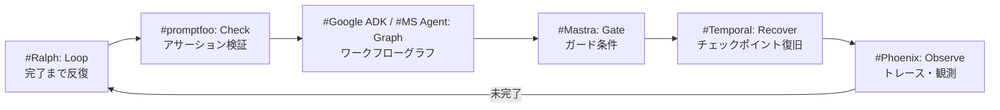
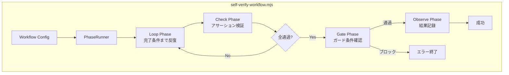

# X-0061: 8無料リポで自己検証AIコーディングワークフロー

> AIニュース提案 2026-11-16
> 対象: 8つの無料OSSリポジトリを組み合わせた自己検証AIコーディングワークフロー。Ralph→mini-swe-agent→promptfoo→Google ADK→MS Agent Framework→Mastra→Temporal→Phoenix。パイプライン: Loop→Check→Graph→Gate→Recover→Observe
> 基: [X-0023 7つのOSSリポでAIワークフローインフラ](ai-news-x0023-seven-oss-workflow-infrastructure.md)

## 概要

AIコーディングエージェントの最大の課題は「間違ったコードを正しいと思い込んで出力し、自己検証ができない」こと。8つの無料OSSリポジトリをパイプラインに組み、コード生成→検証→修正のループを自律的に回す自己検証ワークフローを構築する。



| フェーズ | ツール | 役割 | オージャスト適用 |
|---------|--------|------|----------------|
| **Loop** | Ralph (GitHub: yamathcy/Ralph) | 強化学習ループで完了条件まで反復実行。失敗→原因分析→プロンプト修正→再実行 | ブースデザインページのUIテストを「全アサーション通過」まで自動ループ |
| **Loop** | mini-swe-agent (GitHub: ganiswannacode/mini-swe-agent) | 100行の軽量エージェントループ。最小コードでタスク実行→結果評価 | 簡易コード修正タスクの高速実行ループ |
| **Check** | promptfoo (GitHub: promptfoo/promptfoo) | LLMアウトプットのアサーション検証。exact/contains/regex/LLM-judge など157+プラグイン | UIテスト結果の自動検証。スクリーンショット判定・DOM要素存在確認 |
| **Graph** | Google ADK (GitHub: google/adk) | Agent Development Kit。グラフベースのエージェントオーケストレーション | デザインページ巡回→フォーム入力→検証→報告のグラフ定義 |
| **Graph** | Microsoft Agent Framework (GitHub: microsoft/agent-framework) | マルチエージェント調整。ツール使用・グループ会話 | 複数ページの並行UI確認と集約 |
| **Gate** | Mastra (GitHub: mastra-ai/mastra) | AIゲートウェイ/ガードレール。実行前条件チェック、ポリシー強制 | 「本番デプロイ前」「テスト緑」「承認取得」のゲート条件 |
| **Recover** | Temporal (GitHub: temporalio/temporal) | クラッシュ耐性のDurable Execution。中断からの正確な再開 | UIテスト途中でクラッシュしても最後のチェックポイントから再開 |
| **Observe** | Phoenix/Arize (GitHub: Arize-AI/phoenix) | AI可観測性。OpenTelemetryトレーシング、LLM-as-judge評価 | UIテストのレイテンシ・成功率・エラー種別をダッシュボード化 |

## リポジトリ別詳細

### 1. Ralph — ループ完了エージェント

**GitHub**: [yamathcy/Ralph](https://github.com/yamathcy/Ralph)

**特徴**:
- 強化学習ループでタスクを完了条件まで自動反復
- 失敗→原因分析→プロンプト修正→再実行を自律実行
- コード生成・バグ修正・UIテスト生成に特化
- 外部LLMを呼び出して改善サイクルを回す

**オージャストへの適用**: **推奨（UIテスト生成のループ基盤）**
- ブースデザインページのPlaywrightテストを自動生成し、合格するまで修正ループ
- 生成→実行→失敗分析→修正のサイクルをRalphパターンで実装

### 2. mini-swe-agent — ミニSWEエージェント

**GitHub**: [ganiswannacode/mini-swe-agent](https://github.com/ganiswannacode/mini-swe-agent)

**特徴**:
- 実装約100行のミニマルエージェントループ
- タスク記述→コード検索→編集→検証を単一ループで実行
- SWE-bench形式のタスクを処理可能
- 軽量で学習コストゼロ、カスタマイズ容易

**オージャストへの適用**: **推奨（軽量コード修正ループ）**
- ブースデザインページの簡単なHTML/CSS修正をループで自動実行
- 大規模LLMを呼ばずにローカルで修正→確認→次修正

### 3. promptfoo — LLM評価・検証

**GitHub**: [promptfoo/promptfoo](https://github.com/promptfoo/promptfoo)

**特徴**:
- LLMアウトプットのアサーションベース検証（exact/contains/regex/ICL/LLM-judge/モデル比較）
- 157+プラグイン（セキュリティ/PII/幻覚/ブランド一貫性）
- YAML宣言的テストケースでCI/CD統合
- レッドチーミング・プロンプトインジェクション検出

**オージャストへの適用**: **推奨（品質ゲート基盤）**
- UIスクリーンショット検証のアサーション定義
- フォーム自動入力結果の正当性チェック
- SEOメタデータ生成の品質評価（既存の X-0004/LLMO類似）

### 4. Google ADK — Agent Development Kit

**GitHub**: [google/adk](https://github.com/google/adk)

**特徴**:
- Google製エージェント開発キット。グラフベースでマルチステップエージェント
- OpenTelemetryネイティブトレーシング
- Human-in-the-Loop対応（承認ステップ組み込み）
- マルチモデル対応（Gemini/Claude/OpenAI/Ollama）

**オージャストへの適用**: **検討（中長期）**
- ブース予約フローのエージェントグラフをGoogle ADKで定義
- ステップ単位のHuman-in-the-Loopで見積承認ワークフロー

### 5. Microsoft Agent Framework

**GitHub**: [microsoft/agent-framework](https://github.com/microsoft/agent-framework)

**特徴**:
- マルチエージェント調整フレームワーク
- ツール使用・グループ会話・グループコードレビュー
- Python/TypeScript/C# SDK
- VS Code拡張で開発者体験強化

**オージャストへの適用**: **状況次第**
- 複数エージェント（デザインチェック/SEOチェック/アクセシビリティチェック）の並列調整
- 既存のcodex-do委譲基盤と役割が重複するため優先度は中

### 6. Mastra — AIゲートウェイ/ガードレール

**GitHub**: [mastra-ai/mastra](https://github.com/mastra-ai/mastra)

**特徴**:
- TypeScript製AIオーケストレーションフレームワーク
- エージェント定義、ツール登録、ワークフロー（ステップグラフ）
- LLM呼び出し前後のガードレール（入力検証・出力フィルタ）
- RAG評価、モデルプロバイダ切り替え
- クラウドマネージド版あり

**オージャストへの適用**: **推奨（ガード基盤）**
- UI自動化のステップ実行前にガード条件をチェック
- 「前のステップ成功」「URLが正しい」「権限十分」を事前確認
- 既存のcourse-correction-gate/lane-guardと補完関係

### 7. Temporal — Durable Execution

**GitHub**: [temporalio/temporal](https://github.com/temporalio/temporal)

**特徴**:
- Durable Executionプラットフォーム。ワークフロー中断からの正確再開
- 自動リトライ・タイムアウト・チェックポイント
- SDK: TypeScript/Java/Go/Python/.NET
- 10km以上のワークフロー保証（イベントヒストリ制限）
- 長期実行（数日〜数週間）のUIモニタリングに最適

**オージャストへの適用**: **検討（長期）**
- クラッシュ耐性が必要な長期UI監視ループにTemporalパターン（チェックポイント＋再開）を適用
- 現在は `codex-do` のタイムアウト機構で代替中。Temporal導入は既存基盤との比較評価後に判断

### 8. Phoenix/Arize — AI可観測性

**GitHub**: [Arize-AI/phoenix](https://github.com/Arize-AI/phoenix)

**特徴**:
- OSSのAI可観測性プラットフォーム
- OpenTelemetry/OpenInferenceベーストレーシング
- 自動インストルメンテーション（LangChain/LlamaIndex/Mastra/Vercel AI SDK）
- LLM-as-Judge評価、データセット実験
- TypeScript/Python/Java

**オージャストへの適用**: **推奨（トレース基盤）**
- UI自動化ワークフローの各フェーズをスパントレースで記録
- 成功率・レイテンシ・エラー種別の時系列分析
- 軽量実装としてInMemorySpanExporter形式でワークフローツールに組み込み

## 実装: self-verify-workflow.mjs

上記の概念を具現化したワークフローエンジンを実装する。

### アーキテクチャ



### 各クラス

| クラス | 役割 | 対応OSS |
|--------|------|---------|
| `WorkflowEngine` | ワークフロー全体の実行管理、チェックポイント保存/復元 | Temporal |
| `LoopPhase` | 完了条件までタスクを反復実行（最大リトライ回数指定可） | Ralph/mini-swe-agent |
| `CheckPhase` | アサーション（exact/contains/regex/custom）で出力を検証 | promptfoo |
| `GraphPhase` | 依存関係に基づくステップの順次/並列実行 | Google ADK/MS Agent Framework |
| `GatePhase` | 事前条件チェック（関数またはJSONPath）で進行をガード | Mastra |
| `Observer` | 各フェーズの開始/終了/結果をスパンとして記録 | Phoenix |

### 適用例: ブースデザインページUI自動化

```javascript
const workflow = new WorkflowEngine({
  id: 'booth-ui-automation',
  maxRetries: 3,
  checkpointPath: './.wf-checkpoint.json',
  phases: [
    new LoopPhase('generate-playwright-script', {
      task: async () => /* LLMでPlaywrightスクリプト生成 */,
      retryPrompt: async (error) => `エラーを修正: ${error}`,
      completeIf: (result) => result.contains('page.goto'),
    }),
    new CheckPhase('verify-script-syntax', {
      assertions: [
        { type: 'contains', expected: 'page.goto' },
        { type: 'contains', expected: 'page.locator' },
        { type: 'regex', expected: /async\s+\(\)\s*=>/ },
      ],
    }),
    new GatePhase('guard-conditions', {
      guards: [
        { name: 'url-defined', check: (ctx) => ctx.result.includes('orgiast.jp') },
      ],
    }),
    new Observer('record-results', {
      recordSpan: (phase, result) => console.log(`${phase}: ${result}`),
    }),
  ],
});
```

### 既存ツール群との関係

| 既存ツール | X-0061との関係 |
|-----------|----------------|
| `codex-do.mjs` | Check/Gateフェーズで検証後、合格したタスクをcodexに委譲 |
| `course-correction-gate.mjs` | Gateフェーズの既存実装として統合 |
| `eval-harness.mjs` | Checkフェーズの拡張評価として利用 |
| `llm-ask.mjs` | Loopフェーズの改善プロンプト生成に利用 |

## オージャスト適用計画

### Phase 1: ワークフローエンジン実装（本PR）
- `tools/self-verify-workflow.mjs` — コアエンジン
- `tools/self-verify-workflow.test.mjs` — 全フェーズのテスト
- ブースデザインUIテンプレートによる実行例

### Phase 2: ブースデザインページUIテスト生成（次PR候補）
- 実際の `orgiast.jp/booth-design` ページのスクリーンショット検証
- Playwrightスクリプト自動生成→Loop→Check→Gate→Observe

### Phase 3: CI統合（次PR候補）
- GitHub Actions ワークフローに組み込み
- promptfoo形式のYAMLアサーションファイル対応
- Phoenix形式のトレースエクスポート（OpenTelemetry）