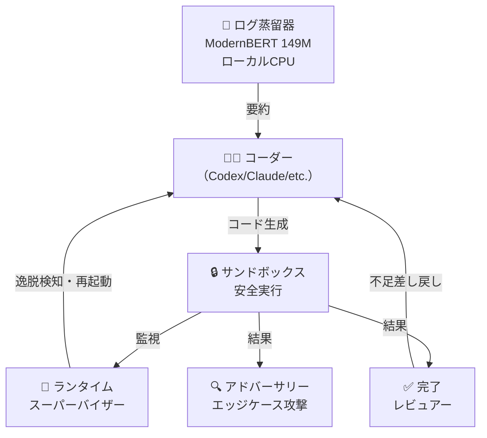

# AIニュース提案 X-0062: Belloマルチエージェントでコーディングコスト66%削減

## 概要

[Bello](https://github.com/Makson179/Bello) は OpenAI Codex／Claude Code 向けのオープンソース・マルチエージェントアドオン。コーディングタスクを複数のAIロールに分割し、supervisor・reviewer・adversary・log distiller の4エージェントが連携することで、品質を維持（むしろ向上）しながらコストを大幅削減する。

## アーキテクチャ

Bello はコーダー（メイン実行）と4つのオプションコンポーネントで構成される。

### 各ロール

| ロール | 役割 | モデル | 備考 |
|---|---|---|---|
| **コーダー** | コード作成・サブエージェント委任 | Codex / Claude / 任意 | メイン実行体 |
| **ラン�ン��イムスーパーバイザー** | 実行中監視・リスク判断・逸脱防止 | 別モデル可 | 危険コマンドブロック |
| **完了レビュアー** | 結果とタスク照合・不足差し戻し | 別モデル可・新規コンテキスト | コーダーと同じコンテキストは使わない |
| **アドバーサリー** | エッジケース・無効入力で攻撃テスト | 別モデル可 | 品質保証 |
| **ログ蒸留器** | ツール出力を短要約 | ModernBERT 149M（ローカルCPU） | 追加API費用ゼロ |

## コスト削減の実測結果

### Efficient Budget構成（メイン提案）

| 指標 | 素のCodex | Bello Efficient Budget | 改善 |
|---|---|---|---|
| Codex週間制限消費 | 100% | **33.7%**（66.3%削減） | **▼66%** |
| 平均スコア | 48.10% | **48.80%**（+1.45%） | **▲1.45%** |
| 実行時間 | ~28分 | ~1時間49分 | 約3.9倍（要調整） |

### Smart Execution（並列ツール呼出）

- コスト **30〜31%削減**、スコア低下は 0.7〜3.7% と最小
- 長時間コマンドを待つ無駄なモデル呼出の排除が効果

### Log Distiller（近代BERT 149M）

- **Astra**: 22%削減
- **Luna**: 14.8%削減
- ローカルCPU動作のためAPI費用ゼロ

### Sol Ultra C+A（最高品質）

- 素のCodex比で平均スコア **26.4%向上**
- NetHackers（Goalモード）: 最高スコア **42.18%向上**、目標到達 **4.39倍速**、コスト **9.59%低減**

## オージャストでの適用シナリオ

### 1. SEO最適化作業への適用

現在 Codex（または安いAI）で行っているSEOチェックリスト（X-0063）の適用や構造化データ修正をBelloで実行すると、66%のコスト削減が見込める。特に：

- **適用前**: Codexで1サイトのSEO修正 → 週間割当の15%消費
- **適用後**: Bello経由 → 週間割当の5%程度で完了し、余剰を他サイトへ
- **品質担保**: reviewer + adversary が修正漏れ・副作用を自動チェック

### 2. イベント予約UI構築への適用

イベント百貨店等の予約UIをBelloで構築する場合：

- **コーダー**: 型安全なNext.jsコンポーネントを生成
- **スーパーバイザー**: `next build` エラーをリアルタイム監視
- **レビュアー**: アクセシビリティ・モバイル対応を確認
- **アドバーサリー**: 日付跨ぎ・タイムゾーン・キャンセルフローを網羅的にテスト
- **ログ蒸留器**: ビルドログの長大な出力を圧縮

### 3. 既存ツール連携（GAS・コード自動修正）

- codex-do.mjs の fallback チェーン（cheap-first→Codex）にBelloを中間層として挿入
- 安いAIで下書き→Belloのレビュアーで品質チェック→合格のみCodexで仕上げ

## 導入コスト

| 項目 | コスト |
|---|---|
| Bello本体（OSS） | **無料** |
| ログ蒸留器（ModernBERT） | **無料**（ローカルCPU稼働） |
| API利用料 | 使用するモデルの従量課金のみ（Codex/Claude等） |
| advisorプラグイン | 既存のCodex/Claude Code環境で即利用可能 |

## 注意点・リスク

- **実行時間の増加**（約3.9倍）: コスト削減とトレードオフ。オージャストの深夜バッチ処理に適している
- **テスト規模**: Efficient Budget 66%削減の測定は4タスク×各3実行。個別環境で再検証が必要
- **ロール別モデル選択**: 各エージェントを安いモデルで回す設計が前提。Opusを全ロールに使うと逆効果
- **OpenAI Codex依存**: BelloはCodex向けに最適化されている。Claude Codeでの互換性は要確認

## 検討すべき代替案との比較

| 方式 | コスト削減 | 品質 | 実行時間 | 導入難易度 |
|---|---|---|---|---|
| Bello Efficient Budget | **66%** | +1.45% | 3.9倍 | 低（pip install） |
| Bello Smart Execution | 30% | -0.7〜3.7% | 同等 | 低 |
| 既存のlane-doctor fallback | 中 | 同程度 | 同等 | 中（既存） |
| 単なるモデル格下げ | 高 | 大幅低下 | 同等 | 低 |

## 推奨

1. **段階導入**: まず `pip install Bello` + advisor plugin で既存環境に導入
2. **小規模検証**: 1タスク（SEO修正など）で実測。コスト・時間・品質を本リポジトリの `analysis/` に記録
3. **夜間バッチ適用**: 実行時間が長いため、深夜の自動セッションで運用。`auto-session` に Bello ラッパーを追加
4. **ログ蒸留器は常時ON**: 追加費用ゼロで14〜22%の削減効果

## 出典

- [GitHub: Makson179/Bello](https://github.com/Makson179/Bello)
- [PyPI: Bello 0.6.0](https://pypi.org/project/Bello/0.6.0/)
- [Codex Insider: Bello解説](https://codexinsider.ai/articles/bello-an-open-source-add-on-for-codex-and-claude-code-splits-coding-work-2a8128/)