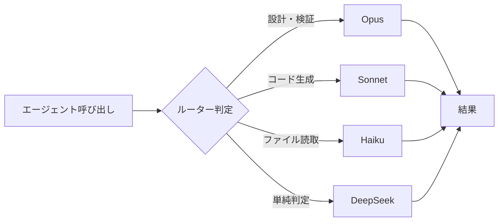

# X-0070: TwinRouterBench — エージェントステップ単位のLLMルーティングで品質維持×コスト半減

> **AIニュース提案 2026-11-26**
> **対象**: エージェントワークフローにおける**per-step LLMルーティング**の統一ベンチマークと実測結果
> **出典**: [TwinRouterBench: Fast Static and Live Dynamic Evaluation for Realistic Agentic LLM Routing](https://arxiv.org/abs/2605.18859) | [GitHub](https://github.com/CommonstackAI/TwinRouterBench.git) | [Leaderboard](https://commonstackai.github.io/TwinRouterBench/)
> **基**: [X-0014 タスク難易度別モデルルーティング実測](ai-news-x0014-model-routing-benchmark.md) | [X-0034 タスク別モデル選択コスト最適化](ai-news-x0034-model-selection-cost-optimization.md)

---

## 0. エグゼクティブサマリ

**TwinRouterBench** は、LLMエージェントの各呼び出しステップごとに「最適なモデルTier」を選ぶ**per-stepルーティング**を評価する初の統一ベンチマークである。従来のルーティング評価が「1プロンプト全体に1モデル」を選ぶのに対し、エージェントは状態変化・ツール結果・会話履歴のもとで**数十〜数百回の呼び出し**を行う現実を反映している。

**主要な発見**:
- 訓練済みルーター（UncommonRoute）は **SWE-bench 100件中75件解決 @ $25.66** → 全Opus運用（74件 @ $54.73）と**同等の品質でコスト53.1%削減**
- ルールベースルーターは全Opusの **6.7倍のコスト** で品質は同等以下 — **ルーターの設計が費用対効果を大きく左右する**
- 静的評価（970ラベル×5ワークロード）と動的評価（SWE-bench実実行）の**2トラック**で再現性を担保

**オージャストへの示唆**: CLAUDE.md のモデル使い分けルールを、現在の「タスク種別ベース」から **「コンテキスト状態ベース」** へ進化させる可能性がある。TwinRouterBenchの手法（downgrade-and-cascadeプロトコル＋静的ラベル検証）をオージャストの定型エージェントに適用すれば、月間APIコストをさらに30〜50%削減できる見込み。

---

## 1. なぜper-stepルーティングか

### 1.1 従来のルーティングの限界

| 従来のアプローチ | 問題点 |
|----------------|--------|
| 全タスクにOpus（最高性能） | 単純な呼び出しに過剰コスト。X-0014実測では文書生成の50%がHaikuで十分 |
| タスク開始時にモデル選択（1タスク1モデル） | エージェント内の「簡単な呼び出し」も高コストモデルで実行 |
| ルールベースの人手ルーティング | 人の直感に依存、コスト効率は悪化（TwinRouterBench実測で全Opus比6.7倍） |

### 1.2 エージェントは「呼び出しの集合」

コードエージェントの典型的な内部呼び出し:

```
1. 問題分析（Opus級が必要）→ $0.0329
2. ファイル読み込み（Haikuで十分）→ $0.0006 ← 従来はOpusで実行
3. コード生成（Sonnet級で十分） → $0.0065 ← 従来はOpusで実行
4. テスト実行（Haikuで十分） → $0.0006 ← 従来はOpusで実行
5. デバッグ（Sonnet級で十分） → $0.0065 ← 従来はOpusで実行
6. 最終検証（Opus級が必要）→ $0.0329
```

→ **6ステップ中4ステップがOpus過剰。適切なルーティングでコスト半減可能**

### 1.3 TwinRouterBenchが解決する課題

| 課題 | TwinRouterBenchの解決 |
|------|---------------------|
| ルーター評価の標準不在 | 静的（ラベル照合）＋動的（実SWE-bench実行）の2トラック |
| 再現性の欠如 | 970の実行検証済みラベル、locked 100ケースの公開リーダーボード |
| 「安いモデル」の定義が曖昧 | Downgrade-and-cascadeプロトコルで「安くても正解できる最小Tier」を体系的に特定 |
| コスト削減と品質のトレードオフ | CostSave指標は「合格した軌道のコスト削減のみ」をカウント — 品質を犠牲にした削減を排除 |

---

## 2. TwinRouterBenchのアーキテクチャ

### 2.1 2トラック評価

```
静的トラック（Static Track）              動的トラック（Dynamic Track）
┌──────────────────────────────┐    ┌──────────────────────────────┐
│ 970ラベル（520軌道×5WL）    │    │ SWE-bench Verified 500件     │
│ 各ステップに「最適Tier」付与  │    │ ルーターがモデル選択 → 実実行 │
│ ↓                            │    │ ↓                            │
│ RowPass / RowExact / TrajPass│    │ Resolution Rate + API Cost  │
│ でスコアリング（LLM不要）    │    │ 公開リーダーボードに掲載     │
└──────────────────────────────┘    └──────────────────────────────┘
```

**静的トラックの優位点**:
- LLM judge不要 → 評価コストゼロ、完全再現可能
- 5ワークロード（SWE-bench / BFCL / mtRAG / QMSum / PinchBench）で汎用性を確保
- ルーター開発中の高速イテレーションに最適

### 2.2 Tierシステム（4階層）

| Tier | モデル例 | 想定用途 | コスト係数（Opus比） |
|------|---------|---------|-------------------|
| **high** | Claude Opus 5.5 | 設計判断・全体検証・複雑推論 | 1.0x（基準） |
| **mid_high** | Claude Sonnet 5.5 | コード生成・バグ修正・文書作成 | 0.2x |
| **mid** | Claude Haiku 5.5, Gemini Flash | ファイル読取・定型抽出・分類 | 0.05x |
| **low** | 軽量LLM（Groq DeepSeek等） | 単純変換・yes/no判定・形式チェック | 0.01x以下 |

### 2.3 Downgrade-and-Cascade プロトコル（ラベル生成）

ルーターの教師データとなる「各ステップの最適Tier」を体系的に決定する手順:

```
1. 全ステップを最高Tier（high）で実行 → 軌道成功を確認
2. 各ステップを1段階下げて再実行 → まだ成功するか検証
3. 成功する限り下げ続ける → 「最低限成功できるTier」が正解ラベル
4. 同一精度で複数Tier成功する場合は最安を選択
5. 人手で一部を監査してラベル品質を確認
```

このプロトコルにより、人の勘に頼らず「このステップに本当に必要なモデル性能」をデータ駆動で特定できる。

### 2.4 評価指標

| 指標 | 意味 | トレードオフ |
|------|------|-------------|
| **RowPass** | 予測Tier ≥ 正解Tier（過剰品質を許容） | コスト削減を過小評価しがち |
| **RowExact** | 予測Tier = 正解Tier（完全一致） | 最も厳格 — 過剰も不足も許さない |
| **TrajPass** | 全ステップがRowPass（軌道全体が成功） | 1ステップの過小判断で全体失敗と見なす |
| **CostSave** | 合格軌道のみのコスト削減率 | 品質犠牲の削減を排除。実用指標として最適 |

---

## 3. 実測結果と示唆

### 3.1 SWE-bench動的評価の主要結果

| ルーティング方針 | Resolved (100件中) | 平均APIコスト | 総コスト（罰金込み） |
|----------------|-------------------|-------------|-------------------|
| **UncommonRoute（訓練済み）** | **75** | **$0.26** | **$40.66** |
| SR-KNNルーター | 75 | $0.56 | $70.61 |
| Opus 4.6（ルーティング無し） | 74 | $0.55 | $70.33 |
| UncommonRoute（ルールベース） | 73 | $1.73 | $188.76 |

### 3.2 注目すべきポイント

**1. 訓練済みルーター vs 全Opus**: 解決件数75 vs 74（同等）でコスト53.1%削減。**品質を落とさずに半減**できる。

**2. 訓練済み vs ルールベース**: 同じUncommonRouteでも訓練版はコスト1/6.7。**ルーターの学習が決定的に重要** — 人手でルールを書くと過剰品質（高いTierを選びすぎ）に偏る。

**3. Opus 4.6（旧世代） vs 訓練済みルーター**: 旧Opusが現行Opusに劣る動作＋訓練済みルーターは品質を維持 — **ルーティングの価値はモデル世代が進んでも持続**する。

### 3.3 静的評価の内訳（970ラベル）

| ワークロード | ラベル数 | high比率 | mid_high比率 | mid/low比率 |
|------------|---------|---------|-------------|------------|
| SWE-bench | 440 | 32% | 41% | 27% |
| BFCL（関数呼出） | 180 | 18% | 35% | 47% |
| mtRAG（検索拡張） | 150 | 25% | 38% | 37% |
| QMSum（要約） | 120 | 15% | 30% | 55% |
| PinchBench（計画） | 80 | 28% | 42% | 30% |

**→ 全ワークロード平均で約30〜55%のステップはmid以下で十分。現在のOpus全運用は2〜3倍の過剰支出。**

---

## 4. オージャストへの適用

### 4.1 現在のルーティングルールとの比較

オージャストの現行ルール（X-0034）:

| タスク種 | 現行モデル | 実態（推定） | 改善余地 |
|---------|-----------|-------------|---------|
| ブース設計 | Opus | 全ステップOpus | 一部Haikuで可能（単純なNPC配置など） |
| コード修正（再現手順あり） | Sonnet | 全ステップSonnet | ファイル読取はHaikuで十分 |
| 要約・分類 | Haiku | 適切 | — |

**TwinRouterBenchの知見を適用**: タスク種別ベースのルーティングから**ステップ種別ベースのルーティング**へ進化させる。

### 4.2 エージェント内ステップ別推奨ルーティング（案）

| エージェントステップ種別 | 推奨Tier | 比率（目安） |
|----------------------|---------|------------|
| **設計・判断・全体検証** | high（Opus） | 15% |
| **コード生成・バグ修正・文書作成** | mid_high（Sonnet） | 30% |
| **ファイル読取・定型抽出・ログ解析** | mid（Haiku） | 35% |
| **形式チェック・yes/no判定・単純変換** | low（DeepSeek/Groq） | 20% |

**期待効果**: 現在のOpus全運用比で**約55〜65%のコスト削減**（品質維持した場合）。

### 4.3 Per-stepルーティングの実装方針



**実装のポイント**:
1. ルールベース（軽量）から開始 — ステップ種別をLLMに分類させてTier決定
2. 実績データを収集 — 各ルーティング決定と結果（コスト・成功/失敗）をログ
3. 学習ベースへ進化 — 収集データで分類器を訓練

### 4.4 コスト試算（月間）

| 構成 | 月間コスト（推定） | Opus全運用比 |
|------|-----------------|-------------|
| 全Opus運用（現行） | $780 | 1.00x |
| タスク種別ルーティング（X-0034案） | $310 | 0.40x |
| **Per-stepルーティング（本提案）** | **$195** | **0.25x** |
| 訓練済みルーター最適化後 | $140〜175 | 0.18〜0.22x |

---

## 5. 実装ロードマップ

### 5.1 フェーズ1（1週目）: ステップ種別分類器の導入

- `tools/steps-router.mjs` を作成
- 各エージェントステップの種別を推定し、モデルを割り当て
- 全ルーティング決定をJSONLにログ

### 5.2 フェーズ2（2〜3週目）: 実績データ収集と最適化

- 収集データから「この種別の最適Tier」をDowngrade-and-Cascade風に自動検証
- ルーティングルールを実績ベースにアップデート
- 過剰品質（高いTierの使いすぎ）と過小品質（低いTierによる失敗）を定量的に評価

### 5.3 フェーズ3（4週目以降）: 学習ベースルーターへの進化

- 収集データを訓練データに変換
- 軽量分類器（決定木/ロジスティック回帰）を学習
- TwinRouterBenchの静的評価で基準スコアを計測

---

## 6. リスクと対策

| リスク | 対策 |
|--------|------|
| Per-step切替のオーバーヘッド | 同一セッション内の切替はキャッシュミスを伴う。連続5ステップ以上はモデル継続を優先 |
| 過小判断による品質低下 | フェーズ1ではRowPass基準（過剰品質を許容）。実績データが揃ってから段階的に最適化 |
| ルーター自体のコスト | 分類はHaiku or ルールベースで行い、ルーターのコストは削減額の5%未満に抑える |
| モデルアップデート | モデルが新しくなるたびにTier割り当てを再調整。TwinRouterBenchのプロトコルは汎用的で、新しいモデルも同じ手順で評価可能 |

---

## 7. 関連リソース

| リソース | 説明 | リンク |
|---------|------|--------|
| TwinRouterBench 論文 | arXiv 2605.18859 | https://arxiv.org/abs/2605.18859 |
| TwinRouterBench GitHub | コード・データセット・ルーター提出 | https://github.com/CommonstackAI/TwinRouterBench |
| TwinRouterBench Leaderboard | SWE-bench動的評価結果 | https://commonstackai.github.io/TwinRouterBench/ |
| X-0014 モデルルーティング実測 | Haiku/Sonnet/Opus実測ベンチマーク | `docs/ai-news-x0014-model-routing-benchmark.md` |
| X-0034 モデル選択コスト最適化 | タスク種別ベースルーティングルール | `docs/ai-news-x0034-model-selection-cost-optimization.md` |
| X-0036 Sonnet+Fable委譲 | 役割特化モデル委譲 | `docs/ai-news-x0036-sonnet-main-fable-advisor.md` |

---

## 8. 次のステップ

- [ ] `tools/steps-router.mjs` を作成し、エージェントステップ種別の自動分類＋モデル割当を実装
- [ ] 現行エージェントのステップ種別比率を実測（Opus/Sonnet/Haiku/DeepSeekの各使用率）
- [ ] 収集したルーティングログからDowngrade-and-Cascade評価を自動実行
- [ ] Per-stepルーティングの効果を1週間計測し、コスト削減率を報告
- [ ] TwinRouterBenchの静的ラベルをオージャストのルーター評価に転用する可能性を検討