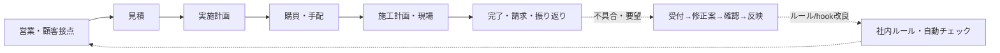

# X-0087（別内容）: 展示会ブース 営業・見積・施工計画 AIワークフロー

> **要約 1/3:** 株式会社オージャスト自社PR（PR TIMES 2026-10-30）は、営業・見積・実施計画・購買・施工計画をAI内製システムに一本化し、社内ルール／自動化を約4か月で1,158回改良した事例である。
>
> **要約 2/3:** 本ドキュメントは記事の業務フローを図化し、内製4システムを現行スキル・tools（実在パスのみ）へ対応づける。既存の同番号「AI学習の5ステップ」文書とは別内容であり、上書きしない。
>
> **要約 3/3:** 文書のみ。本番変更・外部送信・kim承認待ち成果物の新規作成はしない。アプリからの Claude API 新規利用は提案しない（他AI既定・ONBOARDING §2.8.0）。

## 番号衝突注記

| 項目 | 本ファイル（別内容） | 既存 X-0087 |
|------|---------------------|-------------|
| ファイル | `docs/ai-news-x0087-exhibition-booth-sales-estimating-workflow.md` | `docs/ai-news-x0087-ai-learning-5-steps-automation.md` |
| 題名 | 展示会ブース営業・見積・施工計画AIワークフロー | AI学習の5ステップで自動化へ |
| 関連PR | 本PR（新規） | PR #2336 |
| 扱い | **上書き禁止・併存** | そのまま維持 |

next-session 上の題名「検索結果: AI exhibition booth event production sales estimating workfl」は本ファイル側の出典（自社PR）を指す。番号 `X-0087` は一意でないため、ファイル名・本文の衝突注記で区別する。

## 出典・観測

| 項目 | 値 |
|------|-----|
| 観測日 | **2026-11-25** |
| 出典種別 | 株式会社オージャスト 自社プレスリリース |
| 公開日 | 2026-10-30 11:00 |
| URL | https://prtimes.jp/main/html/rd/p/000000038.000055979.html |
| 記事の主張（要約） | 営業〜施工計画をAI内製システムに一本化。ルール／自動化を 2026-07〜10/29 で **1,158回** 改良。外部向けはマキモノ・AI代行堂 |

## 1. 記事から抽出した業務ワークフロー

記事本文の流れ: 営業 → 見積 → 実施計画 → 購買 → 施工計画（案件管理・売上見込み・手配物・原価粗利を含む）。

| 段階 | 記事上の役割 | 散らばりが起きやすかったもの（記事） |
|------|--------------|--------------------------------------|
| 営業 | 顧客管理・申込・督促 | メール／チャット |
| 見積 | 見積書作成 | 表計算への転記 |
| 実施計画 | 案件ごとの計画・手配物 | 表計算・個別メモ |
| 購買 | 申請〜承認〜会計連携 | 手作業の会計登録 |
| 施工計画 | 規定判定・部材割付提案 | 属人判断 |

## 2. 内製4システムと現行スキル・tools の対応

推測の新API・架空パスは置かない。記事のシステム名と、リポジトリ／スキルとして実在するものだけを対応づける。

| # | 記事の内製システム | 役割（記事） | 現行の実在対応（パス・名称のみ） |
|---|-------------------|--------------|----------------------------------|
| 1 | 営業・案件管理 | 顧客・見積・案件一覧・売上見込み。申込書・入金督促の自動化 | `~/.claude/skills/case/`、`case-resume`、`case-consult-sources`（案件ハブ・Gmail/Drive照会）。見積作成は `orgiast-mitsumori` スキル（Googleスプレッドシート見積・実施計画）。GAS見積は rules/gas.md 配下の既存GAS運用 |
| 2 | 展示会ブース制作の管理 | 実施計画・手配物・原価粗利の一元化。「施工相談AI」で規定判定・部材割付提案 | 見積／実施計画の正本は `orgiast-mitsumori` 経由の案件Drive上スプレッドシート。施工相談AIの個別実装パスは本記事からは特定せず、**記事記載の機能**として扱う（新規APIを捏造しない） |
| 3 | 購買管理アプリ | 申請→承認→freee登録。スマホ操作 | 記事ベースの言及のみ。本リポ内の購買アプリ本体パスは本ドキュメントでは断定しない（未照会＝未確認） |
| 4 | 不具合・要望ループ | 画面投稿→AI整理・修正案→担当確認→反映→投稿者通知 | 一般化すると `rules/`・`feedback` memory・hook／ゲートへの失敗反映（§1.22 事故は型で直す、と同型）。具体アプリURLは記事に無いため書かない |

補足（コスト規律）:

- デプロイ済みアプリ・cron・GAS・スクリプトが呼ぶ LLM／検索は **他AI既定**（Gemini・Groq・DeepSeek・OpenRouter・Grok 等）。Claude API（`@anthropic-ai/sdk`・`api.anthropic.com`・`claude-*`）の新規利用と Claude への自動フォールバックは提案しない（ONBOARDING §2.8.0）。

## 3. 「AIに作業させる社内ルールを毎日改良」運用チェックリスト

記事: 失敗はその都度ルールと自動チェックへ反映。改良件数は 8月179 / 9月373 / 10月605（29日まで）で合計1,158（2026-10-29時点）。

| # | チェック | 完了の目安 |
|---|----------|------------|
| 1 | 失敗・手戻りを1件、再現条件つきで記録したか | ログ／inbox／memory に「何が起きたか」が残る |
| 2 | 原因を型で言語化したか（同型の再発を防ぐ） | 「人のミス」で止めず、手順欠落・検証欠落・経路欠落を特定 |
| 3 | ルール文書（CLAUDE.md / rules / skill）へ反映したか | 次回エージェントが同じ指示で避けられる文言がある |
| 4 | 可能なら hook／ゲート／テストで機械検査したか | 文書だけの注意書きで終わらせない |
| 5 | 読み戻し・完了検証で「直った」を確認したか | 送信・外部反映はAPI読み戻しまで（該当時） |
| 6 | 社外影響・削除・課金が無い変更か。あるなら承認待ちにしたか | 本提案の範囲外の本番変更はしない |
| 7 | 安いレーン（Codex／他AI）へ委譲できる作業を Claude 監督だけで抱えていないか | 実装・量産は他AI既定 |

## 4. 外部提供との境界

| 公開してよいもの（記事） | 社内に留めるもの |
|--------------------------|------------------|
| **マキモノ**（https://makimono-md.vercel.app）— AI指示書マーケット・公開API | 営業・案件／ブース制作管理／購買／社内不具合ループの **本体データ・認証・社内ルール全文** |
| **AI代行堂**（https://www.ai-daikodo.com）— LINE経由の制作代行 | 顧客案件・見積金額・手配・freee連携・kim承認待ち文面 |

方針: 指示書の型や一般化した手順は外部提供しうるが、社内システム本体・顧客PII・秘匿設定は公開しない。本PRでもそれらを含めない。

## 5. 次アクション（文書のみ）

| 優先 | 内容 | 本PRでの扱い |
|------|------|--------------|
| — | 本ドキュメントのレビュー | 文書追加のみ |
| 後続（kim判断） | 購買アプリパスの実在確認・施工相談AIの実装場所の棚卸し | **作らない**（承認待ち成果物・本番変更・外部送信なし） |
| 禁止 | アプリからの Claude API 新規採用提案 | 書かない |

## 関連

- 既存同番号（別内容）: [ai-news-x0087-ai-learning-5-steps-automation.md](./ai-news-x0087-ai-learning-5-steps-automation.md)
- 業務フロー自動化の別提案: [ai-news-x0064-business-flow-automation.md](./ai-news-x0064-business-flow-automation.md)
- 成果物索引: [`../outputs/X-0087-booth-sales-estimating-workflow/README.md`](../outputs/X-0087-booth-sales-estimating-workflow/README.md)
