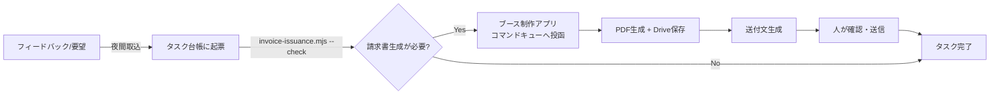

# 請求書発行 手順書（自動処理対応）

> 正本: ONBOARDING §2.9（Drive・共通知識）
> 関連 memory: `project_booth_invoice_and_cover_letter.md`, `feedback_invoice_send_own_thread_and_mark_n2.md`
> 更新: 2026-11-05

## 概要

ブース制作案件における請求書発行の一連の流れを自動化する。本手順は「夜間バッチ」としても「即時処理」としても実行できる。

## 前提条件

- ブース制作アプリ（GAS）がデプロイ済み
- タスク台帳 WebApp が稼働中
- `~/.claude/task-sheet.env` に `TASK_SHEET_WEBAPP_URL` と `TASK_SHEET_TOKEN` が設定済み

## 提供機能

### 1. ブース制作アプリ案件パネル（人が使う）

**導線**: 案件パネル下部 `📝 お客様の文章・口頭メモをここに貼る` に貼って ▶ 実行

| 機能 | 呼出元 | 説明 |
|---|---|---|
| `Phase_FromText_generate(caseId)` | パネル▶ | 貼付欄を読み種別判定（見積/請求書/送付文） |
| `Phase_Invoice_generate(caseId, pastedText)` | パネル▶/コマンドキュー | 請求書生成（テンプレ複製→明記込→PDF） |
| `Phase_CoverLetter_generate(caseId, pastedText)` | パネル▶/コマンドキュー | 送付文生成（実施計画書シートに追記） |

### 2. 夜間バッチツール（自動実行）

**ツール**: `node tools/invoice-issuance.mjs`

| コマンド | 処理内容 | 実行タイミング |
|---|---|---|
| `--check` | タスク台帳から請求書関連タスクを一覧表示 | 夜間バッチ冒頭 |
| `--generate` | 未処理タスクを検出しコマンドキューへ投函 | 夜間バッチ本処理 |
| `--done --taskId <id> --link <url>` | タスクを完了にする | 生成確認後 |
| `--procedure` | 本手順書を表示 | 確認用 |

## 請求書テンプレート詳細

- **シートID**: `1bNVo9IEynOaOp7H92PQJbXAOEVq6tSa7h3UvaMEQxDA`
- **テンプレ名**: `請求書テンプレート_株式会社オージャスト`
- **インボイス対応**: 登録番号 `T9120001143926`
- **owner**: nishi@orgiast.jp

### シート構成（4シート）

実際の使用時は**明細見出しのあるシート以外を削除**しないと記入ガイドまで PDF に入る。

| シート名 | 用途 |
|---|---|
| 請求書（インボイス対応） | 本番出力 |
| 請求書 | 旧形式（互換） |
| 記入ガイド (1) | 削除必須 |
| 記入ガイド | 削除必須 |

### セル配置

| 位置 | 内容 | 注意 |
|---|---|---|
| A3:C3 | 宛名 | 伏字参照禁止 |
| A4:C4 | 担当者 | 伏字参照禁止 |
| D3:G3 | 請求書番号： | 自動採番しない。空なら「請求書番号：」だけ |
| D4:G4 | 発行日： | 実行日を入れる |
| D5〜D11 | 自社情報 | **触らない** |
| D15 | =G32（合計） | 数式セルに書かない |
| A17〜G17 | 明細見出し | 固定 |
| G18:G27 | 金額 | =IF(OR(E..="",F..=""),"",D..*E..) |
| A30:D30 | 【お支払期限】 | |

### 🔴 明細行数の制限

明細は**行18〜27の10行まで**。11行目以降を書くと `A28`【お振込先】を破壊し、かつ `SUMIF($F$18:$F$27, ...)` の範囲外で**合計に入らない**。

### 🔴 セル探索の鉄則

伏字 `○`（U+25CB）を照合キーにしない。テンプレは **U+25CB**、うっかり書くと **U+25EF** で黙って外れる（実測あり）。

**正しい探索**: 「請求書番号」を含むセルの row を起点に、宛名=同rowの1列目 / 担当者=row+1の1列目で引く。数式セルには書かない（`getFormulas()` で確認）。

## 送付ルール

1. **専用メールで送る** — 打ち合わせスレッドに相乗り禁止
2. **To は請求依頼者（経理・決裁窓口）**、CC に案件担当者
3. **件名**: `【御請求書送付】<案件名> 前金`（請求書と分かる語を入れる）
4. **本ツールでは送信しない** — 送付文とファイル URL を生成し、人が確認してから送る
5. **送信後**、見積シート `管理画面（正式）※シート名変更禁止` の該当行 N 列（請求書発行）に `○`（U+25CB）を入れ、読み戻す

## 関連ファイル

| ファイル | 役割 |
|---|---|
| `tools/invoice-issuance.mjs` | 夜間バッチツール |
| `src/Phase_Invoice.js` | 請求書生成（GAS） |
| `src/Phase_CoverLetter.js` | 送付文生成（GAS） |
| `src/DocExport.js` | PDF 出力（Drive） |
| `src/Phase_CostProfit.js` | 原価・請求・粗利（未コミット） |
| `gas/task-sheet/WebApp.gs` | タスク台帳 API |
| `gas/task-sheet/TaskLedger.gs` | タスク台帳ロジック |