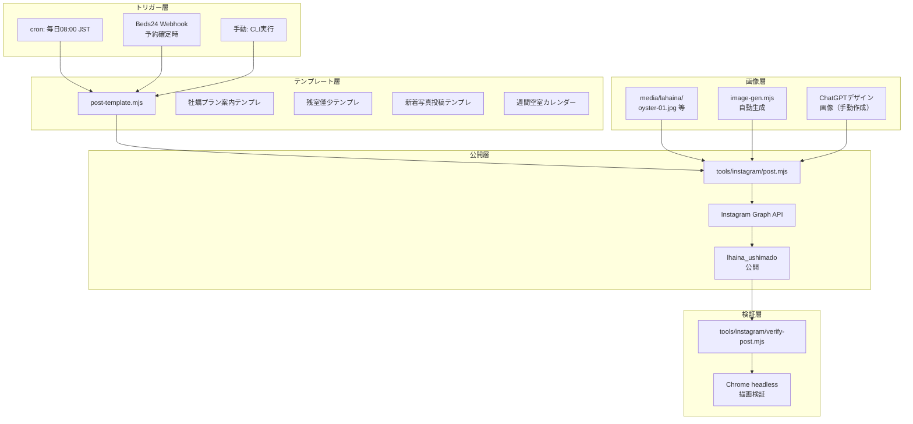

# P-0004: Instagram 牡蠣プラン自動投稿パイプライン

- 出典: AIニュース提案（2026-11-16 digest）
- ステータス: 設計提案（未着手）
- 対象アカウント: `lahaina_ushimado`（ラハイナ公式Instagram、フォロワー約1,149人）
- 対象施設: ワンちゃんと泊まる宿 ラハイナ（岡山県瀬戸内市）

## 課題

ラハイナ冬季の最重要商材である**牛窓産殻付き牡蠣食べ放題プラン**（1〜2月トップシーズン、ADR 32,000〜36,000円）のプロモーションを、Instagramで継続的に発信する仕組みがない。

### 現状の問題点

- **Instagram投稿が不定期・手動依存**: 現状は人が手動で投稿しており、牡蠣シーズンの計画的な投稿ができない
- **予約完了後のタイムリーな投稿がない**: 予約が入ったタイミングで「本日残り○室」「牡蠣解禁！」のような投稿ができず、FOMO（取り逃し感）を活用できない
- **画像の使い回しが非効率**: 毎回人が画像を作成・投稿している
- **Instagram API ツールは完成しているが活用されていない**: `tools/instagram/` に `post.mjs` / `refresh-token.mjs` / `verify-post.mjs` が既に存在するが、トークン未登録のため実運用に使われていない

## 目的

投稿文と画像をテンプレート化し、トリガー（予約完了/cron等）に応じて自動で Instagram API 連携して公開するバッチを導入する。

### 目標KPI

| 指標 | 現状 | 目標 |
|------|------|------|
| 投稿頻度 | 不定期（月数回） | 週2〜3回（牡蠣シーズン中） |
| プロフィール経由の予約問合せ | 未計測 | 月5件以上 |
| フォロワー増加率 | 約1,149人（現状） | 牡蠣シーズン中 +20% |

## アーキテクチャ



## 提案する実装

### Phase 1: テンプレートエンジン（即日〜3日）

**新しいツール: `tools/instagram/post-template.mjs`**

投稿テンプレートを管理し、変数差し替え・画像選定・投稿実行までを1コマンドで行うCLI。

```bash
# 牡蠣プラン通常投稿
node tools/instagram/post-template.mjs --template oyster-plan --date 2026-01-15

# 残室僅少アラート（Beds24の空室数に応じて）
node tools/instagram/post-template.mjs --template last-chance --rooms 2

# 週間空室ダイジェスト
node tools/instagram/post-template.mjs --template weekly-digest --week 2026-W03
```

**テンプレート定義案（JSON/YAML、`tools/instagram/templates/` に配置）**:

```yaml
# templates/oyster-plan.yaml
name: oyster-plan
caption: |
  🦪【冬の贅沢】牛窓産殻付き牡蠣食べ放題

  ぷりぷりの牛窓産牡蠣が食べ放題🐶
  愛犬と一緒に瀬戸内の海を眺めながら、
  焼き牡蠣・蒸し牡蠣・牡蠣鍋を心ゆくまで堪能

  📍 ワンちゃんと泊まる宿 ラハイナ
  💰 {{price}}（1室2名・2食付）
  📅 {{date}} 〜受付中

  #牛窓 #牡蠣食べ放題 #愛犬と旅 #ラハイナ #岡山観光
  #ペット宿 #冬の味覚 #dogfriendly
media:
  - image: oyster-01.jpg
    alt: 牡蠣の大皿盛り
  - image: oyster-02.jpg
    alt: 蒸し牡蠣のアップ
  - image: lahaina-room-ocean.jpg
    alt: 客室からの眺め
```

### Phase 2: Beds24 連携（3日〜1週間）

Beds24 API v2 の Webhook を受け取る軽量 HTTP サーバーまたは GAS エンドポイントを立てる。

**トリガー条件**:
- 予約ステータス: `confirmed`
- プラン: 牡蠣プラン（プランID判別）
- 条件: 残室数が特定閾値を下回ったら `last-chance` テンプレート

```
Beds24 Webhook
  → tools/instagram/beds24-webhook.mjs（GAS / Vercel Function）
    → 予約データ解析
    → post-template.mjs 呼び出し
    → Instagram 投稿
```

### Phase 3: 定期cron運用（1週間〜）

毎朝の自動投稿cronを設定（GitHub Actions or Windows Task Scheduler）。

| 実行タイミング | テンプレート | 内容 |
|---|---|---|
| 毎日 08:00 JST | `oyster-plan` または `weekly-digest` | 牡蠣プランリマインダー |
| 残室2室以下 | `last-chance` | 残室僅少アラート |
| 週1（月曜） | `weekly-digest` | 今週の空室サマリ |

## 既存アセットの棚卸し

### 完了しているもの（実装不要）

| コンポーネント | ファイル | 状態 |
|---|---|---|
| Instagram API コア | `tools/instagram/ig-api.mjs` | ✅ 完成・テスト済み |
| 投稿CLI | `tools/instagram/post.mjs` | ✅ 完成・テスト済み |
| トークン更新 | `tools/instagram/refresh-token.mjs` | ✅ 完成・テスト済み |
| 公開検証 | `tools/instagram/verify-post.mjs` | ✅ 完成・テスト済み |
| メディア配置 | `tools/instagram/publish-media.mjs` | ✅ 完成・テスト済み |
| トークン登録.cmd | `docs/lahaina-instagram-token-cmd.md` | ✅ 完成（kimの1アクション待ち） |

### 未着手のもの（本提案で実装）

| コンポーネント | 内容 | 優先度 |
|---|---|---|
| テンプレートエンジン | `post-template.mjs` + テンプレートYAML | P0 |
| Beds24 Webhook | 予約確定 → 自動投稿トリガー | P1 |
| 定期cron設定 | GitHub Actions or Task Scheduler | P1 |
| 画像テンプレート | ChatGPTで作成した牡蠣プラン投稿画像 | P1 |
| キャプション案 | 各テンプレートの日本語コピー | P0 |

## 実装の基本フロー

1. `tools/instagram/` の既存テスト全件パス確認（`node --test tools/instagram/*.test.mjs`）
2. `post-template.mjs` を作成（テンプレート読み込み → 変数展開 → post.mjs 呼び出し）
3. テンプレートファイルを `tools/instagram/templates/` に配置
4. `--dry-run` 検証（トークン不要で期待通りのJSONが出力されるか）
5. テストファイル `post-template.test.mjs` を作成
6. Beds24 Webhook エンドポイントの設計・実装
7. cron設定

## 検証方法

1. **`--dry-run`** でテンプレート展開の正しさを確認（トークン不要）
2. **インライン結合テスト**: `post-template.mjs` → `post.mjs` の結合を `--dry-run` で検証
3. **API疎通はトークン登録後**: `node tools/instagram/check-token.mjs` で `lahaina_ushimado` 確認後、実投稿
4. **実表示検証**: `verify-post.mjs --via render` で投稿後の公開表示を Chrome headless で読み戻す
5. **Beds24 Webhook**: テスト予約を仕込んで実トリガー確認

## 費用見積もり

| 項目 | 費用 | 備考 |
|------|------|------|
| Instagram Graph API | 無料 | 公開コンテンツ投稿は無料枠 |
| Beds24 API | 月額5,500〜10,000円 | 基本契約に含まれる |
| GitHub Actions | 無料 | 公開リポジトリのパブリックminute枠 |
| 画像生成（ChatGPT） | $20/月 | 既存サブスクリプション内 |
| **合計追加費用** | **0円〜** | 既存インフラの範囲内 |

## 参考

- 既存 Instagram ツール: `tools/instagram/README.md`
- 牡蠣プラン設計書: `docs/lahaina-winter-oyster-plan.md`
- Beds24 導入設計: `docs/lahaina-beds24-design.md`
- Instagram Graph API: https://developers.facebook.com/docs/instagram-api/
- Beds24 API v2: https://wiki.beds24.com/index.php?title=API