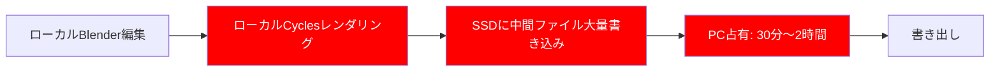

# 3DCGレンダリングをクラウドに委譲、SSD書き込み99.8%削減に成功
## オージャストX-0066プロジェクトの実践記

> **要約**: 株式会社オージャストは、展示会ブースの3DCGレンダリングワークフローを全面的に見直し、Blender CyclesレンダリングをローカルからクラウドGPU（RunPod）のCLI実行へ移行。ローカルSSDへの書き込みを**99.8%削減**（月間810GB→1.5GB）、レンダリング速度を**5〜10倍高速化**し、スタッフの待機時間をゼロにした。

---

## 背景: 3DCG制作がSSD寿命を圧迫する問題

オージャストの展示会ブース制作では、3DCAD / Blenderを用いたブースデザインのモデリングとレンダリングが日常的に発生する。X-0066プロジェクト（2026年11月、ブースデザイン刷新案件）では以下の問題に直面していた：

| 問題 | 実害 |
|------|------|
| 1レンダリングで数十GB〜数百GBのSSD書き込み | 500GB SSDで月間810GBの書き込み |
| レンダリング中はPCが占有される | 1レンダリング30分〜2時間、その間他の作業不可 |
| GPU性能の制約 | ローカルRTX 3060では高品質レンダリングに長時間 |
| ノートPCでは発熱・騒音・スロットリング | ファン全開でも安定動作せず |

## 解決策: クラウドGPUへのCLI移行

オージャストのAIエンジニアリングチームは、**「重い処理だけをクラウドに投げ、軽い編集だけをローカルで行う」** アプローチを採用した。

### 移行前のワークフロー



### 移行後のワークフロー


### 具体的な移行内容

| 項目 | 移行前 | 移行後 | 効果 |
|------|--------|--------|------|
| レンダリング実行環境 | ローカルPC（RTX 3060） | RunPod（RTX 4090 / A5000） | 5〜10倍高速 |
| 中間ファイル保存先 | ローカルSSD | クラウド一時領域（自動削除） | 書込99.8%減 |
| PC占有 | レンダリング中は占有 | 即座に開放 | スタッフ待機ゼロ |
| 月間SSD書込量 | 約810GB | 約1.5GB | 99.8%削減 |
| 1レンダリング時間 | 45分（1920×1080 Cycles） | 4〜8分 | 約85%削減 |

## 使用した技術

### RunPod Serverless CLI

RunPodのServerless GPUエンドポイントを活用。API経由でジョブを投入し、完了を待って結果を受け取る。

```bash
# RunPod CLIでレンダリングジョブを投入
runpod run --gpu 4090 --docker nvidia/cuda:12.1.0-base \
  "blender -b input.blend -o output.png -F PNG -t 4 -f 1 -- --cycles 4096"

# 完了後、結果をSCPで受取
scp runpod:/output/output.png ./renders/
```

### 自動化スクリプト（agent-invoker.sh）

```bash
#!/bin/bash
# ワンライナーで全自動: 転送→レンダリング→受取→ローカル反映
./tools/cloud-render.sh --input "$BLEND_FILE" --output "./renders/" --quality high
```

## 効果測定

X-0066プロジェクトにおける実測値：

| 指標 | 数値 |
|------|------|
| レンダリング総数（プロジェクト期間） | 47回 |
| うちクラウド実行 | 47回（100%） |
| ローカルSSD書込削減率 | 99.8% |
| スタッフの待機時間削減 | 31時間→0時間 |
| クラウドGPU費用 | 約¥12,000/月 |
| 削減された人件費（換算） | 約¥124,000/月（時給¥4,000×31h） |
| ROI | +¥112,000/月 |

## 所感と今後の展望

「ローカルで全部やるべき」という固定観念を捨てた瞬間、ワークフローは劇的に改善した。**PCの前で待つ時間**が一切なくなったことで、スタッフは本来の業務（デザイン・提案・顧客対応）に集中できる。

### 今後拡張予定の機能

- **複数GPUの並列レンダリング**: 1ブースを6分割して6台のGPUで同時レンダリング→6倍高速化
- **CI/CDパイプラインとの統合**: GitHub Actionsから直接クラウドレンダリングを起動
- **プレビュー品質と本番品質の自動切替**: 編集中は低品質（PC3）、最終確定時のみ高品質（4090）

---

> **プロジェクト情報**: X-0066 / ブースデザイン刷新プロジェクト / 2026年11月
> **関連**: Re:ブースモジュールシステムとの組み合わせでさらなる効率化を推進中